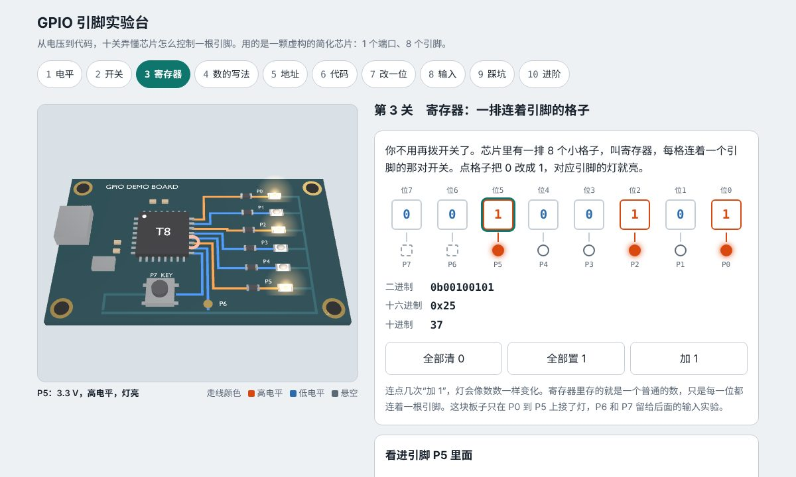

# GPIO 引脚实验台

零基础讲清楚“代码怎么控制芯片的一根引脚”。上面是一块 Blender 脚本建模的小开发板，可以拖着转；下面是十关小实验，每一关只讲一件事。实验里改的每一个位，都会实时反映到板子上：走线按电平变色，灯亮灭，按键下沉。



## 怎么打开

- **Windows**：双击 `启动演示.bat`。它先检查 `main` 分支有没有更新，有就 `git pull --ff-only`，然后用默认浏览器打开 `index.html`。
- **其他系统**：直接打开 `index.html`。单文件页面，模型和代码都在里面，离线也能看。

## 十关讲什么

| 关 | 内容 | 你动手做什么 |
| --- | --- | --- |
| 1 电平 | 引脚上只有电压，够高算 1，够低算 0，中间不可信 | 拖电压，看芯片读成什么 |
| 2 开关 | 输出引脚里面只有两个开关：一个接电源，一个接地 | 亲手拨开关，试出亮、灭、悬空、短路 |
| 3 寄存器 | 一排 8 个格子，每格管一个引脚的那对开关 | 点格子改 0 和 1，看灯像数数一样变 |
| 4 数的写法 | `0x21` 是什么：8 个格子每 4 个一组，每组换成一个字符 | 点格子，做出 0x21、0x3F、0x80 |
| 5 地址 | CPU 只会“往某个门牌号存数、取数”；寄存器是连着硬件的格子；总线是送信的路 | 往内存格子和 OUT 各存一个数，对比灯的反应 |
| 6 代码 | 一行 `OUT = 0x21;` 是一封信：读到这一行、信上路、寄存器收信、引脚跟着变 | 三行程序，每按一次只走一站 |
| 7 改一位 | `|=` 和 `&= ~` 只动点名的位；CPU 实际分读、改、写三步 | 点名要点亮或熄灭的位，对比直接赋值 |
| 8 输入 | 读按键：悬空会乱跳，上拉给默认电平，按下读到 0 | 开关上拉、按按键，看读数记录 |
| 9 踩坑 | 灯不亮的三个原因：没开时钟、没设方向、没写数据；输出脚被外面接地会短路 | 勾选程序行，看寄存器实际存了什么 |
| 10 进阶 | 开漏为什么能共用一根线；读、改、写被中断打断会丢数据，置位寄存器怎么避免 | 自己挑中断插进来的时机 |

## 这颗芯片是虚构的

为了让主线清楚，实验台用的是一颗简化的教学芯片 T8，不对应任何真实型号。和真实芯片的差别：

| 这里的简化 | 真实芯片（以 STM32 为例） |
| --- | --- |
| 只有 1 个端口、8 个引脚 | 引脚按端口分组（GPIOA、GPIOB……），每个端口最多 16 个，各有一套寄存器 |
| 每项配置每个引脚占 1 位 | 模式、上下拉各占 2 位，复用功能占 4 位 |
| 寄存器叫 DIR、OUT、IN、PULL、OTYPE、SET、CLR | 大致对应 MODER、ODR、IDR、PUPDR、OTYPER、BSRR |
| 时钟开关 CLK 是一个独立的寄存器 | 时钟在另一个外设里（RCC） |
| 输入门限取电源电压的 30% 和 70% | 这是 CMOS 的典型值，准确数值看数据手册 |
| 电流、电压只表现亮和灭 | 每个引脚能提供的电流有限，LED 亮度随电流变化 |

原理部分（内存映射 I/O、推挽和开漏、上拉、读改写竞争）是所有 Cortex-M 芯片通用的公认知识。地址、寄存器名、要不要先开时钟，每家都不同，换到手上的芯片时以它的参考手册为准。

## 文件夹里有什么

| 路径 | 内容 |
| --- | --- |
| `index.html` | 打包好的演示页面（约 1 MB，含 three.js 和模型） |
| `启动演示.bat` | Windows 一键启动，含 main 更新检查 |
| `重新生成模型.bat` | 用本机 Blender 重跑建模脚本 |
| `规划.md` | 做这个演示之前定的方案：三种做法的取舍、关卡顺序、设计假设 |
| `blender/build_board.py` | 纯脚本建模：板子、芯片、8 条走线、6 个 LED、按键、丝印 |
| `blender/out/` | `board.blend`、`board.glb` |
| `web/src/core.js` | 教学芯片的模型：寄存器读写、引脚电气状态、读改写竞争 |
| `web/src/stage.js` | three.js 舞台：走线按电平上色、点灯、按键、点零件选引脚 |
| `web/src/main.js` | 十关的界面 |
| `web/src/page.html` | 页面骨架和样式 |
| `web/test_core.mjs` | 模型的校验（12 项） |

网页靠物体名字找零件（`TRACE_n`、`LEG_n`、`LED_n`、`BTN_cap`、`PAD_6`）。改建模脚本里的名字，要同步改 `stage.js`。

## 重新构建

```bash
# 1. 建模（二选一）
blender -b --factory-startup -P blender/build_board.py -- --out blender/out
pip install bpy && python blender/build_board.py --out blender/out

# 2. 打包页面
cd web
npm install
node test_core.mjs    # 校验模型
node build.mjs        # 更新上一级的 index.html
```
