# HTML 教室

用网页（three.js）讲清楚机器和设备怎么工作的教学项目集合。每个顶层文件夹是一个独立的小项目。

## 在线演示（点链接直接打开）

下面这些页面都是单个 html 文件，放在 GitHub Pages 上，手机和电脑点开就能用，不用装任何东西。动图是用无头浏览器实际打开页面、点几下录下来的（比实际播放快一些）。
页面里嵌着三维模型，单页 0.2 ~ 6 MB，第一次打开要等几秒。

| 预览 | 项目 |
| --- | --- |
| <a href="https://guangxianzhu.github.io/HTML-classroom/%E8%B8%8F%E6%9D%BF%E6%91%A9%E6%89%98%E8%BD%A6%E5%8A%A8%E5%8A%9B%E7%B3%BB%E7%BB%9F/index.html">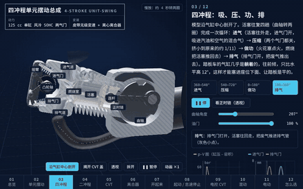</a> | **[踏板摩托车的发动机和动力系统](https://guangxianzhu.github.io/HTML-classroom/%E8%B8%8F%E6%9D%BF%E6%91%A9%E6%89%98%E8%BD%A6%E5%8A%A8%E5%8A%9B%E7%B3%BB%E7%BB%9F/index.html)** ▶ 点击打开  拧油门就走是怎么做到的：Blender 建模（结构参照公开专利）的四冲程单元摆动总成（发动机 + 皮带无级变速 + 离心离合器 + 齿轮 + 后轮）、二冲程、轮毂电机、摆臂电机，剖开看活塞气门、V 形槽和离合块；十五章讲四冲程 / 二冲程、油门到底控制什么（进气量 → 喷油 → 扭矩）、CVT 力平衡、滚子重量和上坡降档、转速 / 扭矩 / 功率 / 车速怎么互相算、热值和油耗（一滴油的去向）、怠速停止、电控 CVT、轻混和电动  源码和说明：[踏板摩托车动力系统/](%E8%B8%8F%E6%9D%BF%E6%91%A9%E6%89%98%E8%BD%A6%E5%8A%A8%E5%8A%9B%E7%B3%BB%E7%BB%9F/) |
| <a href="https://guangxianzhu.github.io/HTML-classroom/%E9%A3%9E%E5%BA%A6%E6%B7%B7%E5%8A%A8%E5%8E%9F%E7%90%86/index.html">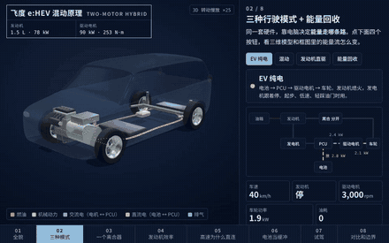</a> | **[飞度混动原理](https://guangxianzhu.github.io/HTML-classroom/%E9%A3%9E%E5%BA%A6%E6%B7%B7%E5%8A%A8%E5%8E%9F%E7%90%86/index.html)** ▶ 点击打开  本田飞度 e:HEV 两电机混动：Blender 建模的整车和动力系统（发动机、发电机、驱动电机、一个直连离合器、固定齿比齿轮、PCU、电池），八章讲清楚为什么大部分时间电机推车、发动机发电，高速巡航时发动机直接推车；效率图、链路损耗、间歇发电和试驾都由能量模型实时算出  源码和说明：[飞度混动原理/](%E9%A3%9E%E5%BA%A6%E6%B7%B7%E5%8A%A8%E5%8E%9F%E7%90%86/) |
| <a href="https://guangxianzhu.github.io/HTML-classroom/%E5%8D%8A%E5%AF%BC%E4%BD%93%E6%B9%BF%E6%B3%95%E8%AE%BE%E5%A4%87%E7%9A%84%E6%B3%B5/index.html">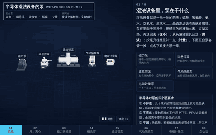</a> | **[半导体湿法设备的泵](https://guangxianzhu.github.io/HTML-classroom/%E5%8D%8A%E5%AF%BC%E4%BD%93%E6%B9%BF%E6%B3%95%E8%AE%BE%E5%A4%87%E7%9A%84%E6%B3%B5/index.html)** ▶ 点击打开  半导体湿法设备里的五种泵：Blender 建模（结构参照公开专利）的磁力泵、磁悬浮泵、波纹管泵、气动隔膜泵、电磁计量泵，剖开看内部，液体按压力着色流动；八章讲离心原理、磁力联轴器脱耦、悬浮控制、往复泵脉动、气锁和怎么选  源码和说明：[半导体湿法设备的泵/](%E5%8D%8A%E5%AF%BC%E4%BD%93%E6%B9%BF%E6%B3%95%E8%AE%BE%E5%A4%87%E7%9A%84%E6%B3%B5/) |
| <a href="https://guangxianzhu.github.io/HTML-classroom/%E6%B9%BF%E6%B3%95%E8%AE%BE%E5%A4%87%E6%B5%81%E9%87%8F%E8%AE%A1/index.html">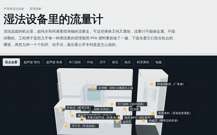</a> | **[湿法设备流量计](https://guangxianzhu.github.io/HTML-classroom/%E6%B9%BF%E6%B3%95%E8%AE%BE%E5%A4%87%E6%B5%81%E9%87%8F%E8%AE%A1/index.html)** ▶ 点击打开  半导体湿法设备里的九种流量计：Blender 建模的虚构清洗台和九个剖面（超声波两种、卡门涡街、叶轮、浮子、差压、热式 MFC、科里奥利、电磁），八个原理实验，17 篇公开专利拆解和选型题  源码和说明：[湿法设备流量计/](%E6%B9%BF%E6%B3%95%E8%AE%BE%E5%A4%87%E6%B5%81%E9%87%8F%E8%AE%A1/) |
| <a href="https://guangxianzhu.github.io/HTML-classroom/%E6%B6%B2%E4%BD%93%E8%B0%83%E5%8E%8B%E9%98%80/index.html">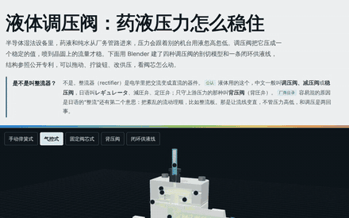</a> | **[液体调压阀](https://guangxianzhu.github.io/HTML-classroom/%E6%B6%B2%E4%BD%93%E8%B0%83%E5%8E%8B%E9%98%80/index.html)** ▶ 点击打开  半导体湿法设备：Blender 建模的四种调压阀剖切（手动弹簧式、气控平衡式、固定阀芯双膜片式、背压阀）和闭环供液线，结构参照公开专利；讲下垂、入口压力效应、开环和闭环、背压阀  源码和说明：[液体调压阀/](%E6%B6%B2%E4%BD%93%E8%B0%83%E5%8E%8B%E9%98%80/) |
| <a href="https://guangxianzhu.github.io/HTML-classroom/%E6%B0%94%E4%BD%93%E8%B0%83%E5%8E%8B%E9%98%80/index.html">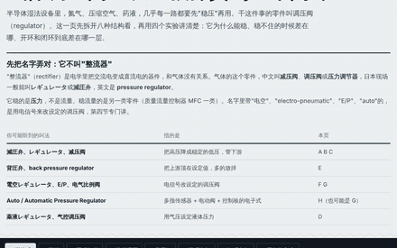</a> | **[气体调压阀](https://guangxianzhu.github.io/HTML-classroom/%E6%B0%94%E4%BD%93%E8%B0%83%E5%8E%8B%E9%98%80/index.html)** ▶ 点击打开  半导体湿法设备里的气体 regulator：Blender 建模的八种剖面（弹簧式、两级、圆顶加载、氟树脂药液阀、背压阀、开环 / 闭环电气比例阀、压电数字式），实时仿真压力和气流，四个实验讲清下垂、两级减压和开环 / 闭环差在哪一层；液体侧见"液体调压阀"  源码和说明：[气体调压阀/](%E6%B0%94%E4%BD%93%E8%B0%83%E5%8E%8B%E9%98%80/) |
|  | **[湿法浓度计原理](https://guangxianzhu.github.io/HTML-classroom/%E6%B9%BF%E6%B3%95%E6%B5%93%E5%BA%A6%E8%AE%A1%E5%8E%9F%E7%90%86/index.html)** ▶ 点击打开  半导体湿法设备：九种浓度计（吸光、折射、无电极电导、超声、密度、滴定、臭氧、隔膜电极、比电阻）各配 Blender 模型、原理小实验和公开专利解读，单文件离线页  源码和说明：[湿法浓度计原理/](%E6%B9%BF%E6%B3%95%E6%B5%93%E5%BA%A6%E8%AE%A1%E5%8E%9F%E7%90%86/) |
| <a href="https://guangxianzhu.github.io/HTML-classroom/%E6%B9%BF%E6%B3%95%E6%B8%A9%E8%B0%83%E5%99%A8%E5%8E%9F%E7%90%86/index.html">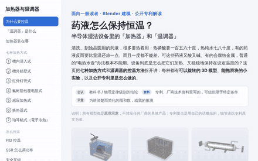</a> | **[湿法温调器原理](https://guangxianzhu.github.io/HTML-classroom/%E6%B9%BF%E6%B3%95%E6%B8%A9%E8%B0%83%E5%99%A8%E5%8E%9F%E7%90%86/index.html)** ▶ 点击打开  半导体湿法设备：药液怎么加热、怎么恒温。七种加热方式（浸入、贴壁、红外灯、氟树脂包覆、感应、换热器、珀耳帖 / 電子冷熱）各配 Blender 模型、原理小实验和公开专利解读，再加 PID 控温、SSR 调功和安全互锁三个实验，单文件离线页  源码和说明：[湿法温调器原理/](%E6%B9%BF%E6%B3%95%E6%B8%A9%E8%B0%83%E5%99%A8%E5%8E%9F%E7%90%86/) |
| <a href="https://guangxianzhu.github.io/HTML-classroom/%E6%97%A0%E5%B0%98%E5%AE%A4%E7%A9%BA%E6%B0%94%E8%BF%87%E6%BB%A4/index.html">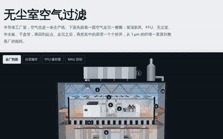</a> | **[无尘室空气过滤](https://guangxianzhu.github.io/HTML-classroom/%E6%97%A0%E5%B0%98%E5%AE%A4%E7%A9%BA%E6%B0%94%E8%BF%87%E6%BB%A4/index.html)** ▶ 点击打开  半导体无尘室：Blender 建模的厂房剖面、FFU 爆炸图和 MAU 剖切，加上纤维过滤、二维气流、颗粒账本和温湿度四个原理实验  源码和说明：[无尘室空气过滤/](%E6%97%A0%E5%B0%98%E5%AE%A4%E7%A9%BA%E6%B0%94%E8%BF%87%E6%BB%A4/) |
| <a href="https://guangxianzhu.github.io/HTML-classroom/%E5%B9%B2%E6%B3%95%E5%88%BB%E8%9A%80%E6%9C%BA/output/%E5%B9%B2%E6%B3%95%E5%88%BB%E8%9A%80%E6%9C%BA_%E7%A6%BB%E7%BA%BF%E7%89%88.html">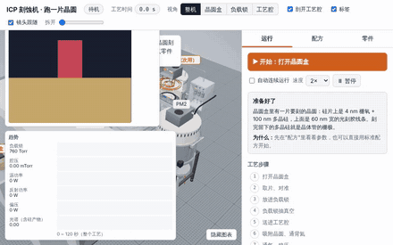</a> | **[干法刻蚀机](https://guangxianzhu.github.io/HTML-classroom/%E5%B9%B2%E6%B3%95%E5%88%BB%E8%9A%80%E6%9C%BA/output/%E5%B9%B2%E6%B3%95%E5%88%BB%E8%9A%80%E6%9C%BA_%E7%A6%BB%E7%BA%BF%E7%89%88.html)** ▶ 点击打开  原创 ICP 刻蚀机：在网页里操作机台，晶圆从晶圆盒经负载锁、传输腔进工艺腔刻蚀再放回，15 步每步讲“在干什么、为什么”；可以改配方，试几个错误配方看会出什么问题  源码和说明：[干法刻蚀机/](%E5%B9%B2%E6%B3%95%E5%88%BB%E8%9A%80%E6%9C%BA/) |
| <a href="https://guangxianzhu.github.io/HTML-classroom/%E7%94%B5%E6%B5%81%E6%80%8E%E4%B9%88%E8%BD%AC%E5%8A%A8%E7%A3%81%E5%9C%BA/index.html">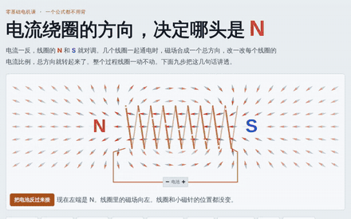</a> | **[电流怎么转动磁场](https://guangxianzhu.github.io/HTML-classroom/%E7%94%B5%E6%B5%81%E6%80%8E%E4%B9%88%E8%BD%AC%E5%8A%A8%E7%A3%81%E5%9C%BA/index.html)** ▶ 点击打开  零基础电机课：不用公式，从指南针讲到三相电、扭矩转速和逆变器，九步都能动手（纯 2D 离线页）  源码和说明：[电流怎么转动磁场/](%E7%94%B5%E6%B5%81%E6%80%8E%E4%B9%88%E8%BD%AC%E5%8A%A8%E7%A3%81%E5%9C%BA/) |
|  | **[电动车电机调速](https://guangxianzhu.github.io/HTML-classroom/%E7%94%B5%E5%8A%A8%E8%BD%A6%E7%94%B5%E6%9C%BA%E8%B0%83%E9%80%9F/index.html)** ▶ 点击打开  Blender 建模 + 实时 dq 仿真：电动车的电机怎么调扭矩、调转速，十章从旋转磁场讲到 FOC、弱磁、能量回收和试驾  源码和说明：[电动车电机调速/](%E7%94%B5%E5%8A%A8%E8%BD%A6%E7%94%B5%E6%9C%BA%E8%B0%83%E9%80%9F/) |
| <a href="https://guangxianzhu.github.io/HTML-classroom/%E8%BD%AF%E4%BB%B6%E5%AE%9A%E4%B9%89%E6%B1%BD%E8%BD%A6/index.html">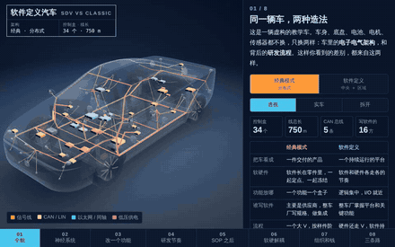</a> | **[软件定义汽车](https://guangxianzhu.github.io/HTML-classroom/%E8%BD%AF%E4%BB%B6%E5%AE%9A%E4%B9%89%E6%B1%BD%E8%BD%A6/index.html)** ▶ 点击打开  Blender 建模的同一辆车、三代电子电气架构：线束和改动范围由模型算出来，八章讲清软件定义和经典研发的差别，从架构、V 模型、车队灰度讲到组织、成本和路线选择  源码和说明：[软件定义汽车/](%E8%BD%AF%E4%BB%B6%E5%AE%9A%E4%B9%89%E6%B1%BD%E8%BD%A6/) |
| <a href="https://guangxianzhu.github.io/HTML-classroom/%E6%97%A0%E8%BD%AC%E7%9B%98%E5%BE%AE%E6%B3%A2%E7%82%89/index.html">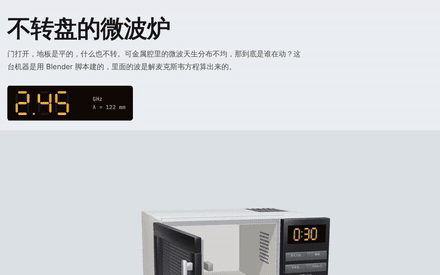</a> | **[无转盘微波炉](https://guangxianzhu.github.io/HTML-classroom/%E6%97%A0%E8%BD%AC%E7%9B%98%E5%BE%AE%E6%B3%A2%E7%82%89/index.html)** ▶ 点击打开  Blender 建模 + 三维电磁仿真：地板下的回转天线怎么让热点轮换，和转盘比谁更匀  源码和说明：[无转盘微波炉/](%E6%97%A0%E8%BD%AC%E7%9B%98%E5%BE%AE%E6%B3%A2%E7%82%89/) |
| <a href="https://guangxianzhu.github.io/HTML-classroom/%E6%8C%89D%E5%88%B0%E9%97%AA%E7%8E%B0/index.html">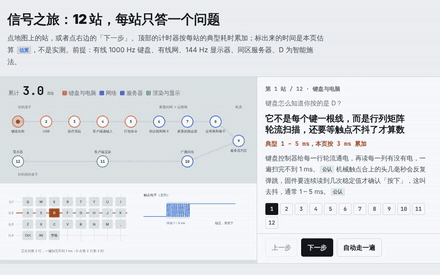</a> | **[按D到闪现](https://guangxianzhu.github.io/HTML-classroom/%E6%8C%89D%E5%88%B0%E9%97%AA%E7%8E%B0/index.html)** ▶ 点击打开  通信原理：从在英雄联盟里按下 D 到屏幕上看到闪现，一次按键往返的 12 站、延迟预算和服务器权威判定（纯 2D 离线页）  源码和说明：[按D到闪现/](%E6%8C%89D%E5%88%B0%E9%97%AA%E7%8E%B0/) |

## 需要先在电脑上跑 Blender 的项目

这几个项目的三维模型是运行时用 Blender 脚本生成的，生成的模型文件没有放进仓库，所以**没有在线链接**。在 Windows 上装好 Blender，双击项目里的 `启动.bat`（会先 `git pull` 检查更新，再调 Blender 生成模型），具体怎么打开网页查看器见各项目的 README。下面是 Blender 渲染的静态图。

| 预览 | 项目 |
| --- | --- |
|  | **[无刷电机爆炸图](%E6%97%A0%E5%88%B7%E7%94%B5%E6%9C%BA%E7%88%86%E7%82%B8%E5%9B%BE/)**  57 型无刷直流电机：结构 / 原理 / 模型 |
|  | **[三相电机爆炸图](%E4%B8%89%E7%9B%B8%E7%94%B5%E6%9C%BA%E7%88%86%E7%82%B8%E5%9B%BE/)**  三相鼠笼式异步电机：结构 / 原理 / 电动 / 发电 |
|  | **[涵道无人机](%E6%B6%B5%E9%81%93%E6%97%A0%E4%BA%BA%E6%9C%BA/)**  原创 3 寸涵道穿越机：飞行演示 + 差速原理 + 爆炸图 |
|  | **[E235电车模型](E235%E7%94%B5%E8%BD%A6%E6%A8%A1%E5%9E%8B/)**  山手线 E235 系先头车 1:1，门和灯可动 |
|  | **[五指灵巧手](%E4%BA%94%E6%8C%87%E7%81%B5%E5%B7%A7%E6%89%8B/)**  20 自由度直驱灵巧手：零件树 + 参数表 + 逐件建模 |
|  | **[迷你车床爆炸图](%E8%BF%B7%E4%BD%A0%E8%BD%A6%E5%BA%8A%E7%88%86%E7%82%B8%E5%9B%BE/)**  8 合 1 迷你桌面车床爆炸图 |
|  | **[万用表爆炸图](%E4%B8%87%E7%94%A8%E8%A1%A8%E7%88%86%E7%82%B8%E5%9B%BE/)**  数字万用表：原理爆炸图 |
|  | **[AI服务器爆炸图](AI%E6%9C%8D%E5%8A%A1%E5%99%A8%E7%88%86%E7%82%B8%E5%9B%BE/)**  8U 八卡 HGX 训练服务器：原理爆炸图 |
|  | **[四缸发动机爆炸图](%E5%9B%9B%E7%BC%B8%E5%8F%91%E5%8A%A8%E6%9C%BA%E7%88%86%E7%82%B8%E5%9B%BE/)**  2.0L DOHC 16V 直列四缸：原理爆炸图 |

## 动图怎么更新

页面改版后想重新录动图，见 [docs/previews/README.md](docs/previews/README.md)。
