# HTML 教室

用网页（three.js）讲清楚机器和设备怎么工作的教学项目集合。每个顶层文件夹是一个独立的小项目。

## 在线演示（点链接直接打开）

下面这些页面都是单个 html 文件，放在 GitHub Pages 上，手机和电脑点开就能用，不用装任何东西。动图是用无头浏览器实际打开页面、点几下录下来的（比实际播放快一些）。
页面里嵌着三维模型，单页 0.1 ~ 11 MB，第一次打开要等几秒。

| 预览 | 项目 |
| --- | --- |
| <a href="https://guangxianzhu.github.io/HTML-classroom/%E7%94%B5%E6%A2%AF%E8%B0%83%E5%BA%A6%E7%AE%97%E6%B3%95/index.html">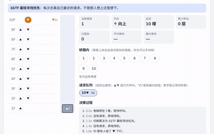</a> | **[电梯调度算法](https://guangxianzhu.github.io/HTML-classroom/%E7%94%B5%E6%A2%AF%E8%B0%83%E5%BA%A6%E7%AE%97%E6%B3%95/index.html)** ▶ 点击打开  单台电梯怎么决定下一步去哪：FCFS、SSTF、SCAN、LOOK 四种调度算法的动画演示。楼层外按 ▲/▼ 叫电梯，乘客上车后自动按目标楼层，电梯按所选算法移动、开关门，旁边实时写出每一步的决策理由、请求队列、平均 / 最长等待，下方画楼层-时间轨迹；“制造饥饿场景”让顶楼的人在 SSTF 下一直等不到；同一组请求下四种算法的路径图和总移动层数可以先猜再揭晓；讲清楚为什么外呼要分上下、SCAN / LOOK 只顺路接同方向的人，以及现实电梯的“集选控制”本质是 LOOK（纯 2D 离线页）  源码和说明：[电梯调度算法/](%E7%94%B5%E6%A2%AF%E8%B0%83%E5%BA%A6%E7%AE%97%E6%B3%95/) |
| <a href="https://guangxianzhu.github.io/HTML-classroom/4%E4%BD%8DCPU%E4%BA%92%E5%8A%A8%E6%95%99%E5%AD%A6/index.html">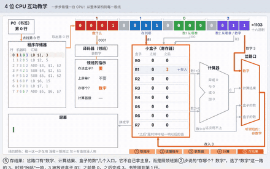</a> | **[4 位 CPU 互动教学](https://guangxianzhu.github.io/HTML-classroom/4%E4%BD%8DCPU%E4%BA%92%E5%8A%A8%E6%95%99%E5%AD%A6/index.html)** ▶ 点击打开  给零基础的人一步步看懂一台 CPU：一台 4 位玩具 CPU（9 条指令、8 个寄存器）的完整数据通路，每条指令拆成取指、译码、读寄存器、运算、写回五小步，橙色线是这一步在用的通路；先用厨房比喻说人话（书签、领班、小盒子、岔路口），想深入再打开电路细节看信号名和二进制；12 章从二进制、指令格式、译码器、寄存器堆、全加器和补码减法、单周期时钟讲到 ASCII 显示，最后对比它和真正的 CPU（SPARC）还差什么；每章先猜题再看讲解，执行前也能先预测结果；附指令拆解器、ALU 实验台和程序编辑器（纯 2D 离线页）  源码和说明：[4位CPU互动教学/](4%E4%BD%8DCPU%E4%BA%92%E5%8A%A8%E6%95%99%E5%AD%A6/) |
| <a href="https://guangxianzhu.github.io/HTML-classroom/%E7%AB%8B%E4%BD%93%E8%BD%A6%E5%BA%93%E5%8E%9F%E7%90%86/index.html">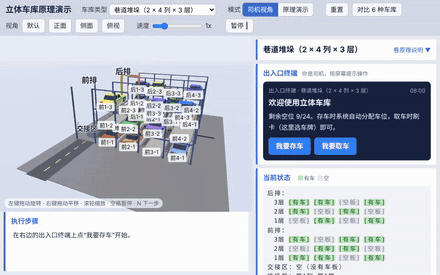</a> | **[立体车库原理](https://guangxianzhu.github.io/HTML-classroom/%E7%AB%8B%E4%BD%93%E8%BD%A6%E5%BA%93%E5%8E%9F%E7%90%86/index.html)** ▶ 点击打开  6 种立体车库（简易升降、升降横移、垂直循环、巷道堆垛、塔库、平面移动）的三维交互演示：司机视角下只和出入口终端打交道，识别车牌、系统自动分配车位、按提示把车开进交接区、刷卡取车，设备怎么动都在画面里；原理演示里直接点车位存取，每一步动作配一句“为什么这样动”（空位让位、顺逆时针哪边近、行走和升降同时进行取较大值、空板管理、预定位），可以单步讲解、自动选位（每个空位试算一遍挑最快的），还能把 6 种车库各随机存取 200 次，比容量、占地和耗时  源码和说明：[立体车库原理/](%E7%AB%8B%E4%BD%93%E8%BD%A6%E5%BA%93%E5%8E%9F%E7%90%86/) |
|  | **[DF-01 数字工厂：总装车间数字孪生](https://guangxianzhu.github.io/HTML-classroom/%E6%95%B0%E5%AD%97%E5%B7%A5%E5%8E%82/index.html)** ▶ 点击打开  一座新能源汽车总装车间的剖切式三维数字孪生（three.js 程序化建模，单文件离线）：原材料立体库的堆垛机和叉车、伺服压机 + 横杆机械手、16 台六轴机器人点焊冒火花、玻璃涂装房里的喷涂机器人和烘房、空中输送链、两条 13 工位总装线（越往后装上的件越多）、EOL 光廊和四轮定位、坡道下到成品车堆场，AGV 跑中央环线，牵引车按铰接挂车运动学倒车进月台；外面一层琥珀色数据层（分区轮廓、穿墙进来的能源流、工位信标、扫描带、孪生包络）和 SCADA 控制台 HUD（OEE、产量、WIP、AGV、能耗、告警）；21 个工位会随机故障并真的停机；点地面进分区、点设备看 inspector，按空格是 88 秒一圈的电影级巡游（9 段覆盖全流程、无缝循环），`录屏模式.bat` 是隐藏 HUD 的 2.39:1 纯净录屏  源码和说明：[数字工厂/](%E6%95%B0%E5%AD%97%E5%B7%A5%E5%8E%82/) |
| <a href="https://guangxianzhu.github.io/HTML-classroom/%E8%B6%85%E5%A3%B0%E6%B3%A2%E6%B5%81%E9%87%8F%E8%AE%A1%E5%8F%82%E6%95%B0%E5%AE%9E%E9%AA%8C%E5%AE%A4/index.html">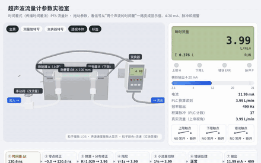</a> | **[超声波流量计参数实验室](https://guangxianzhu.github.io/HTML-classroom/%E8%B6%85%E5%A3%B0%E6%B3%A2%E6%B5%81%E9%87%8F%E8%AE%A1%E5%8F%82%E6%95%B0%E5%AE%9E%E9%AA%8C%E5%AE%A4/index.html)** ▶ 点击打开  时间差式 PFA 超声波流量计的参数一个个拆开讲：Blender 建模的 U 形检测器（两端压电换能器）+ 变换器（LCD、四个 LED）+ 手动阀，实时仿真从“两个声波的时间差”到显示值、4-20 mA、频率、积算脉冲和报警的整条信号链；十关讲时间差原理、零点调整（故意在有流量时做零点会怎样）、阻尼和响应时间、小流量切除、满量程和 PLC 量程对不上、上下限报警的回差 / 延时 / NO·NC、脉冲积压和定量补液超量、药液动粘度和层流湍流修正、气泡和错误时输出，最后是参数总表（范围引自东京计装、东フロ、基恩士、富士、Levitronix 公开资料）和现场调参顺序  源码和说明：[超声波流量计参数实验室/](%E8%B6%85%E5%A3%B0%E6%B3%A2%E6%B5%81%E9%87%8F%E8%AE%A1%E5%8F%82%E6%95%B0%E5%AE%9E%E9%AA%8C%E5%AE%A4/) |
|  | **[现代建筑工地：超高层 4D 施工进度](https://guangxianzhu.github.io/HTML-classroom/%E7%8E%B0%E4%BB%A3%E5%BB%BA%E7%AD%91%E5%B7%A5%E5%9C%B0/index.html)** ▶ 点击打开  一栋原创的 248 m 超高层（2026 年的工程，守 250 m 限高）从挖基坑到竣工：拖时间轴看地下连续墙、基坑开挖和内支撑、筏板、地下室，再看核心筒带着造楼机 4 天一层往上爬，钢柱、钢梁、楼承板、楼板、幕墙一层层跟在下面（竖向流水）；造楼机是 Blender 建模的顶模集成平台（贝雷片钢平台、12 个支点、7 层挂架、大钢模、布料机，参照公开资料里的平台参数），能剖开看里面、切到支点看 12 个油缸分三次把平台顶上一层；工地是活的：成槽机、旋挖钻、挖机装渣土车、罐车和泵车、两台动臂塔吊把钢柱钢梁落到正在装的那层、楼承板一张张铺、楼板先铺钢筋再浇筑、幕墙单元板一块块吊装、临边栏杆和安全网、地下室满堂支模架、施工电梯、工人刷脸进场，车辆进出大门；还有 2026 年的智能建造：巡检无人机绕楼、四足机器狗、钢筋绑扎 / 钢柱焊接 / 墙面打磨机器人、塔吊远程操控室、智慧工地大屏、扬尘超标自动开的雾炮，侧栏点一下镜头跟过去；右上角“自动导览”一键看完全程（19 站，每站一句解说，可循环、可只留画面录屏）；每段讲解标明资料 / 推断 / 假设  源码和说明：[现代建筑工地/](%E7%8E%B0%E4%BB%A3%E5%BB%BA%E7%AD%91%E5%B7%A5%E5%9C%B0/) |
| <a href="https://guangxianzhu.github.io/HTML-classroom/%E8%A1%8C%E6%98%9F%E9%94%A5%E7%9B%98%E6%97%A0%E7%BA%A7%E5%8F%98%E9%80%9F%E5%99%A8/index.html">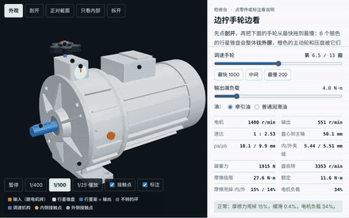</a> | **[行星锥盘无级变速器](https://guangxianzhu.github.io/HTML-classroom/%E8%A1%8C%E6%98%9F%E9%94%A5%E7%9B%98%E6%97%A0%E7%BA%A7%E5%8F%98%E9%80%9F%E5%99%A8/index.html)** ▶ 点击打开  带电机、顶上一个手轮、“200 ~ 1000 转随意调”的 MB / UDL 型机械无级变速器：Blender 建模（结构参照 MB 型公开说明和公开专利）的电机 + 变速器，剖开能看 6 个双锥行星盘被主动轮和外环两对刃口夹着，拧手轮时整体往外挪、碟簧被撑开、转速跟着变；七章讲摩擦传动、行星机构和 Willis 速比、接触半径怎么变、碟簧加压和打滑、快挡被电机卡住慢挡被摩擦卡住、手轮到凸轮环的调速链，和变频器怎么选，11 件专利拆解；每条结论标明公认 / 资料 / 推断 / 估算  源码和说明：[行星锥盘无级变速器/](%E8%A1%8C%E6%98%9F%E9%94%A5%E7%9B%98%E6%97%A0%E7%BA%A7%E5%8F%98%E9%80%9F%E5%99%A8/) |
|  | **[车钻铣三合一机床：电子挂轮](https://guangxianzhu.github.io/HTML-classroom/%E8%BD%A6%E9%92%BB%E9%93%A3%E4%B8%89%E5%90%88%E4%B8%80%E6%9C%BA%E5%BA%8A/index.html)** ▶ 点击打开  参照 CT125E 的桌面车钻铣三合一机床：Blender 建模的整机（可爆炸、可透视看内部的编码器和步进电机），九章讲车削、挂轮为什么能车螺纹、电子挂轮的整数累加算法和丢步极限、多刀车螺纹为什么要等零点脉冲、钻铣头绕立柱转 360°、从棒料一步步做出 M6 螺栓 / 螺母 / 相机螺丝，加上参数表逐条解释和 11 件公开专利；推测和假设的地方都标出来了  源码和说明：[车钻铣三合一机床/](%E8%BD%A6%E9%92%BB%E9%93%A3%E4%B8%89%E5%90%88%E4%B8%80%E6%9C%BA%E5%BA%8A/) |
| <a href="https://guangxianzhu.github.io/HTML-classroom/%E4%B8%80%E6%9D%A1%E6%8C%87%E4%BB%A4%E5%88%B0%E6%89%8B%E6%8C%87/index.html">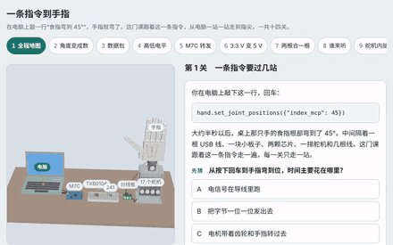</a> | **[一条指令到手指](https://guangxianzhu.github.io/HTML-classroom/%E4%B8%80%E6%9D%A1%E6%8C%87%E4%BB%A4%E5%88%B0%E6%89%8B%E6%8C%87/index.html)** ▶ 点击打开  在电脑上敲一行“食指弯到 45°”，腱绳手的手指就弯了，中间发生了什么：Blender 建模的桌面全景（电脑、M7C 板、电平转换、合线、17 个舵机的手）、舵机剖视和一根手指，零基础十五关跟着这条指令一站一站走，标定、数据包、串口电平、半双工、舵机闭环、线轴腱绳、预紧回差、时间账、六条总线，最后是七道真实故障的排查题；内容来自 whj_MCU 仓库，每关标明哪些是实测、哪些是估算  源码和说明：[一条指令到手指/](%E4%B8%80%E6%9D%A1%E6%8C%87%E4%BB%A4%E5%88%B0%E6%89%8B%E6%8C%87/) |
| <a href="https://guangxianzhu.github.io/HTML-classroom/GPIO%E5%BC%95%E8%84%9A%E5%AE%9E%E9%AA%8C%E5%8F%B0/index.html">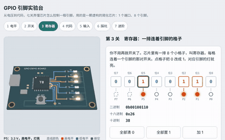</a> | **[GPIO 引脚实验台](https://guangxianzhu.github.io/HTML-classroom/GPIO%E5%BC%95%E8%84%9A%E5%AE%9E%E9%AA%8C%E5%8F%B0/index.html)** ▶ 点击打开  零基础讲代码怎么控制芯片的一根引脚：Blender 建模的小开发板（走线按电平变色、灯和按键会动）+ 十关小实验，从高低电平、引脚里的两个开关、寄存器，到十六进制、地址、一行代码怎么走到引脚、只改一位、读按键和上拉、灯不亮的三个原因、开漏和读改写竞争；用一颗虚构的简化芯片，和真实芯片的差别列在说明里  源码和说明：[GPIO引脚实验台/](GPIO%E5%BC%95%E8%84%9A%E5%AE%9E%E9%AA%8C%E5%8F%B0/) |
| <a href="https://guangxianzhu.github.io/HTML-classroom/%E8%B8%8F%E6%9D%BF%E6%91%A9%E6%89%98%E8%BD%A6%E5%8A%A8%E5%8A%9B%E7%B3%BB%E7%BB%9F/index.html">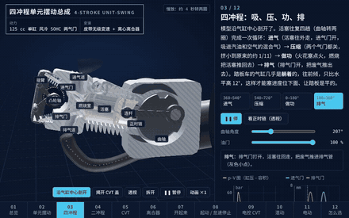</a> | **[踏板摩托车的发动机和动力系统](https://guangxianzhu.github.io/HTML-classroom/%E8%B8%8F%E6%9D%BF%E6%91%A9%E6%89%98%E8%BD%A6%E5%8A%A8%E5%8A%9B%E7%B3%BB%E7%BB%9F/index.html)** ▶ 点击打开  拧油门就走是怎么做到的：Blender 建模（结构参照公开专利）的四冲程单元摆动总成（发动机 + 皮带无级变速 + 离心离合器 + 齿轮 + 后轮）、二冲程、轮毂电机、摆臂电机，剖开看活塞气门、V 形槽和离合块；十五章讲四冲程 / 二冲程、油门到底控制什么（进气量 → 喷油 → 扭矩）、CVT 力平衡、滚子重量和上坡降档、转速 / 扭矩 / 功率 / 车速怎么互相算、热值和油耗（一滴油的去向）、怠速停止、电控 CVT、轻混和电动  源码和说明：[踏板摩托车动力系统/](%E8%B8%8F%E6%9D%BF%E6%91%A9%E6%89%98%E8%BD%A6%E5%8A%A8%E5%8A%9B%E7%B3%BB%E7%BB%9F/) |
| <a href="https://guangxianzhu.github.io/HTML-classroom/%E9%A3%9E%E5%BA%A6%E6%B7%B7%E5%8A%A8%E5%8E%9F%E7%90%86/index.html">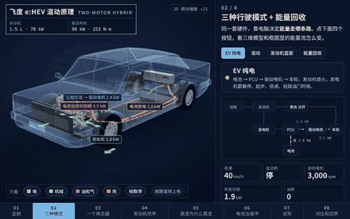</a> | **[飞度混动原理](https://guangxianzhu.github.io/HTML-classroom/%E9%A3%9E%E5%BA%A6%E6%B7%B7%E5%8A%A8%E5%8E%9F%E7%90%86/index.html)** ▶ 点击打开  本田飞度 e:HEV 两电机混动：Blender 建模的整车和动力系统（发动机、发电机、驱动电机、一个直连离合器、固定齿比齿轮、PCU、电池），八章讲清楚为什么大部分时间电机推车、发动机发电，高速巡航时发动机直接推车；效率图、链路损耗、间歇发电和试驾都由能量模型实时算出  源码和说明：[飞度混动原理/](%E9%A3%9E%E5%BA%A6%E6%B7%B7%E5%8A%A8%E5%8E%9F%E7%90%86/) |
| <a href="https://guangxianzhu.github.io/HTML-classroom/%E5%8D%8A%E5%AF%BC%E4%BD%93%E6%B9%BF%E6%B3%95%E8%AE%BE%E5%A4%87%E7%9A%84%E6%B3%B5/index.html">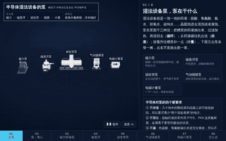</a> | **[半导体湿法设备的泵](https://guangxianzhu.github.io/HTML-classroom/%E5%8D%8A%E5%AF%BC%E4%BD%93%E6%B9%BF%E6%B3%95%E8%AE%BE%E5%A4%87%E7%9A%84%E6%B3%B5/index.html)** ▶ 点击打开  半导体湿法设备里的五种泵：Blender 建模（结构参照公开专利）的磁力泵、磁悬浮泵、波纹管泵、气动隔膜泵、电磁计量泵，剖开看内部，液体按压力着色流动；八章讲离心原理、磁力联轴器脱耦、悬浮控制、往复泵脉动、气锁和怎么选  源码和说明：[半导体湿法设备的泵/](%E5%8D%8A%E5%AF%BC%E4%BD%93%E6%B9%BF%E6%B3%95%E8%AE%BE%E5%A4%87%E7%9A%84%E6%B3%B5/) |
| <a href="https://guangxianzhu.github.io/HTML-classroom/%E6%B9%BF%E6%B3%95%E8%AE%BE%E5%A4%87%E6%B5%81%E9%87%8F%E8%AE%A1/index.html">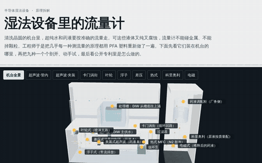</a> | **[湿法设备流量计](https://guangxianzhu.github.io/HTML-classroom/%E6%B9%BF%E6%B3%95%E8%AE%BE%E5%A4%87%E6%B5%81%E9%87%8F%E8%AE%A1/index.html)** ▶ 点击打开  半导体湿法设备里的九种流量计：Blender 建模的虚构清洗台和九个剖面（超声波两种、卡门涡街、叶轮、浮子、差压、热式 MFC、科里奥利、电磁），八个原理实验，17 篇公开专利拆解和选型题  源码和说明：[湿法设备流量计/](%E6%B9%BF%E6%B3%95%E8%AE%BE%E5%A4%87%E6%B5%81%E9%87%8F%E8%AE%A1/) |
| <a href="https://guangxianzhu.github.io/HTML-classroom/%E6%B6%B2%E4%BD%93%E8%B0%83%E5%8E%8B%E9%98%80/index.html">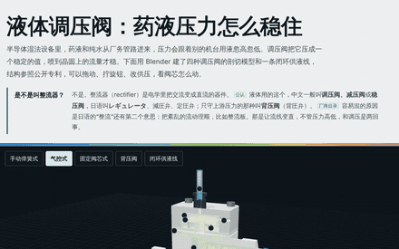</a> | **[液体调压阀](https://guangxianzhu.github.io/HTML-classroom/%E6%B6%B2%E4%BD%93%E8%B0%83%E5%8E%8B%E9%98%80/index.html)** ▶ 点击打开  半导体湿法设备：Blender 建模的四种调压阀剖切（手动弹簧式、气控平衡式、固定阀芯双膜片式、背压阀）和闭环供液线，结构参照公开专利；讲下垂、入口压力效应、开环和闭环、背压阀  源码和说明：[液体调压阀/](%E6%B6%B2%E4%BD%93%E8%B0%83%E5%8E%8B%E9%98%80/) |
| <a href="https://guangxianzhu.github.io/HTML-classroom/%E6%B0%94%E4%BD%93%E8%B0%83%E5%8E%8B%E9%98%80/index.html">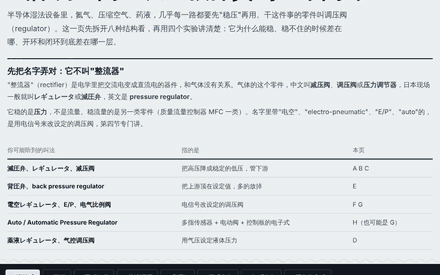</a> | **[气体调压阀](https://guangxianzhu.github.io/HTML-classroom/%E6%B0%94%E4%BD%93%E8%B0%83%E5%8E%8B%E9%98%80/index.html)** ▶ 点击打开  半导体湿法设备里的气体 regulator：Blender 建模的八种剖面（弹簧式、两级、圆顶加载、氟树脂药液阀、背压阀、开环 / 闭环电气比例阀、压电数字式），每种单独一页（先猜题、再分步拆、最后讲失效条件），实时仿真压力和气流，讲清下垂、两级减压和开环 / 闭环差在哪一层；液体侧见"液体调压阀"  源码和说明：[气体调压阀/](%E6%B0%94%E4%BD%93%E8%B0%83%E5%8E%8B%E9%98%80/) |
|  | **[湿法浓度计原理](https://guangxianzhu.github.io/HTML-classroom/%E6%B9%BF%E6%B3%95%E6%B5%93%E5%BA%A6%E8%AE%A1%E5%8E%9F%E7%90%86/index.html)** ▶ 点击打开  半导体湿法设备：九种浓度计（吸光、折射、无电极电导、超声、密度、滴定、臭氧、隔膜电极、比电阻）各配 Blender 模型、原理小实验和公开专利解读，单文件离线页  源码和说明：[湿法浓度计原理/](%E6%B9%BF%E6%B3%95%E6%B5%93%E5%BA%A6%E8%AE%A1%E5%8E%9F%E7%90%86/) |
| <a href="https://guangxianzhu.github.io/HTML-classroom/%E6%B9%BF%E6%B3%95%E6%B8%A9%E8%B0%83%E5%99%A8%E5%8E%9F%E7%90%86/index.html">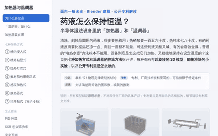</a> | **[湿法温调器原理](https://guangxianzhu.github.io/HTML-classroom/%E6%B9%BF%E6%B3%95%E6%B8%A9%E8%B0%83%E5%99%A8%E5%8E%9F%E7%90%86/index.html)** ▶ 点击打开  半导体湿法设备：药液怎么加热、怎么恒温。七种加热方式（浸入、贴壁、红外灯、氟树脂包覆、感应、换热器、珀耳帖 / 電子冷熱）各配 Blender 模型、原理小实验和公开专利解读，再加 PID 控温、SSR 调功和安全互锁三个实验，单文件离线页  源码和说明：[湿法温调器原理/](%E6%B9%BF%E6%B3%95%E6%B8%A9%E8%B0%83%E5%99%A8%E5%8E%9F%E7%90%86/) |
| <a href="https://guangxianzhu.github.io/HTML-classroom/%E6%97%A0%E5%B0%98%E5%AE%A4%E7%A9%BA%E6%B0%94%E8%BF%87%E6%BB%A4/index.html">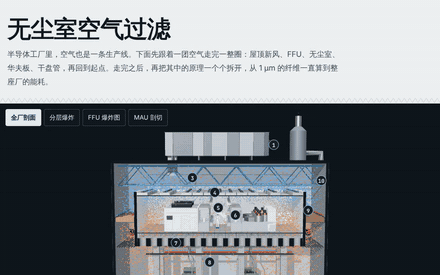</a> | **[无尘室空气过滤](https://guangxianzhu.github.io/HTML-classroom/%E6%97%A0%E5%B0%98%E5%AE%A4%E7%A9%BA%E6%B0%94%E8%BF%87%E6%BB%A4/index.html)** ▶ 点击打开  半导体无尘室：Blender 建模的厂房剖面、FFU 爆炸图和 MAU 剖切，加上纤维过滤、二维气流、颗粒账本和温湿度四个原理实验  源码和说明：[无尘室空气过滤/](%E6%97%A0%E5%B0%98%E5%AE%A4%E7%A9%BA%E6%B0%94%E8%BF%87%E6%BB%A4/) |
| <a href="https://guangxianzhu.github.io/HTML-classroom/%E5%B9%B2%E6%B3%95%E5%88%BB%E8%9A%80%E6%9C%BA/output/%E5%B9%B2%E6%B3%95%E5%88%BB%E8%9A%80%E6%9C%BA_%E7%A6%BB%E7%BA%BF%E7%89%88.html">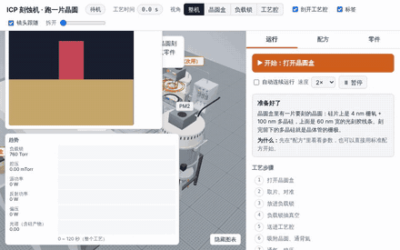</a> | **[干法刻蚀机](https://guangxianzhu.github.io/HTML-classroom/%E5%B9%B2%E6%B3%95%E5%88%BB%E8%9A%80%E6%9C%BA/output/%E5%B9%B2%E6%B3%95%E5%88%BB%E8%9A%80%E6%9C%BA_%E7%A6%BB%E7%BA%BF%E7%89%88.html)** ▶ 点击打开  原创 ICP 刻蚀机：在网页里操作机台，晶圆从晶圆盒经负载锁、传输腔进工艺腔刻蚀再放回，15 步每步讲“在干什么、为什么”；可以改配方，试几个错误配方看会出什么问题  源码和说明：[干法刻蚀机/](%E5%B9%B2%E6%B3%95%E5%88%BB%E8%9A%80%E6%9C%BA/) |
| <a href="https://guangxianzhu.github.io/HTML-classroom/%E7%94%B5%E6%B5%81%E6%80%8E%E4%B9%88%E8%BD%AC%E5%8A%A8%E7%A3%81%E5%9C%BA/index.html">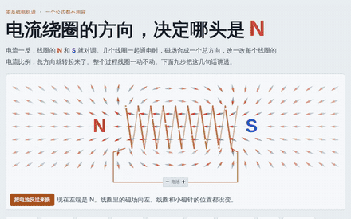</a> | **[电流怎么转动磁场](https://guangxianzhu.github.io/HTML-classroom/%E7%94%B5%E6%B5%81%E6%80%8E%E4%B9%88%E8%BD%AC%E5%8A%A8%E7%A3%81%E5%9C%BA/index.html)** ▶ 点击打开  零基础电机课：不用公式，从指南针讲到三相电、扭矩转速和逆变器，九步都能动手（纯 2D 离线页）  源码和说明：[电流怎么转动磁场/](%E7%94%B5%E6%B5%81%E6%80%8E%E4%B9%88%E8%BD%AC%E5%8A%A8%E7%A3%81%E5%9C%BA/) |
|  | **[电动车电机调速](https://guangxianzhu.github.io/HTML-classroom/%E7%94%B5%E5%8A%A8%E8%BD%A6%E7%94%B5%E6%9C%BA%E8%B0%83%E9%80%9F/index.html)** ▶ 点击打开  Blender 建模 + 实时 dq 仿真：电动车的电机怎么调扭矩、调转速，十章从旋转磁场讲到 FOC、弱磁、能量回收和试驾  源码和说明：[电动车电机调速/](%E7%94%B5%E5%8A%A8%E8%BD%A6%E7%94%B5%E6%9C%BA%E8%B0%83%E9%80%9F/) |
| <a href="https://guangxianzhu.github.io/HTML-classroom/%E8%BD%AF%E4%BB%B6%E5%AE%9A%E4%B9%89%E6%B1%BD%E8%BD%A6/index.html">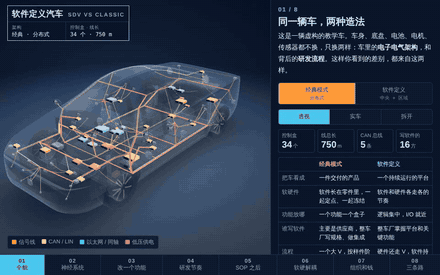</a> | **[软件定义汽车](https://guangxianzhu.github.io/HTML-classroom/%E8%BD%AF%E4%BB%B6%E5%AE%9A%E4%B9%89%E6%B1%BD%E8%BD%A6/index.html)** ▶ 点击打开  Blender 建模的同一辆车、三代电子电气架构：线束和改动范围由模型算出来，八章讲清软件定义和经典研发的差别，从架构、V 模型、车队灰度讲到组织、成本和路线选择  源码和说明：[软件定义汽车/](%E8%BD%AF%E4%BB%B6%E5%AE%9A%E4%B9%89%E6%B1%BD%E8%BD%A6/) |
| <a href="https://guangxianzhu.github.io/HTML-classroom/%E6%B1%BD%E8%BD%A6%E6%A8%A1%E6%8B%9F%E5%99%A8/index.html">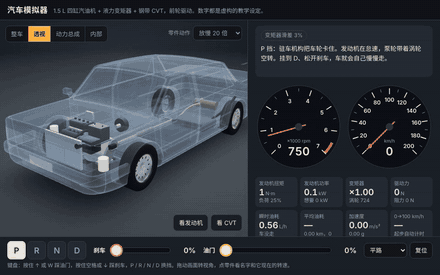</a> | **[汽车模拟器](https://guangxianzhu.github.io/HTML-classroom/%E6%B1%BD%E8%BD%A6%E6%A8%A1%E6%8B%9F%E5%99%A8/index.html)** ▶ 点击打开  一辆虚构的直板老式三厢车，Blender 建模的 1.5 L 四缸 + 液力变矩器 + 钢带 CVT：挂 D 拖油门，曲轴、活塞、气门、锥轮、钢带按算出来的转速转，看转速、速比、车速、油耗怎么变，带蠕行、失速、断油滑行和 0→100 计时；也能坐进驾驶位，看活的仪表、挡杆和踏板  源码和说明：[汽车模拟器/](%E6%B1%BD%E8%BD%A6%E6%A8%A1%E6%8B%9F%E5%99%A8/) |
| <a href="https://guangxianzhu.github.io/HTML-classroom/%E6%97%A0%E8%BD%AC%E7%9B%98%E5%BE%AE%E6%B3%A2%E7%82%89/index.html">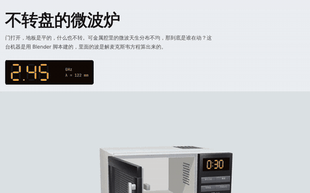</a> | **[无转盘微波炉](https://guangxianzhu.github.io/HTML-classroom/%E6%97%A0%E8%BD%AC%E7%9B%98%E5%BE%AE%E6%B3%A2%E7%82%89/index.html)** ▶ 点击打开  Blender 建模 + 三维电磁仿真：地板下的回转天线怎么让热点轮换，和转盘比谁更匀  源码和说明：[无转盘微波炉/](%E6%97%A0%E8%BD%AC%E7%9B%98%E5%BE%AE%E6%B3%A2%E7%82%89/) |
| <a href="https://guangxianzhu.github.io/HTML-classroom/%E6%8C%89D%E5%88%B0%E9%97%AA%E7%8E%B0/index.html">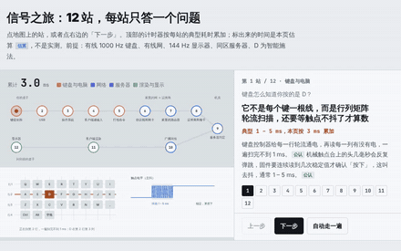</a> | **[按D到闪现](https://guangxianzhu.github.io/HTML-classroom/%E6%8C%89D%E5%88%B0%E9%97%AA%E7%8E%B0/index.html)** ▶ 点击打开  通信原理：从在英雄联盟里按下 D 到屏幕上看到闪现，一次按键往返的 12 站、延迟预算和服务器权威判定（纯 2D 离线页）  源码和说明：[按D到闪现/](%E6%8C%89D%E5%88%B0%E9%97%AA%E7%8E%B0/) |

## 需要先在电脑上跑 Blender 的项目

这几个项目的三维模型是运行时用 Blender 脚本生成的，生成的模型文件没有放进仓库，所以**没有在线链接**。在 Windows 上装好 Blender，双击项目里的 `启动.bat`（会先 `git pull` 检查更新，再调 Blender 生成模型），具体怎么打开网页查看器见各项目的 README。下面是 Blender 渲染的静态图。

| 预览 | 项目 |
| --- | --- |
|  | **[无刷电机爆炸图](%E6%97%A0%E5%88%B7%E7%94%B5%E6%9C%BA%E7%88%86%E7%82%B8%E5%9B%BE/)**  57 型无刷直流电机：结构 / 原理 / 模型 |
|  | **[三相电机爆炸图](%E4%B8%89%E7%9B%B8%E7%94%B5%E6%9C%BA%E7%88%86%E7%82%B8%E5%9B%BE/)**  三相鼠笼式异步电机：结构 / 原理 / 电动 / 发电 |
|  | **[涵道无人机](%E6%B6%B5%E9%81%93%E6%97%A0%E4%BA%BA%E6%9C%BA/)**  原创 3 寸涵道穿越机：飞行演示 + 差速原理 + 爆炸图 |
|  | **[E235电车模型](E235%E7%94%B5%E8%BD%A6%E6%A8%A1%E5%9E%8B/)**  山手线 E235 系先头车 1:1，门和灯可动 |
|  | **[五指灵巧手](%E4%BA%94%E6%8C%87%E7%81%B5%E5%B7%A7%E6%89%8B/)**  20 自由度直驱灵巧手：零件树 + 参数表 + 逐件建模 |
|  | **[迷你车床爆炸图](%E8%BF%B7%E4%BD%A0%E8%BD%A6%E5%BA%8A%E7%88%86%E7%82%B8%E5%9B%BE/)**  8 合 1 迷你桌面车床爆炸图 |
|  | **[万用表爆炸图](%E4%B8%87%E7%94%A8%E8%A1%A8%E7%88%86%E7%82%B8%E5%9B%BE/)**  数字万用表：原理爆炸图 |
|  | **[AI服务器爆炸图](AI%E6%9C%8D%E5%8A%A1%E5%99%A8%E7%88%86%E7%82%B8%E5%9B%BE/)**  8U 八卡 HGX 训练服务器：原理爆炸图 |
|  | **[四缸发动机爆炸图](%E5%9B%9B%E7%BC%B8%E5%8F%91%E5%8A%A8%E6%9C%BA%E7%88%86%E7%82%B8%E5%9B%BE/)**  2.0L DOHC 16V 直列四缸：原理爆炸图 |

## 动图怎么更新

页面改版后想重新录动图，见 [docs/previews/README.md](docs/previews/README.md)。
