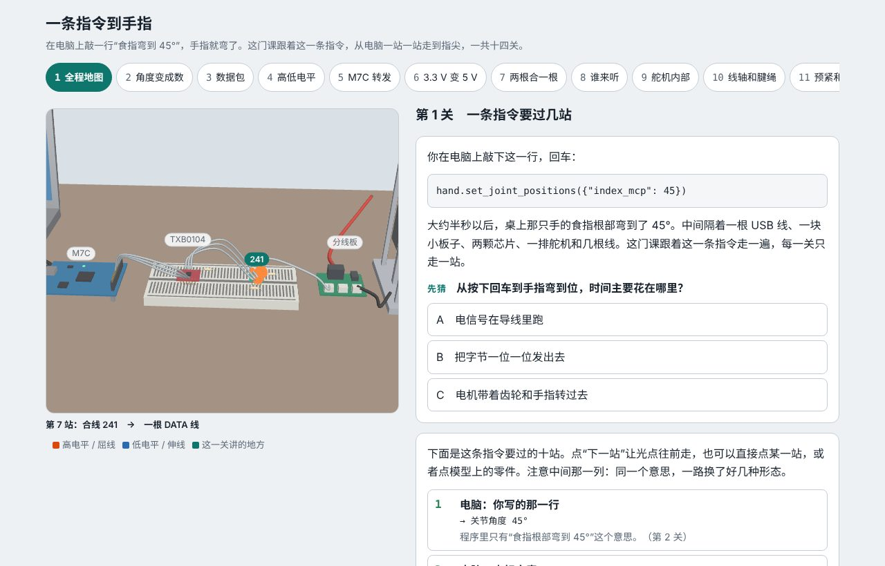
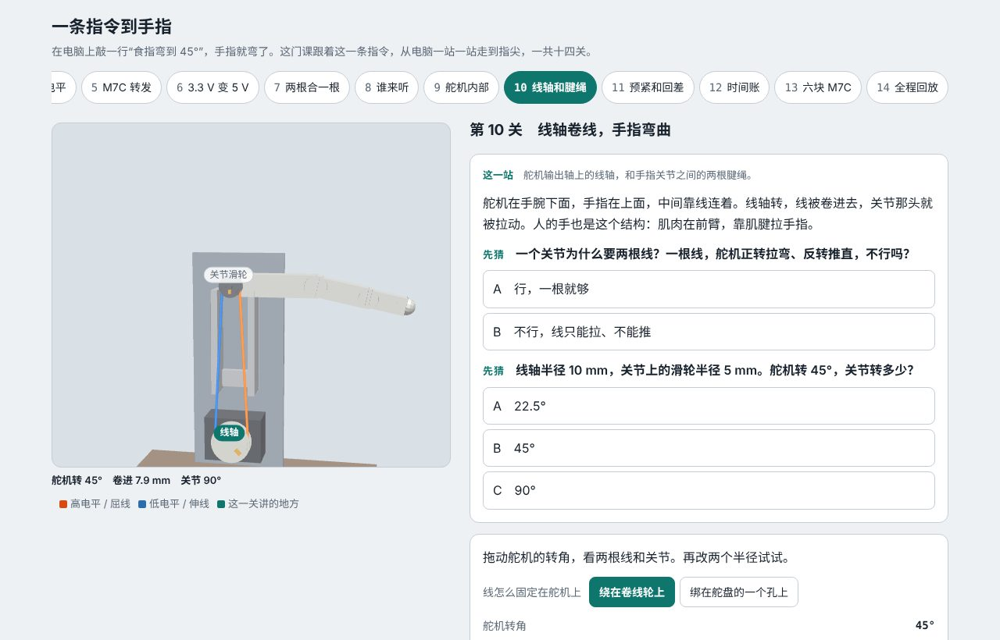

# 一条指令到手指

在电脑上敲一行 `hand.set_joint_positions({"index_mcp": 45})`，桌上那只腱绳手的食指就弯了。这一页跟着这一条指令，从电脑一站一站走到指尖，零基础十四关，每关只讲一件事、先猜再动手。

内容来自 [GuangxianZhu/whj_MCU](https://github.com/GuangxianZhu/whj_MCU)：电脑 → USB → M7C 板 → TXB0104 电平转换 → 74LVC2G241 合线 → 单线舵机总线 → 17 个舵机 → 线轴和腱绳 → 手指。那个仓库记的是“实物上怎么接、怎么查”，这一页讲的是“每一站为什么是这样”。





## 怎么打开

- **Windows**：双击 `启动演示.bat`。它先检查 `main` 分支有没有更新，有就 `git pull --ff-only`，然后用默认浏览器打开 `index.html`。
- **其他系统**：直接打开 `index.html`。单文件页面（约 2 MB），three.js、三个模型和代码都在里面，离线也能看。

## 十四关讲什么

| 关 | 这一站 | 新概念 | 你动手做什么 |
| --- | --- | --- | --- |
| 1 全程地图 | 整条链路 | 同一个意思一路换了六种形态 | 让光点走完十站 |
| 2 角度变成数 | 电脑 | 标定：撞两头、连一条线 | 撞两个极限，把 45° 换成电机位置数 |
| 3 数据包 | 电脑 | 包头、ID、长度、指令、地址、数值、校验 | 改 ID 和数值，弄坏一个字节看校验 |
| 4 高低电平 | M7C 的串口 | UART：起始位、低位先发、停止位、波特率 | 看一个字节的波形，让收的人用错波特率 |
| 5 M7C 转发 | M7C 板 | 透传和按包转发 | 两种办法各走一包，对比坏包怎么处理 |
| 6 3.3 V 变 5 V | TXB0104 | 门限随电源变；弱输出被电阻分压 | 重现“下拉电阻插成 10 kΩ”那次 |
| 7 两根合一根 | 241 | 半双工、三态门、DIR（TXEN）、上拉 | 拨 DIR，做出一次电平打架 |
| 8 谁来听 | 舵机总线 | ID 认领、广播、应答、Return Delay | 换五种包；找 TXEN 松手的时间窗口 |
| 9 舵机内部 | 8 号舵机 | 位置闭环、减速齿轮、磁编码器、电流上限 | 挡住它，对比 60 mA 和 300 mA |
| 10 线轴和腱绳 | 线轴 → 关节 | 线只能拉不能推；线长守恒 | 改两个半径；对比卷线轮和舵盘孔 |
| 11 预紧和回差 | 两根线 | 太松空转，太紧摩擦 | 来回拖出一个“环”，再调到刚好 |
| 12 时间账 | 来回全程 | Sync Write / Sync Read；一轮多久 | 57600 对 1 Mbps，改舵机数 |
| 13 六块 M7C | 整只手的接法 | 并行才快；故障隔离 | 轮流对同时；弄断一条总线 |
| 14 全程回放 | 整条链路 | 一站一站排查 | 播放全程；七道真实故障的排查题 |

## 哪些是真的，哪些是简化

每一关末尾都有“依据”一栏，标出每句话是公认原理、手册规格、仓库里的实测、推断，还是为了演示编的数字。总的来说：

| 这里的做法 | 实际情况 |
| --- | --- |
| 用单个 Write 包讲包的结构 | orca_core 实际发的是 Sync Write（一包带 17 个舵机），第 12 关讲 |
| 标定数字（3210 / 1640）、关节范围（−20°～95°） | 示例。真实数值在你电脑上的 `calibration.yaml` 里 |
| 线轴半径 10 mm、滑轮半径 5 mm | 取自 whj_MCU 路线图里的算例，不是那只手的实际尺寸 |
| 面包板上的器件从左到右按信号顺序排 | 实物的列号不一样，看 whj_MCU 的 `docs/breadboard` |
| 舵机内部零件的摆放 | 示意，不是 XC330 真实的内部布局；画面上齿轮转得比真实的慢 |
| 手的外形 | 自己画的简化版，不是任何产品的图纸 |
| 所有时间 | 按协议字节数算的理论值，没有算 USB 和电脑程序的开销，仓库里没有实测记录 |
| 线上拉力 | 按“扭矩和电流成正比”粗估，只适合比大小 |
| 挡住时压进去多少、空载电流、回差 | 最简单的弹簧 / 线性 / 死区模型，只看趋势 |

原理部分（闭环、UART、半双工、ID 认领、线长守恒、回差）是通用的，换一只手、换一种舵机也成立。

## 文件夹里有什么

| 路径 | 内容 |
| --- | --- |
| `index.html` | 打包好的演示页面 |
| `启动演示.bat` | Windows 一键启动，含 main 更新检查 |
| `重新生成模型.bat` | 用本机 Blender 重跑建模脚本（也先检查更新） |
| `规划.md` | 动手前定的方案：主题、讲法、关卡顺序、设计假设 |
| `blender/build_models.py` | 纯脚本建模：桌面全景、舵机剖视、一根手指 |
| `blender/out/` | `desk` / `servo` / `finger` 的 `.blend` 和 `.glb`，以及给网页用的坐标表 `layout.json` |
| `web/src/core.js` | 教学模型：组包和校验、UART、标定换算、门限、241、TXEN 窗口、位置环、腱绳、时间账、分组 |
| `web/src/stage.js` | three.js 舞台：三个模型切换、镜头、标签、沿线走的光点、实时画的腱绳 |
| `web/src/levels_a.js` / `levels_b.js` / `levels_c.js` | 第 1–5 / 6–10 / 11–14 关 |
| `web/src/ui.js`、`main.js`、`page.html` | 共用小部件、关卡切换外壳、页面骨架和样式 |
| `web/test_core.mjs` | 模型的校验（24 项） |

网页靠物体名字找零件（`ST_*`、`WIRE_*`、`SERVO_n`、`SPOOL_n`、`F_<手指>_<n>`、`SV_*`、`FG_*`），信号路线靠 `layout.json` 里的 `paths`。改建模脚本里的名字，要同步改 `stage.js`。

## 校验了什么

`node web/test_core.mjs` 拿 whj_MCU 里的已知答案来对：

- 6 个数据包（ping、Goal Position、Torque、应答、Sync Write、Sync Read）和 `HANDOFF.md` 里的逐字节一致
- 时间账（17 个 57600 一轮 84.9 ms、3 个 19.0 ms、1 Mbps 5.2 ms；六条同时约 19 ms、轮流约 109 ms）和 `docs/六块M7C方案调研.md` 的表一致
- 下拉 10 kΩ 时约 3.57 V、100 kΩ 时约 4.81 V，和实测的 3.5 V / 4.77 V 对得上
- 线轴 10 mm、滑轮 5 mm 时舵机 45° → 关节 90°，舵盘孔最多拉 2r，和 `docs/路线图_腱绳手指.md` 的算例一致
- 17 个 ID 分到 6 块板，不重不漏

页面本身用无头浏览器把十四关逐关打开、点了一遍，没有报错，手机宽度下没有横向溢出。

## 重新构建

```bash
# 1. 建模（二选一）
blender -b --factory-startup -P blender/build_models.py -- --out blender/out
pip install bpy && python blender/build_models.py --out blender/out

# 2. 打包页面
cd web
npm install
node test_core.mjs    # 校验模型
node build.mjs        # 生成 ../index.html
```
