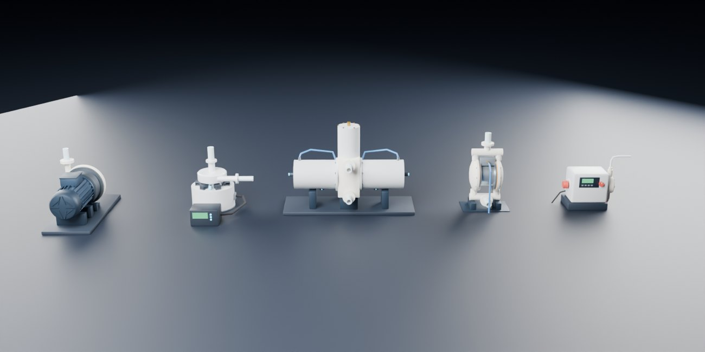
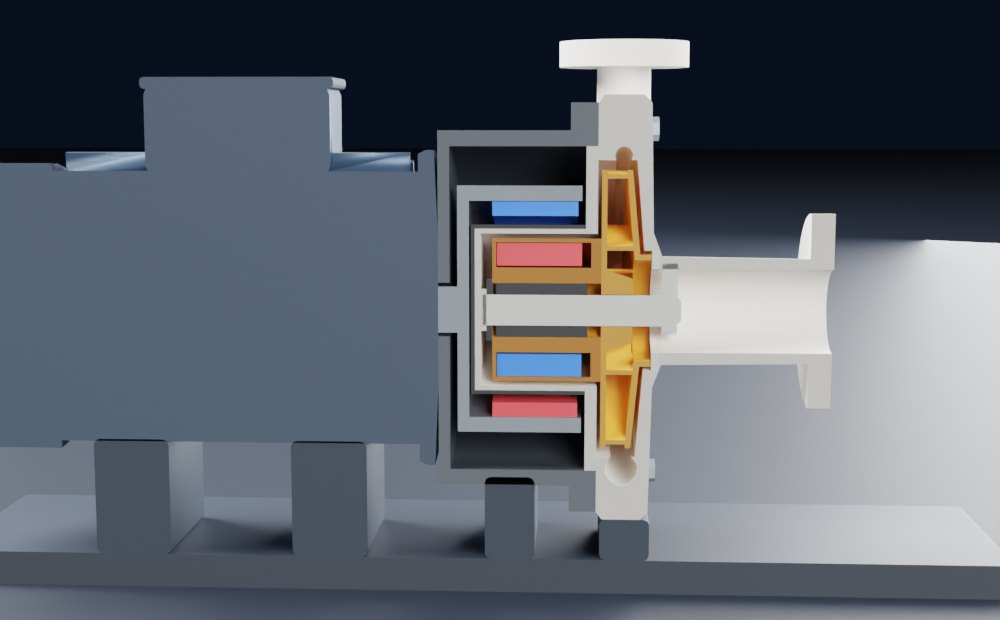
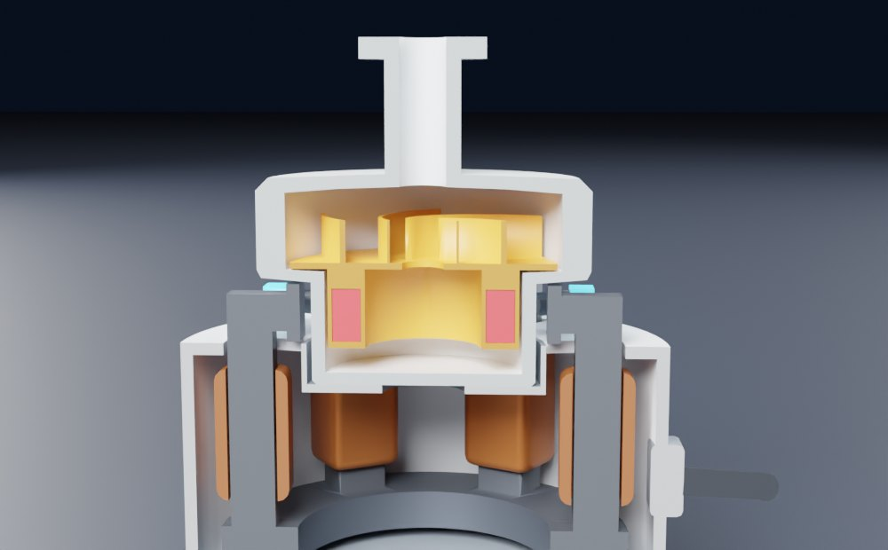
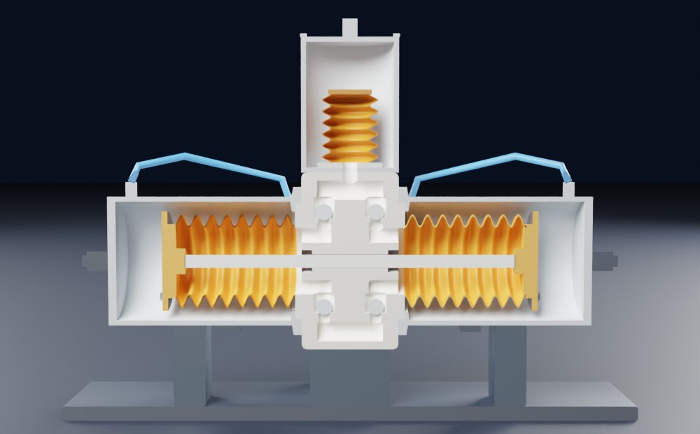
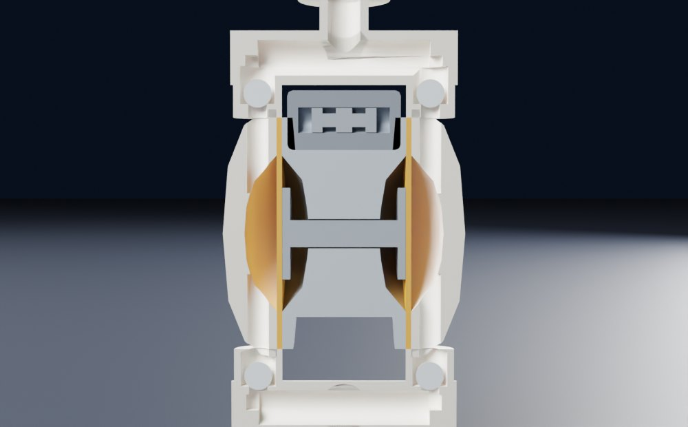
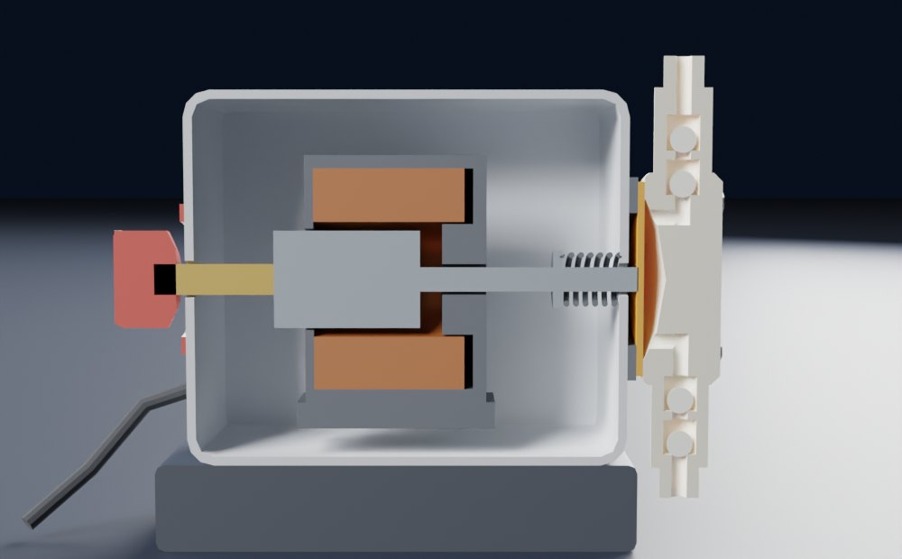

# 半导体湿法设备的泵

面向一般用户，讲清楚湿法设备（清洗、刻蚀）里常见的五种泵是怎么工作的、为什么这样设计、什么时候会坏：

- **磁力泵**（マグネットポンプ）：电机转外磁铁，隔着封死的隔离套带动里面的内磁铁和叶轮，没有轴封
- **磁悬浮泵**：叶轮和磁铁环整个悬在液体里，无轴承电机一边推它转一边扶它居中
- **波纹管泵**（ベローズポンプ，“左右动的那个”）：压缩空气交替压左右两只 PTFE 波纹管，一根连杆带两边一起走
- **气动隔膜泵**：波纹管泵的表兄弟，两片隔膜一根轴，滑阀自己换向
- **电磁计量泵**：电磁铁一下一下推隔膜，每下挤出固定的一小口

五台泵都用 Blender 脚本建模，结构参考公开专利（页面最后一章列了 19 篇专利和 8 份厂家资料）。网页可以剖开看内部，液体小点按压力从蓝到红流动，每章有一个能动手的原理实验。

- **网页版（手机可看）**：<https://claude.ai/artifact/BRb3B3AF6vWvtEUAFAKDoZ>（默认只有自己能打开，要给别人看需在页面的 Share 里开启分享）
- **离线版**：`index.html`，模型和 three.js 都打包在里面，双击就能看（没网时字体回退到系统字体）



| 磁力泵 | 磁悬浮泵 | 波纹管泵 |
|---|---|---|
|  |  |  |

| 气动隔膜泵 | 电磁计量泵 |
|---|---|
|  |  |

## 怎么打开

- **Windows**：双击 `启动.bat`。它先 `git pull --ff-only origin main` 检查更新（没网或没装 git 就跳过），再用默认浏览器打开 `index.html`。
- **其他系统**：直接打开 `index.html`。

要改模型再看效果：双击 `重新生成模型.bat`。它会找 Blender（`blender_path.txt` → PATH → `Program Files\Blender Foundation\Blender*` → Steam），重跑建模脚本；装了 Node 就顺便重新打包 `index.html`。

舞台右下角的工具条：**剖开**（每按一下换一种剖法）、**透视**（外壳变透明）、**拆开**（爆炸图）、暂停、速度。点任何零件会显示它的名字。

## 八章内容

| 章 | 讲什么 | 实验 |
|---|---|---|
| 01 总览 | 泵在湿法设备里干的三种活，半导体的四个硬要求，“甩”和“挤”两大家族 | 过滤器慢慢堵了，离心泵和容积泵的流量谁掉得多 |
| 02 甩：离心 | 叶轮、后弯叶片、越来越宽的蜗壳，运行点和相似定律 | 改转速、阻力、抬升高度，看泵曲线和管路曲线的交点 |
| 03 磁力联轴器 | 磁铁隔着隔离套传扭矩，内磁铁落后的角度，轴承靠药液润滑冷却 | 换成磷酸、硫酸，加温、开阀门，看扭矩什么时候超过磁铁能传的上限而脱耦；干转 |
| 04 磁悬浮 | 为什么必须主动控制，哪几个方向主动、哪几个被动，转子为什么扁 | 冲转子一下，改控制延迟，关掉控制器 |
| 05 波纹管泵 | 四个球阀、两种换向、出口压力为什么超不过气压、换向那一下的脉动 | 分步看四个阶段；改气压、阻力、阻尼器大小，看出口流量波形 |
| 06 气动隔膜泵 | 滑阀怎么自己换向，憋死不坏 | 分步看阀芯；把出口阀慢慢关上直到憋停 |
| 07 电磁计量泵 | 行程长度和次数决定流量，双球阀串联，气锁 | 剂量计算；双氧水放气时会不会气锁，自动排气阀和定期满行程的效果 |
| 08 怎么选 | 五台泵对比表，槽内循环的三条路（磁力泵是最主流的），现场症状速查，证据强弱，全部来源 | — |

每章都写了为什么这样做、依赖的假设、什么时候失效，并标了证据强度：公认、专利 / 厂家资料、本页简化、我的推测。

## 网页里的计算

| 项目 | 做法 |
|---|---|
| 离心泵 | 扬程 H = H₀(n/n₀)² − aQ²，效率在关死点和零扬程点为零、中间最高，所以轴功率随流量增加；系统曲线 H = Hs + kQ² |
| 磁力联轴器 | 能传扭矩 T<sub>max</sub>·sin(pδ)，8 极；钕铁硼按扭矩 −0.24 %/°C 变弱；负载扭矩 = 轴功率 / 角速度，和比重成正比；超过上限就锁定为脱耦，要“停机再启动” |
| 磁悬浮 | 一个方向：m·x″ = k<sub>s</sub>·x + k<sub>i</sub>·i + F，PD 控制，0.1 ms 采样，测量延迟可调，碰到 1.5 mm 的缝就算撞壳 |
| 往复泵波形 | 每个行程开头一小段换向（不动），然后加速 → 匀速 → 减速；两边轮流挤，所以只有换向时出口流量掉到零；阻尼器用一阶滤波近似 |
| 气动泵运行点 | Q = Q₀·(1 − Pd/P<sub>stall</sub>)，P<sub>stall</sub> 略低于气压；和管路 Pd = Pb + R·Q² 联立 |
| 计量泵 | 每下 = 3.5 mL × 行程长度；气锁：每下挤出 = 行程容积 − 气泡 × (1 − 进口压力 / 出口压力)，等温压缩 |

数值都是“教学泵”的量级，是我设的，不对应任何型号；结构和趋势有意义，绝对数字只是量级。`web/test_sim.mjs` 校验这些模型，也校验页面文案里写死的判断（比如“不控制约 11 ms 撞壳”“硫酸扭矩约为水的 1.8 倍”）。

## 改东西

| 想改 | 改哪里 |
|---|---|
| 零件形状、尺寸、标注点、流线、剖切面、机位 | `blender/build_pumps.py`，每台泵一个 `build_pN()` |
| 文案、实验、来源 | `web/src/chapters.js` |
| 数字模型 | `web/src/sim.js` |
| 舞台、剖切上色、各泵怎么动 | `web/src/stage.js` |

```
# 1. 建模（二选一）
blender -b -P blender/build_pumps.py -- --out blender/out [--render]
pip install bpy && python blender/build_pumps.py --out blender/out [--render]

# 2. 打包页面
cd web
npm install
node test_sim.mjs
node build.mjs          # 生成 ../index.html 和 dist/artifact.html
```

布尔运算默认用 Blender 4.5 起的 MANIFOLD 求解器，旧版自动退回 EXACT。坐标约定：毫米，+Z 朝上，五台泵各在自己的局部坐标里建，再平移到 `OFFSET`。会转的零件原点在转轴上，会伸缩的零件原点在固定端。`blender/out/pumps.blend` 打开按空格能看五台泵一起拆开。

## 结论和它的边界

- 半导体用的泵几乎都在想办法**取消穿过泵壳的转轴**：磁铁隔墙传力、空气推膜、电磁铁推膜。为的是不掉渣、不漏。
- 磁力泵流量大、没有脉动，是槽内循环的主力；代价是怕干转、怕进气，重液体和高温会让磁力联轴器脱耦。
- 磁悬浮泵连轴承也去掉了，但要控制器，被动方向的力有限。
- 波纹管泵、隔膜泵能干转、能自吸、憋死不坏，代价是换向时的脉动，要配阻尼器。
- 计量泵怕气泡：行程越短、出口压力越高，越容易气锁。
- 结构细节来自公开专利，模型尺寸是教学示意，不对应任何厂家的任何型号，也不代表任何一家设备厂的实际配置。

来源列在页面最后一章。
