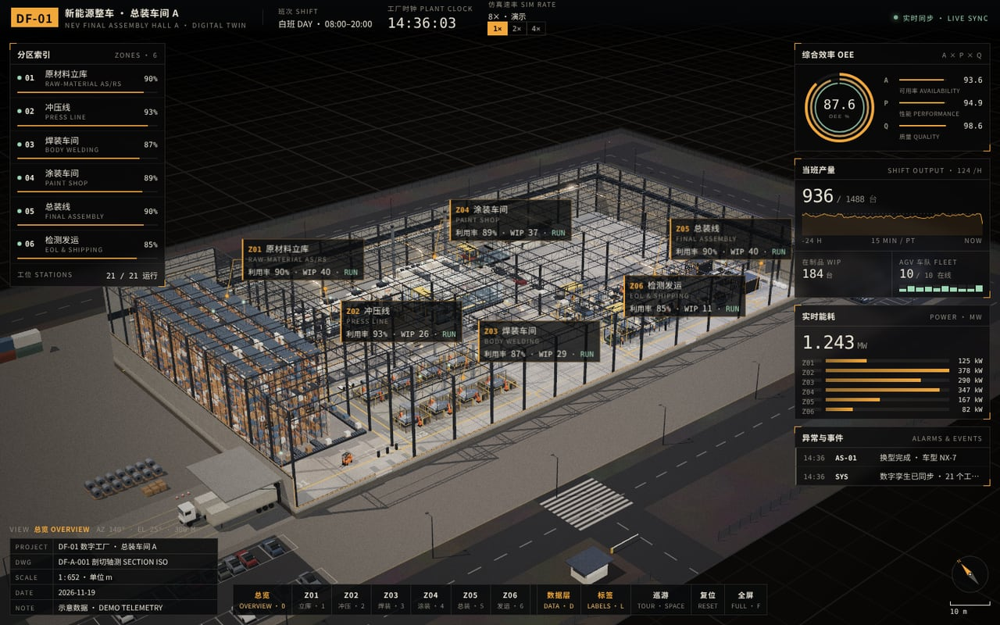
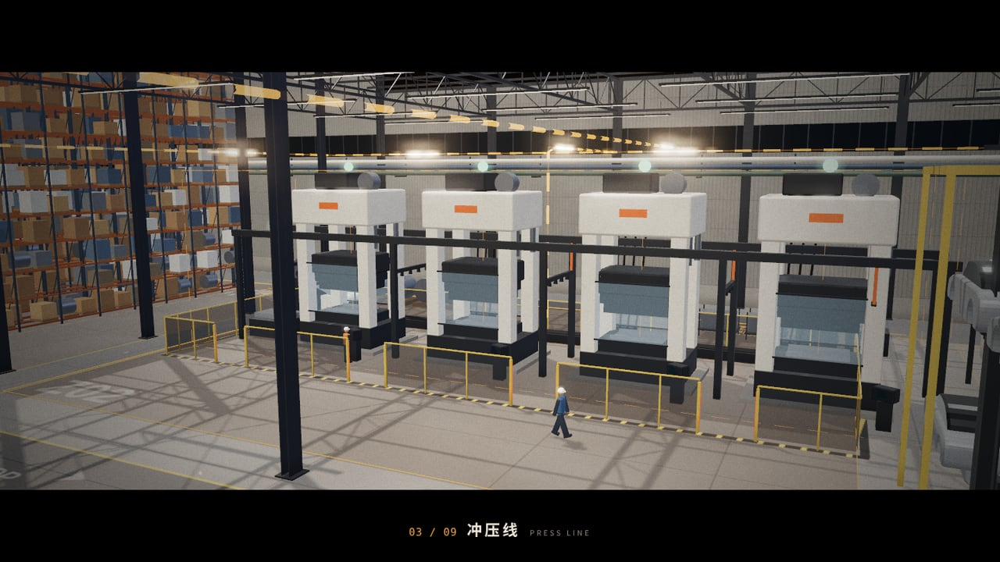

# DF-01 数字工厂 · 总装车间

一座新能源汽车总装车间的实时三维数字孪生，单个 html 文件，双击就能离线打开（three.js r160 已内联，零网络请求）。

剖切式厂房（北墙、东墙满高做背景，西墙切到 7.5 m，南侧只留女儿墙，不做屋面板只留桁架）里，从原材料立体库开始，冲压 → 焊装 → 涂装 → 总装 → 下线检测 → 发运全流程都在动：堆垛机取货、叉车卸挂车、伺服压机冲压 + 横杆机械手传料、16 台六轴机器人点焊冒火花、涂装房里 4 台机器人喷涂、车身走烘房、空中输送链把车身吊到两条总装线、电池合装、玻璃座椅机器人、EOL 光廊、四轮定位、滚台、坡道下到成品车堆场；AGV 沿中央脊线跑环线，进出厂的牵引车按铰接挂车运动学倒车进月台。外面盖一层琥珀色数据层和 SCADA 控制台式 HUD。

## 打开

- Windows：双击 `启动.bat`（先 `git pull --ff-only origin main` 检查更新，再打开页面）
- 纯净录屏：双击 `录屏模式.bat`（同样先检查更新）→ 自动巡游 + 隐藏 HUD + 2.39:1 遮幅，88.5 秒一圈无缝循环；开始录屏后在浏览器里按 F11 全屏
- 也可以直接双击 `index.html`；`film.html` / `tour.html` 是两个跳转页，分别等于 `index.html?film=1` / `?tour=1`
- 改了 `src/` 之后：双击 `重新打包.bat`（需要 Node.js 18+，第一次会 `npm install`），或者命令行 `npm install && node build.mjs`

## 操作

| 操作 | 作用 |
|---|---|
| 左键拖拽 / 滚轮 / 右键（或 Shift + 左键）拖拽 | 环绕 / 缩放 / 平移；手机上单指环绕、双指缩放平移 |
| 点击地面 | 进入该分区（再点一次刷新 inspector） |
| 点击设备 / AGV | 弹出工位 inspector：状态、利用率、告警，可“聚焦”飞近或“注入故障”测试 |
| `1`–`6` / `0` | 分区 Z01–Z06 / 总览 |
| `D` `L` | 数据层 / 投影标签开关 |
| `Space` | 电影级巡游开 / 关（拖拽、滚轮、点场景、`Esc` 也会停） |
| `H` `B` `F` `Esc` | 隐藏 UI / 电影遮幅（同时收起 UI）/ 全屏 / 关闭 inspector 或停止巡游 |
| 顶栏 1× 2× 4× | 演示速率（仿真时钟本身是 8×，所以 4× 时一秒走 32 秒） |

网址参数：`instant` 跳过开场 · `still` 关掉空闲漂移和视差 · `raw` 关后处理 · `lq` 低配（DPR 1、阴影 2048、无 MSAA）· `nolabels` `nodata` `nocard` `hideui` `debug`（左上角显示 FPS / draw calls / 三角面）· `view=overview|Z01…Z06` · `azim elev dist fov tx ty tz` · `sim=1|2|4` · `pr=像素比` · `tour=1` · `film=1` · `letterbox=1` · `tourat=秒`（巡游定格在某一秒，场景照常动）· `tourfast=1`（巡游时长 ×0.16，给 QA 用）。

## 内容

| 分区 | 范围（m） | 里面有什么 |
|---|---|---|
| Z01 原材料立库 | -76…-50 × -34…34 | 4 排 19.8 m 双面货架（约 64% 有货：牛皮纸箱、缠绕膜、蓝灰料箱、钢卷）、3 台堆垛机、P&D 输送线接 AGV、2 台叉车、充电位；西侧 3 个月台门 + 雨棚 + 挂车 |
| Z02 冲压线 | -47…-14 × -34…-6 | 开卷机 + 拆垛、4 台伺服压机（滑块冲程、上下模、玻璃护罩、液压管、操作台）、横杆机械手跨压机传料、废料输送 + 废料箱、围栏 + 光幕 + 危险区斜纹 |
| Z03 焊装车间 | -47…-14 × 6…34 | 2 排 × 4 个焊装单元，每个单元 2 台橙色六轴机器人 + 白车身 + 夹具、焊花和闪光、抽烟尘罩 + 立管、光幕、单元标牌 |
| Z04 涂装车间 | -9…13 × -33…-4 | 玻璃观察墙涂装房（4 台喷涂机器人在 7 轴导轨上、蛇形滑橇输送、车身经过后变色）、发光炉口的烘房隧道、屋顶 AHU 和风管、两根排烟筒 |
| Z05 总装线 | 17…62 × 6…34 | 两条线（z=12 / 28）各 13 工位 × 3.4 m：工具平衡器门架、流利架零件超市、电池合装升降台、多轴拧紧、玻璃 / 座椅机器人、加注机、轮胎排序架；每线 8 台车走节拍，越往后装上的件越多（电池 → 车轮 → 车灯）；北侧门线吊着车门回送；15 名操作工 |
| Z06 检测发运 | 62…76 × 4…36 | 两条 6.4 m EOL 光廊、四轮定位、检测滚台、6 台成品车暂存、东墙发运月台；下线车经坡道开到堆场 |
| Z07 辅助区 | 16…60 × -40…-24 | 玻璃中控室（两排控制台、坐着的值班员）、低压配电室（开关柜指示灯）、维修间 |
| 能源站 | 室外 -48…-24 × -54…-42 | 变压器、冷水机组（风扇在转）、储罐、管桥穿北墙进车间，沿北墙内侧走管廊 |

室外：混凝土场坪、沥青环路、路灯、围栏和大门 + 门卫室、集装箱、钢卷堆场、托盘、锥桶、员工停车场、成品车堆场，整块场地像摄影棚里的模型底座悬在暖石墨色虚空里。

**模拟（`src/sim.js`，HUD 和三维共用一个数据源）**：21 个工位（ASRS-01/02、DOCK-IN、AGV-01、PR-01…04、XF-01、WB-01…04、PT-01、OV-01、AS-01/02、OC-01、EOL-01、DOCK-OUT、EN-01）各有 run / idle / down；每 16–30 秒随机一台故障，6–15 秒后自动复位，idle 是等料。设备真的会反应：压机任何一台故障整条串联线停、AGV-01 故障所有 AGV 停车并亮红灯条、EOL 故障光廊变暗、堆垛机 / 叉车 / 卡车 / 机器人按各自工位的速度系数减速或停。节拍 58 s × 2 线 ≈ 124 台/h，白班 08:00–20:00，开场 14:36、当班 936 / 1488 台，每台车真的从线尾下来时才加一；OEE 由 A × P × Q 合成，能耗 1.2–1.3 MW，96 点产量历史，AGV 电量和充电。

**数据层（`src/data.js`，`D` 开关）**：6 个分区的琥珀细线轮廓 + 外延角标 + 半透明填充 + 地面编号牌；能源流从室外能源站穿北墙，主干 + 6 条支路，流动虚线 + 移动脉冲；AGV 环线和总装线上的物料光点；地面扫描带；关键设备的数字孪生虚线包络；21 个工位信标（绿 / 琥珀 / 红，呼吸，故障时扩散环）和落地引线；西墙切口和南侧板边的剖切线；点选时的高亮框。投影标签（`L`）20 fps 更新，相机后面 / 屏幕外 / 太远时隐藏，卡片之间、卡片和 HUD 面板之间自动避让。

**电影级巡游**：9 段约 88.5 秒，总览 → 立库 → 冲压 → 焊装 → 涂装 → 总装 → 检测发运 → 升空 → 回到总览，第 09 段终点就是开场机位，所以无缝循环。每段先 easeInOutCubic 缓入到抵达机位，再低速漂移到终点，按真实时钟驱动（和帧率无关）。分镜关键帧完全按提示词表格；只是有 5 段（03、04、06、07、08）照直插值会穿过屋架下弦和灯带，所以抵达阶段让相机走经过几个“门洞”途经点的样条（从南侧檐下进出厂房、从空中输送轨道上方跨过），关键帧本身不变，途经点写在 `src/layout.js` 的 `TOUR[].via`。

## 文件

| 文件 | 说明 |
|---|---|
| index.html | 成品：单文件离线版（约 680 KB） |
| 启动.bat / 录屏模式.bat / 重新打包.bat | Windows 一键启动 / 纯净录屏 / 重新打包（都会先检查 main 更新） |
| film.html / tour.html | 跳转页（= `?film=1` / `?tour=1`） |
| src/layout.js | 共享契约：坐标、分区、21 个工位（信标 + 拾取包围盒）、视角、巡游分镜 |
| src/util.js | 参数、随机数、调色板、统一 PBR 材质（世界坐标污渍 + 贴地暗角）、静态合并 `Builder`、实例化零件 `Parts` |
| src/geo.js | 程序化几何：轿车、六轴机器人、操作工、牵引车 / 挂车、叉车、AGV |
| src/studio.js | 渲染器、摄影棚灯光、虚空网格、相机机位 `CamRig` |
| src/building.js | 地面涂装（画布贴图）、剖切厂房、桁架、辅助区、能源站、室外硬景 |
| src/process.js | 冲压线、焊装单元、涂装房 + 烘房、车身流和空中输送、焊花 / 喷雾粒子 |
| src/logistics.js | 立体库、堆垛机、P&D 输送、叉车、铰接卡车、AGV、操作工零件 |
| src/assembly.js | 两条总装线、操作工、EOL / 定位 / 滚台 / 暂存、下线车流 |
| src/data.js | 琥珀数据层 |
| src/post.js | 4× MSAA → bloom → ACES → 移轴 / 暗角 / 静态亮度遮罩颗粒 |
| src/hud.js, src/shell.html | HUD 和页面外壳（样式都在 shell.html 里） |
| src/tourmath.js, src/tour.js | 巡游采样（纯数学，QA 也用它）和播放 |
| src/sim.js | 模拟系统 `SIM` |
| src/main.js | 组装、交互、拾取、自动降级、主循环 |
| build.mjs | esbuild 打包 src + three.js → 内联进 shell.html → index.html |
| qa/ | 运镜穿模检查、交互回归、巡游覆盖、闪烁测量、截图脚本 |
| preview/ | 预览图 |

## 验证（2026-11-19，无头 Chrome + SwiftShader 软件渲染）

- 运镜检查 `node qa/campath.mjs`：按播放用的同一套公式每 0.05 s 采样相机位置，全程和桁架、灯带、墙、柱、空中输送轨道和吊杆、设备包络保持 ≥ 0.9 m
- 交互回归 `node qa/regress.mjs`：**33 / 33** 通过（启动、HUD、分区 / 视角导航、键盘、inspector 列表聚焦、点击设备和地面拾取、注入故障、数据层 / 标签开关、4× 速率、滚轮、拖拽、巡游开停和打断、隐藏 UI、遮幅、复位、控制台零报错、零外部请求、390 × 844 移动端无横向溢出）
- 巡游覆盖 `node qa/tour.mjs`：**9 / 9** 章节按顺序走完并回到第 01 段；首尾机位差 1e-10，段与段之间最大跳变 1e-5
- 闪烁 `node qa/flicker.mjs`：相机不动、场景在动时，顶部虚空区域帧间差 **0**（后处理和 `raw=1` 基线一样）。颗粒只按像素坐标取值并按亮度遮罩；bloom 最远那一级的低电平尾巴被截掉，所以画面别处的焊花、信标变化不会让暗背景在 1 个色阶上来回跳
- 性能：每帧（含 4096 阴影那一遍）约 370 次 draw call、108 万三角面，在 < 400 / < 1.2M 的预算内；静态几何按材质合并、所有重复件实例化，动的东西只每帧改实例矩阵。软件渲染测不了真实帧率；在显卡上目标 60 fps，帧率持续不足时自动先降 DPR（最低 1），再关移轴，再把阴影改成隔帧更新

跑 QA 需要 Playwright 和 sharp：`npm i -D playwright sharp`，再 `npm run qa`（Windows 上把 `CHROME` 环境变量设成 Chrome 的路径，或者装好 Chrome 让 Playwright 用 `channel: 'chrome'`）。

## 说明

- 数据全是示意（DEMO TELEMETRY），设备都是原创通用造型，不对应任何厂家产品。
- 按 `PROMPT-数字工厂.md`（windsor8890/digital-factory-3d）的完整提示词从零实现；坐标、分区、21 个工位 ID、巡游关键帧、URL 参数、验收项都照它来。提示词列出的工位 ID 只有 20 个，第 21 个补了能源站 `EN-01`。
- 立体库 19.8 m 高于 15.8 m 檐高，所以 Z01 上方是一段 21.6 m 的高跨。
- 发运月台挪到东墙 z=6（离开 z=12 / 28 的成品车出口坡道），这样倒车的挂车和下线车流不打架。
