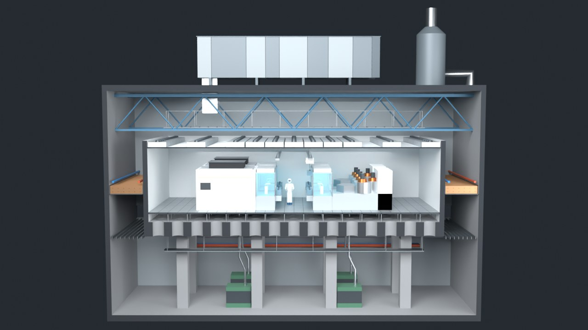
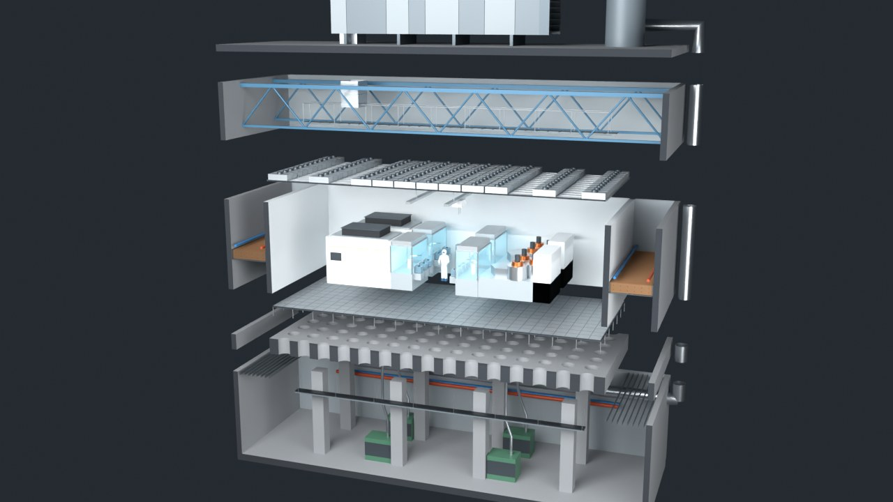

# 无尘室空气过滤

半导体无尘室空气过滤系统的原理演示。先跟着一团空气走完整圈：屋顶 MAU、上风仓、FFU、无尘室、微环境、穿孔地板、华夫板、下技术夹层、干盘管，再回到起点。然后从 1 µm 的纤维算到整座厂的能耗。





## 怎么打开

- **Windows**：双击 `启动演示.bat`。它先检查 `main` 分支有没有更新，有就 `git pull --ff-only`，然后用默认浏览器打开 `index.html`。
- **其他系统**：直接打开 `index.html`。这是单文件页面，模型和数据都在里面，离线也能看（没网时只是字体回退到系统字体）。

## 文件夹里有什么

| 路径 | 内容 |
| --- | --- |
| `index.html` | 打包好的演示页面 |
| `启动演示.bat` | Windows 一键启动，含 main 更新检查 |
| `重新生成模型.bat` | 用本机 Blender 重跑建模脚本，加 `--render` 参数同时出预览图 |
| `blender/build_cleanroom.py` | 纯脚本建模：参数表 → 厂房剖面、FFU 爆炸图、MAU 剖切 → 导出 GLB / .blend |
| `blender/bake_flow.py` | 解剖面流函数，把回路流线烘成 `flow_paths.dat`，网页里的气流点沿它走 |
| `blender/out/` | `cleanroom.blend`（含分层爆炸动画）、`cleanroom.glb`、`spec.json`、流线数据、预览图 |
| `web/src/filter_core.js` | 纤维过滤公式（单纤维效率、穿透率、压降、MPPS） |
| `web/src/micro_core.js` | 纤维旁颗粒轨迹的蒙特卡洛（Kuwabara 流场 + 布朗运动 + 惯性） |
| `web/src/flow_core.js` | 二维不可压 N-S 求解器（MAC 网格、半拉格朗日、红黑 SOR） |
| `web/src/*_lab.js` | 四个实验的界面 |
| `web/src/stage.js` | three.js 舞台：模型、气流点着色器、机位、爆炸、标注 |
| `web/test_core.mjs` | 物理核心的校验 |

## 重新构建

```bash
# 1. 建模（二选一）
blender -b -P blender/build_cleanroom.py -- --out blender/out
pip install bpy && python blender/build_cleanroom.py --out blender/out

# 2. 改了几何才需要：重新解流线（要 numpy、scipy、matplotlib）
python blender/bake_flow.py blender/out

# 3. 打包页面
cd web
npm install
node test_core.mjs    # 校验物理核心
node build.mjs        # 更新上一级的 index.html
```

## 结论和它的边界

- 这套系统把四种污染分开管：颗粒归 ULPA 和单向流，湿度只归 MAU，温度只归干盘管，气态分子归化学过滤。
- 滤纸不是筛子。扩散管小颗粒，拦截和惯性管大颗粒，两头都不占的粒径最难拦。默认参数算出 MPPS 0.20 µm、穿透率 3.2×10⁻⁶（U15 上限 5×10⁻⁶）、滤纸压降 121 Pa。产品资料是 0.12 µm 上下、约 103 Pa。效率和压降吻合，MPPS 偏大。
- 蒙特卡洛和公式的最低点都在 0.2 µm 附近，中段效率差到约 2 倍。公式是按实测校过的渐近式，蒙特卡洛是理想均匀阵列，所以只比趋势。
- 稳态下，下游浓度基本等于产尘速率除以风量，换滤芯几乎不影响它。滤芯决定的是 FFU 出风口的干净程度，这才是单向流和微环境的意义。
- 三维流线是二维、无惯性的流函数解，加了 FFU、地板、盘管三层阻力。没有这三层阻力，气流会全挤在内墙边抄近路。
- 气流实验是二维粗网格，等效黏性远大于真实值，只看趋势。
- 产尘量、室外颗粒浓度、回路压力都是本页假设或估算，页面里逐项标了。
- 厂房和设备都是虚构的，尺寸是教学示意，外形不对应任何真实工厂或产品。

来源列在页面最后一节。
