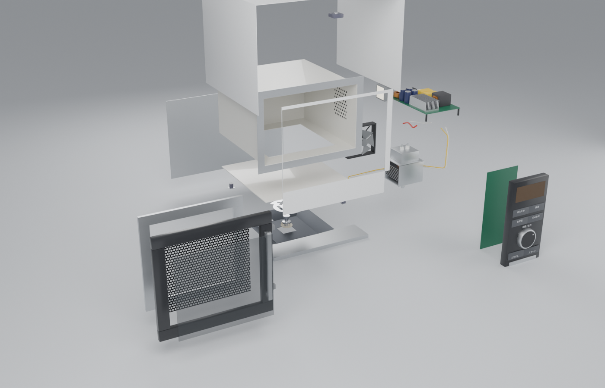

# 不转盘的微波炉

平板式（无转盘）微波炉的原理演示。先让你猜，再切开机器看：地板下面的回转天线怎么转、微波怎么走，再用三维电磁仿真比较回转天线、经典转盘和天线卡住三种情况。



## 怎么打开

- **Windows**：双击 `启动演示.bat`。它会先检查 `main` 分支有没有更新，有就 `git pull`，然后用默认浏览器打开 `index.html`。
- **其他系统**：直接打开 `index.html`。这是单文件页面，模型和仿真数据都在里面，离线也能看（没网时只是字体回退到系统字体）。

## 文件夹里有什么

| 路径 | 内容 |
| --- | --- |
| `index.html` | 打包好的演示页面 |
| `启动演示.bat` | Windows 一键启动，含 main 更新检查 |
| `重新生成模型.bat` | 用本机 Blender 重跑建模脚本 |
| `blender/build_microwave.py` | 纯脚本建模：参数表 → 零件树 → 导出 GLB / .blend / 预览图 |
| `blender/out/` | 生成好的 `microwave.blend`（含爆炸和天线旋转动画）、`microwave.glb`、预览图 |
| `sim3d/mw3d.c` | 三维 FDTD 求解器（C + OpenMP） |
| `sim3d/sweep.sh` | 全部工况 |
| `sim3d/analyze.py`、`build_data.py` | 统计 CV，把结果打包给网页 |
| `sim3d/results.json` | 所有工况的统计数字 |
| `web/` | 页面源码（three.js、2D FDTD、对比实验） |

## 重新构建

```bash
# 1. 建模（二选一）
blender -b -P blender/build_microwave.py -- --out blender/out
pip install bpy && python blender/build_microwave.py --out blender/out

# 2. 三维仿真（2 核约 1 小时）
cd sim3d
gcc -O3 -march=native -fopenmp -ffast-math mw3d.c -o mw3d -lm
./sweep.sh
python3 build_data.py ../web/src/sim.simz runs3

# 3. 打包页面
cd ../web
npm install
node build.mjs        # 同时更新上一级的 index.html
```

## 结论和它的边界

- 回转天线靠不断改变各腔模的激发比例，让热点轮换。食物不用动。
- 回转天线和转盘**没有固定赢家**：大圆盘和靠边的杯子都是转盘更匀，居中的杯子是回转天线更匀，方便当两边范围重叠。天线卡住时明显变差。
- 三维求解器用 30 个空腔谐振频率校验过，平均误差 0.02%。这只说明方程解得对，机型本身是虚构的。
- 全部数字用 3 mm 网格。4 mm 下回转天线的结果明显偏乐观，3 mm 和 2 mm 差约 3 个百分点。
- 天线板尺寸取自公开专利 JP6861397B2 的实施例，不代表任何一款具体产品。
- 仿真是单频、恒定食物参数、没算热传导，所以 CV 是吸热功率的不均匀度，不是温度。完整假设写在页面里。
