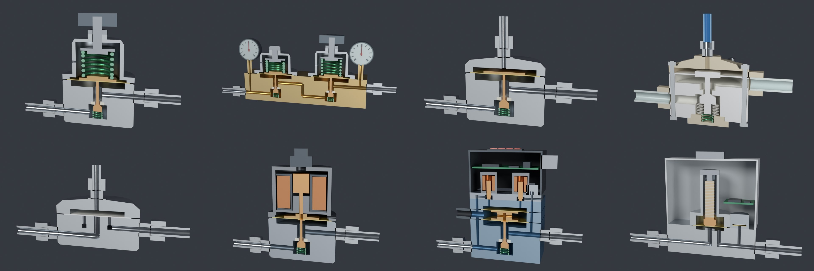

# 气体调压阀：从一根弹簧到一个闭环

半导体湿法设备里，氮气、压缩空气、药液，几乎每一路都要先"稳压"再用。干这件事的零件叫调压阀（pressure regulator，日文 レギュレータ / 減圧弁），不叫"整流器"（整流器是把交流电变直流电的电学器件）。

同仓库的 [液体调压阀](../液体调压阀/) 专讲药液 / 纯水那一侧；这一页讲气体那一侧，以及"电信号 → 气压 → 液压"这条设定链。

这里把八种结构用 Blender 脚本建成剖面模型，**每种单独一页**。每页的顺序都一样：先猜一道题 → 右侧手册一步一步拆（每步只回答一个小问题，镜头自动飞到对应零件、滑块自动调好）→ "弹簧到底动不动" → 动手实验 → 前提和失效条件 → 其他路线 → 证据和来源。入口页 `index.html` 放八张卡片、"怎么选"、现场排查表和全部来源。



| | 结构（单页） | 一句话 |
| --- | --- | --- |
| A | [直动弹簧式减压阀](pages/A-spring.html) | 手轮压弹簧、弹簧压膜片、膜片推阀芯，出口压力顶回膜片 |
| B | [两级减压阀](pages/B-twostg.html) | 第一级挡住钢瓶压力的大变化，第二级精调 |
| C | [圆顶加载减压阀](pages/C-dome.html) | 弹簧换成一腔气，下垂小，设定可以远程改 |
| D | [氟树脂气控液体调压阀](pages/D-ptfe.html) | 用控制气的压力设定药液 / 纯水的压力 |
| E | [背压阀](pages/E-bpr.html) | 管上游：超过圆顶压力就放走 |
| F | [开环电气比例阀](pages/F-epopen.html) | 比例电磁铁代替弹簧，没有压力传感器 |
| G | [闭环电气比例阀](pages/G-epclose.html) | 两只开关电磁阀充放先导腔，压力传感器反馈 |
| H | [数字式自动压力调节器](pages/H-piezo.html) | 压电阀 + 压力传感器 + PID，全金属 |

## 怎么打开

- **Windows**：双击 `启动演示.bat`。它先检查 `main` 分支有没有更新，有就 `git pull --ff-only`，然后用默认浏览器打开入口页 `index.html`。
- **其他系统**：直接打开 `index.html`，或者直接打开 `pages/` 里某一页。每页都是单文件，three.js、这一种阀的模型、仿真全在里面，不联网也能用。
- 旧链接 `index.html#epclose` 这类锚点会自动跳到对应的单页（`spring` `twostg` `dome` `ptfe` `bpr` `epopen` `epclose` `piezo`）。

## 调压弹簧会动吗

会。拧手轮时弹簧压缩量从 2.5 mm（50 kPa）变到 24.7 mm（600 kPa），这是毫米级的大动作；自动调节时弹簧只随膜片动 0.1–0.4 mm，只占预压缩的 1–3%，所以真实的阀上几乎看不出来，这也正是它能稳压的原因。模型里阀芯 / 膜片行程放大约 7.5 倍，手轮和弹簧预压缩按真实的 0.3 倍画。C、D、E、F、G、H 型没有调压弹簧（换成了圆顶气、控制气、电磁铁或压电叠堆），各页第 01 节解释了原因。

> 2026-11 之前的版本里，网页中的剖切零件（手轮、弹簧、膜片、阀芯）全都不会动，只有压力颜色在变。原因是剖切零件有两种材质，three.js 的 GLTFLoader 会把它拆成一个 Group 下挂两个 Mesh，零件信息只在 Group 上，旧代码只在 Mesh 上找，于是一个都没找到。已在 `web/src/stage.js` 修正，`web/test_teach.mjs` 和浏览器自检会检查。

## 文件夹里有什么

| 路径 | 内容 |
| --- | --- |
| `index.html` | 入口页：猜题、八张卡片、怎么选、现场排查、来源（不带三维，打开快） |
| `pages/A-spring.html` … `pages/H-piezo.html` | 八个单页，每页约 1 MB，只带自己那一台的模型 |
| `启动演示.bat` | Windows 一键启动，含 main 更新检查 |
| `重新生成模型.bat` | 用本机 Blender 重跑建模脚本，再重新打包全部页面；加 `--render` 参数同时出预览图 |
| `blender/build_regulators.py` | 纯脚本建模：每个零件先做成完整实体，布尔打孔，再统一切掉前半，剖面换浅色材质 |
| `blender/out/` | `regulators.blend`（八台排开）、`regulators.glb`（网页用，打包时按台拆开）、`spec.json`（动件、气流路径、标注点）、渲染图 |
| `web/src/core.js` | 物理核心：膜片力平衡、可压缩气体过孔流量、容积充放、三种电子控制器、背压阀稳态 |
| `web/src/teach.js` | 每页的教学文案：猜题、分步（每步的滑块改动和镜头零件）、弹簧动不动、失效条件、其他路线、来源 |
| `web/src/data.js` | 每种阀的零件标注、控制项、压力区 |
| `web/src/stage.js` | three.js 舞台：动件、压力着色、气流点、标注 |
| `web/src/bench.js` / `guide.js` | 检修台（单台仿真 + 控制条）/ 右侧手册（猜题 → 分步） |
| `web/src/labs.js` / `labs_html.js` | 各页的动手实验（画图 + HTML） |
| `web/src/type.js` / `home.js` | 单页入口 / 入口页脚本 |
| `web/test_core.mjs` | 物理核心的校验（下垂、进口压力效应、两级 vs 单级、开环 vs 闭环） |
| `web/test_teach.mjs` | 文案和模型对得上：步骤里的零件 / 控制项存在，文案里引用的数字和仿真一致 |

## 重新构建

```bash
# 1. 建模（二选一）
blender -b -P blender/build_regulators.py -- --out blender/out [--render]
pip install bpy && python blender/build_regulators.py --out blender/out [--render]

# 2. 打包页面
cd web
npm install
node test_core.mjs    # 校验物理核心
node test_teach.mjs   # 校验教学文案和数字
node build.mjs        # 更新上一级的 index.html 和 pages/*.html
```

## 结论和它的边界

- 所有自力式调压阀本来就是闭环：膜片既感受出口压力，又和设定力比较。说"开环 / 闭环"时，指的是电信号到压力这一层有没有电子压力传感器。
- 弹簧式的两个固有误差：流量越大出口越低（下垂），进口压力降低出口反而升高（进口压力效应）。默认参数下，0 到 300 NL/min 掉约 15 kPa；钢瓶从 15 MPa 用到 1.5 MPa，单级出口漂约 76 kPa，两级只漂约 0.4 kPa。
- 圆顶加载把弹簧换成一腔气，同样条件下的下垂约为弹簧式的一半。药液调压阀的药液出口大约等于控制气压力，但不会高过供液压力。
- 闭环电气比例阀把流量和进口压力的影响补掉，代价是精度上限变成传感器的精度：传感器零点漂 10 kPa，它会准确地把出口守在错的值上。
- 只有一只进气阀的数字式调压阀不能往外放气，出口堵死时把设定调低，压力不会降。
- 所有尺寸和仿真参数都是教学用的合理量级，只看趋势。结构参考公开专利（入口页和各页最后一节列出），外形不对应任何具体产品。
- "Auto pressure regulator"不是严格的标准术语，入口页第 03 节给了三种最常见的可能和现场分辨方法，确切型号要看设备零件表。
