# 汽车模拟器

一辆虚构的老式三厢车，直线造型，准备装上燃油发动机 + CVT，最后做成一个能开的汽车模拟器。不对应任何一款真车。

**现在做到第 3 步：发动机、CVT、半轴、进排气、水箱、油箱都建好装进车里了，但还不会动。** 仿真和网页是后面两步。方案和进度见 [`规划.md`](规划.md)。

| 外观 | 后面 |
|---|---|
| 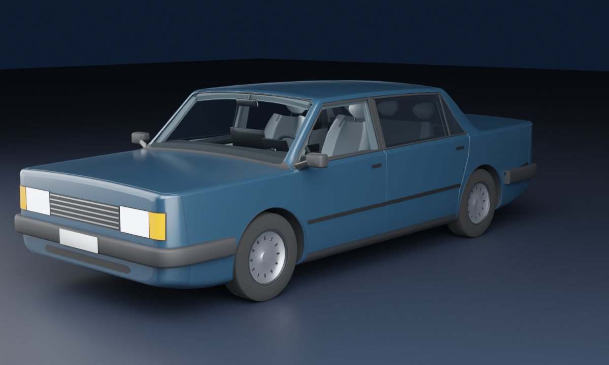 | 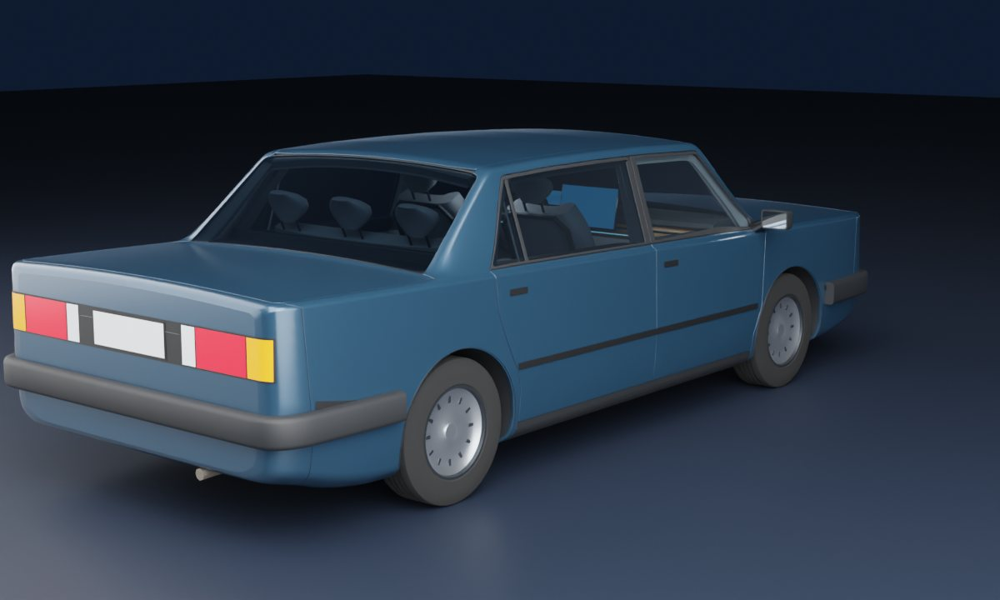 |

| 侧面 | 正面 |
|---|---|
| 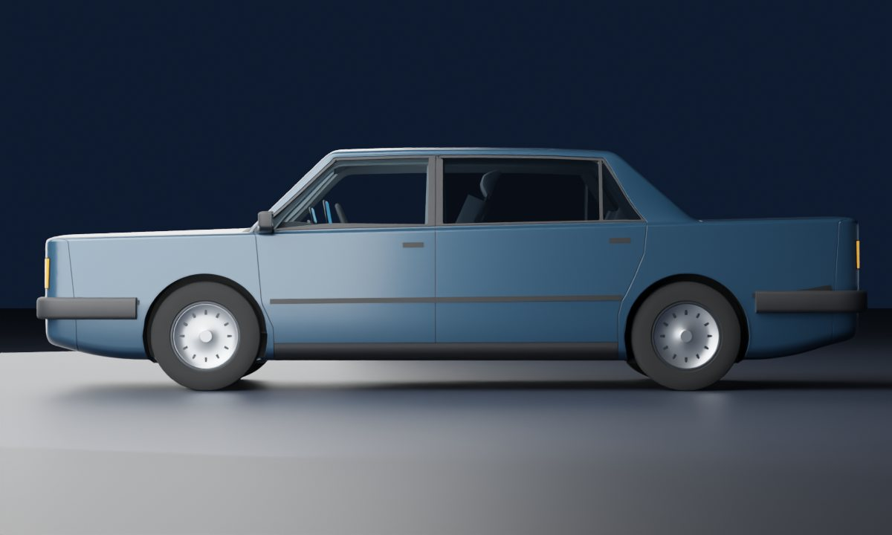 | 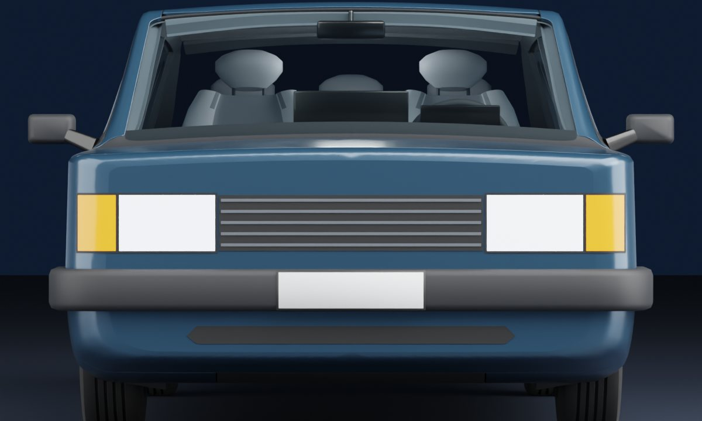 |

| 正后面 | 内饰 |
|---|---|
| 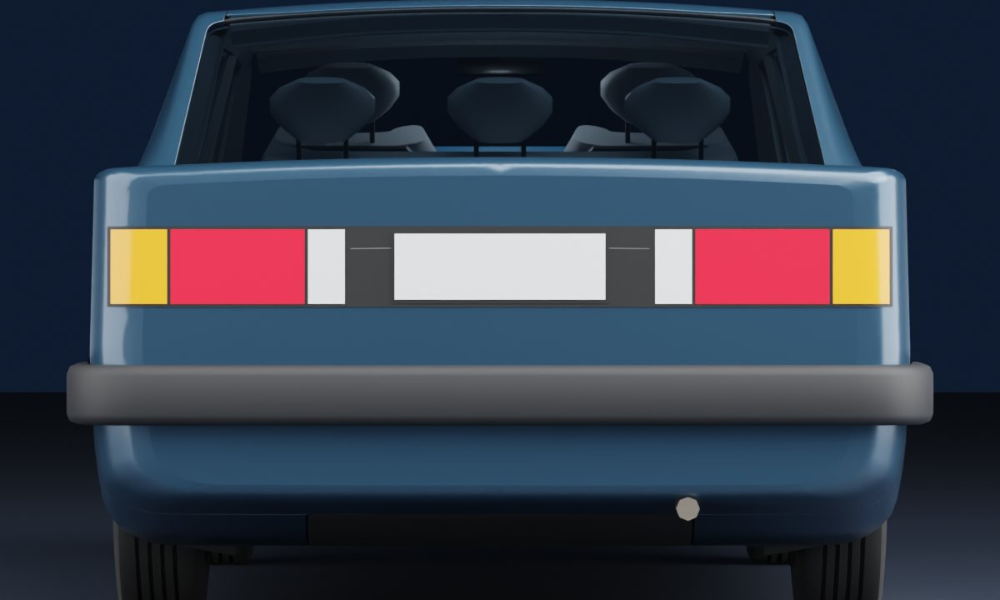 | 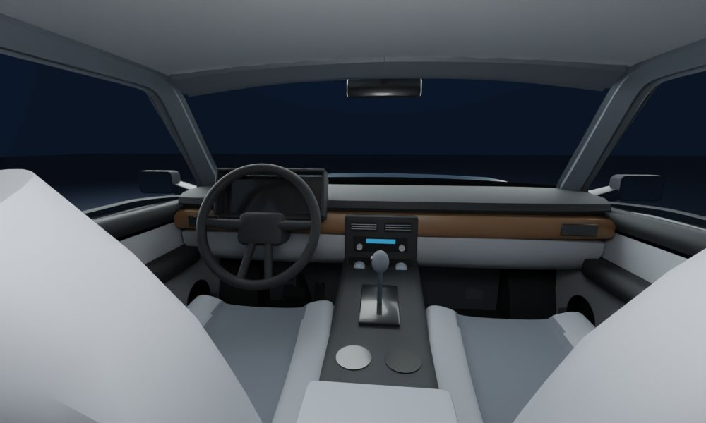 |

| 座舱（拿掉车顶和车门） | 外形的二维预览 |
|---|---|
| 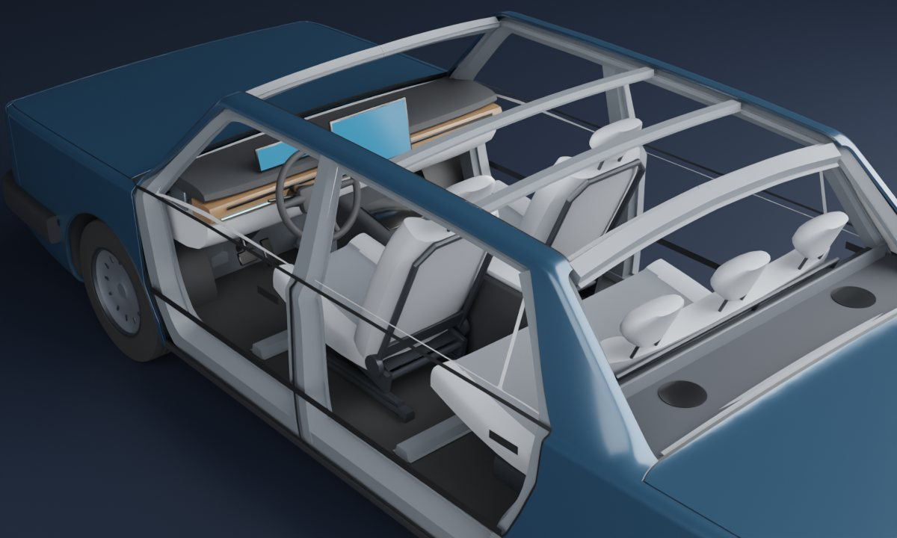 | 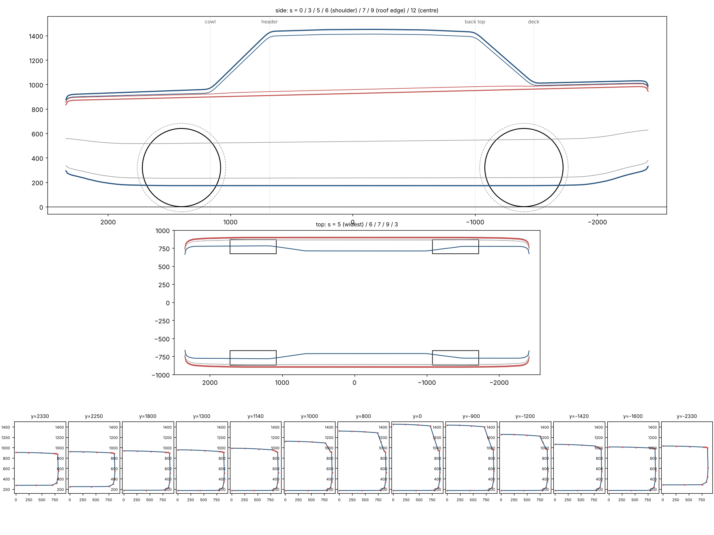 |

| 前舱（拿掉前盖） | 发动机 + CVT |
|---|---|
| 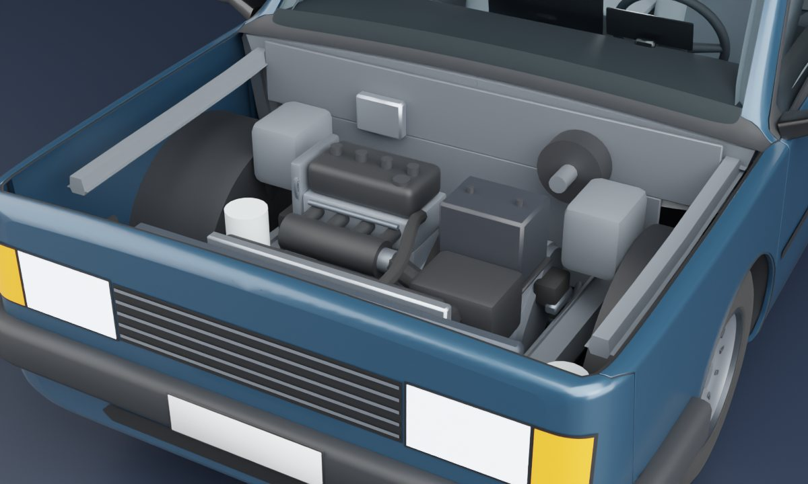 | 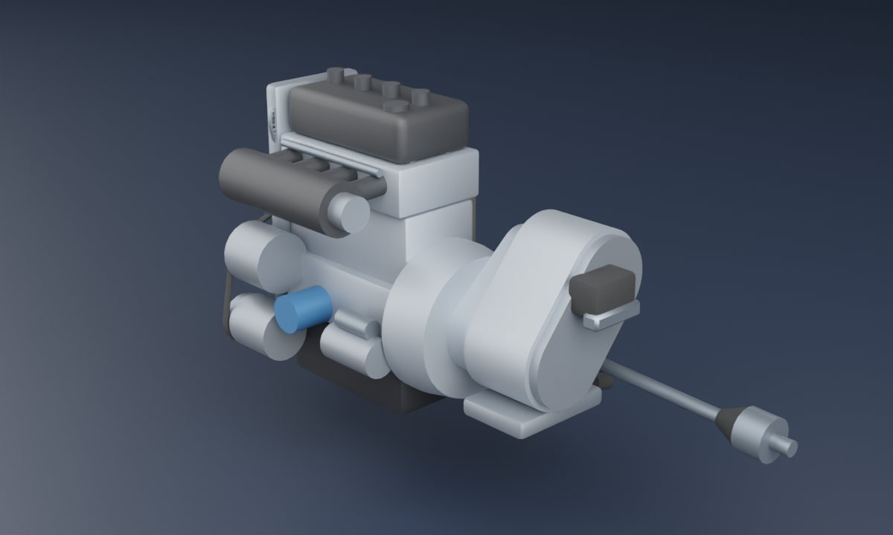 |

| 拿掉壳体，里面会动的件 | 拿掉车身看底盘 |
|---|---|
| 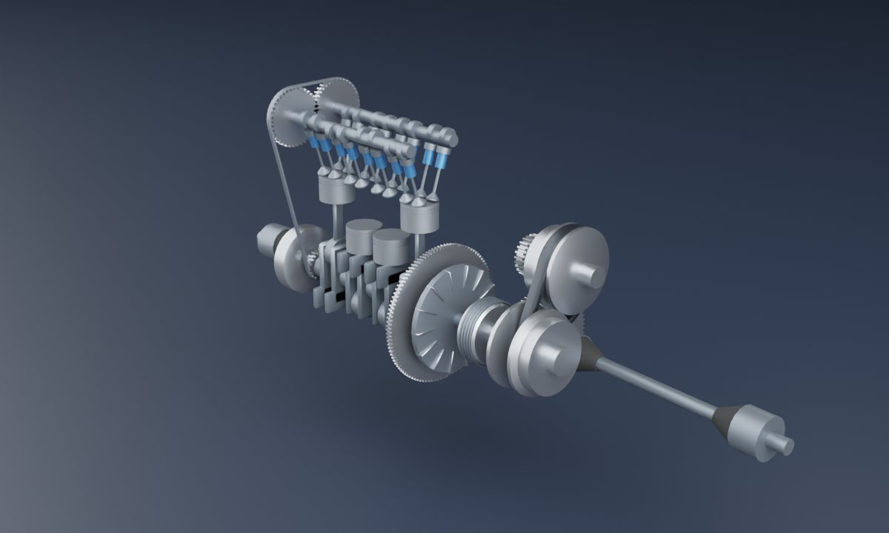 | 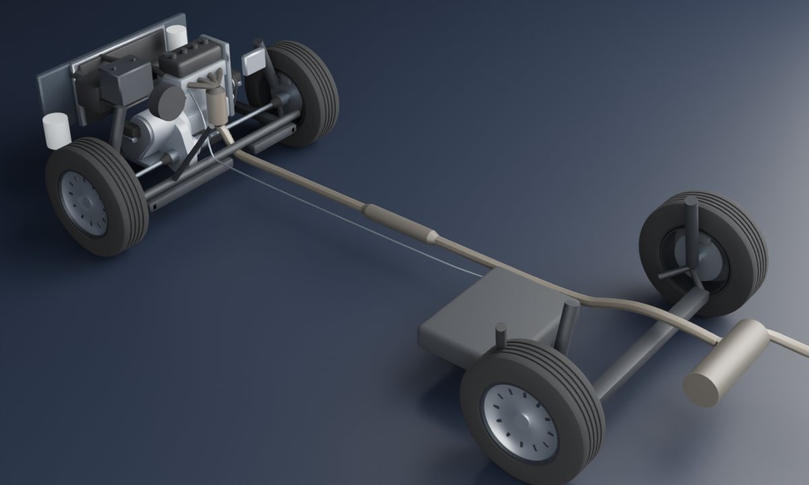 |

前舱布置图（位置和间隙）：

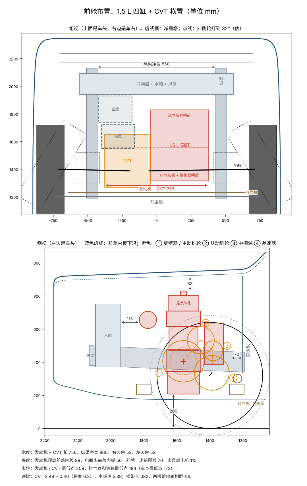

## 怎么打开

- **Windows**：双击 `启动.bat`。它先 `git pull --ff-only origin main` 检查更新（没网或没装 git 就跳过），然后让你选：**[1]** 打开渲染图和布置图 / **[2]** 用 Blender 重新生成模型并打开 `car.blend`（按空格看爆炸动画）/ **[3]** 退出。
- 找不到 Blender 时，把 `blender.exe` 的完整路径写进同目录的 `blender_path.txt`。在 Blender 5.3（`pip install bpy`）上跑过。
- 网页还没做，第 5 步才有。现在能看的是渲染图，和 Blender 里的模型。

## 现在有什么

| 有 | 没有 |
|---|---|
| 白车身骨架、车板（实测缝宽）、玻璃、灯、格栅、保险杠、防擦条、后视镜 | 行驶仿真（油门 → 转速 → 速比 → 车速） |
| 15 吋钢圈 + 全盖轮罩、刹车盘 | 网页 |
| 座椅、仪表台、方向盘、中控、门板、顶棚 | 能转向的前轮 |
| 副车架、悬架摆臂、减震、转向机（占位件） | 换挡杆、踏板和动力系统的连接 |
| 1.5L 四缸发动机：曲轴、活塞、连杆、凸轮轴、气门、正时链，外面是机体、进排气歧管、附件 | |
| CVT：变矩器、前进 / 倒挡行星排、两个锥轮和钢带、两级减速、差速器，外面是壳体 | |
| 半轴、排气管和两个消声器、油箱、水箱和风扇、空滤、电瓶 | |

模型 105 个零件、约 28 万个三角形（动力系统占约 4.6 万）。车板之间的 20 条缝在三维里实测：5% ~ 95% 分位在 2.9 ~ 5.1 mm，最窄 2.7，最宽 8.0（三块板交汇的角上）。逐条数字在 `blender/out/spec.json` 的 `gaps` 里。

## 外形

| 项目 | 数值 | 依据 |
|---|---|---|
| 长 × 宽 × 高 | 4760 × 1800 × 1451 | 长、高沿用原来那辆车的硬点；宽从 1864 收到 1800 |
| 轴距、前悬、后悬 | 2800、945、1015 | 沿用（地板、座椅、轮罩的位置都没动） |
| 比例参考 | 桑塔纳 4546 × 1690 × 1427，轴距 2548 | [搜狐汽车车型库](https://db.auto.sohu.com/model_1084)。只用来对比例，没有照着画 |
| 前挡约 44°、后挡约 41°（和水平面的夹角） | — | 我按老式三厢车的样子取的，没有量具体的车 |
| 肩线前低后高约 1.4°，车头 890 → 车尾 1005 | — | 同上 |
| 车轮 195/65 R15 一类，外径 640 | — | 这个年代中型车的常见规格，我的估计 |

外形全部在 `blender/shape.py`：五条沿车长的线（顶线、肩线、底线、最宽线、车顶边线）加一个横截面配方。改完先跑 `python blender/preview2d.py` 看二维图（几秒钟），对了再跑三维。

## 这次的建法

原来那辆流线型的车，截面是一条穿过 13 个控制点的光滑曲线，所以哪里都是圆的，两种截面过渡的地方容易起包。这次换成 **直线 + 圆角**：

| 做法 | 说明 |
|---|---|
| 截面 | 控制点之间走直线，每个控制点给一个圆角大小（`carkit.fillet_section`）。板面是平的，棱线是清楚的 |
| 棱线 | 肩线、车顶边、防擦条、门槛这几道棱各出三条线（圆角的起点、中点、终点），三角化时当成约束边（`Skin.crease_lines`）。网格的边顺着棱走，棱线不会成锯齿 |
| 圆角大小 | 全车不变。试过让圆角跟着截面类型变大变小，A 柱根的面是扭的，车漆反光起皱 |
| 车头车尾 | 立着的一整块平板，只在最后一百多毫米把四个角倒圆。灯、格栅、车牌画在这块板上 |
| A 柱、C 柱 | 就是车顶边那道棱一路斜下来，落到前盖 / 尾箱盖的边上。前后挡玻璃的侧边是一条 s = 常数的线，三维里自然是直的 |
| 前门前上角 | 车门上缘顺着 A 柱延长，要到前挡下沿前面才碰到腰线。在 A 柱根竖着切一刀，后视镜装在切出来的角上 |

`blender/carkit.py` 是 `汽车建模套件/carkit.py` 1.2 版的副本，上面两个函数是这次加的，已回写母版。

## 动力系统

尺寸全部在 [`params.json`](params.json) 一份表里，Blender 建模、布置图、以后网页里的仿真都读它。发动机和 CVT 是虚构的，数值是我按这个级别常见的范围取的，不对应任何一款产品。

| 项目 | 数值 |
|---|---|
| 发动机 | 直列四缸，缸径 74 × 行程 87，排量 1497 mL，缸心距 82，双顶置凸轮轴 16 气门 |
| 摆放 | 横放，正时端朝车右、CVT 在车左；进气朝前、排气和催化器朝后；曲轴在前轴前面 160、离地 405 |
| CVT 速比 | 2.48 ~ 0.40（跨度 6.2）：锥轮工作半径 31 ~ 77，两轴相距 165，钢带长 682 |
| 减速 | 两级齿轮 25 → 40、19 → 70，总减速比 5.89 |
| 顺序 | 曲轴 → 变矩器 → 前进 / 倒挡行星排 → 主动锥轮 → 钢带 → 从动锥轮 → 中间轴 → 差速器 → 半轴 → 前轮 |

会动的件每个是单独一个物体，原点在自己的转轴上，`extras` 里写着它跟哪根轴转（`shaft` = crank / cam / turbine / primary / secondary / inter / diff / fan）和怎么动（`kind` = rot / piston / rod / valve / sheave / belt）。钢带现在是按起步速比建的一份，形状跟着速比变，网页里要重新生成。

## 装进车里以后量出来的间隙

`build_car.py` 建完模型从网格顶点量的，写在 `blender/out/spec.json` 的 `powertrain.fit` 里；布置图上的数字读的就是它。

| 方向 | 结果 |
|---|---|
| 宽度 | 发动机 + CVT 长 756，纵梁净宽 860，左右各余 52 |
| 高度 | 发动机顶离前盖内板 88；前舱里最高的是电瓶接线柱，离前盖内板 50（前盖厚 25 是估的） |
| 前后 | 离前围板 70，离风扇电机 115 |
| 离地 | 发动机 / CVT 最低点 209；排气管和油箱最低点 184（车身最低点 172） |

零件之间有没有互相穿插，脚本没有自动查。我按坐标手算过这几处：右半轴和催化器、前排气管；转向机和差速器、后抗扭拉杆；空调压缩机和油底壳；下水管和曲轴皮带轮；上水管和空滤。其余的没有逐对查。

为了给差速器让位，转向机和副车架后横梁往后挪了约 100 mm，后横梁中间留了一个口子走排气管。

## 改东西

| 想改 | 改哪里 |
|---|---|
| 外形（五条线、截面、圆角大小、前后挡的位置） | `blender/shape.py` |
| 缝线、窗洞、灯、格栅、保险杠 | `blender/build_car.py` 开头的 `L_…` 和 `build_panels` |
| 车框 | `build_frame`；前舱的硬点（纵梁、前围板、减震塔）在 `shape.py` |
| 车轮 | `build_wheels` |
| 内饰、座椅 | `build_cabin` |
| 发动机、CVT 的尺寸和摆放 | `params.json` |
| 动力系统的零件（发动机、CVT、半轴、进排气、水箱、油箱） | `blender/powertrain.py` |
| 副车架、转向机 | `build_car.py` 的 `build_chassis` |

```
python blender/preview2d.py                     # 外形二维图 → blender/out/shape2d.png
python blender/layout2d.py                      # 前舱布置图 → blender/out/layout_frontbay.png
python blender/build_car.py --out blender/out --render
python blender/build_car.py --out blender/out --render --views bay,powertrain,internals,chassis    # 只渲这几张
python blender/build_car.py --out 某个临时文件夹 --noexport --skip frame,cabin,chassis --check q34f,side --res 900 --samples 12
```

最后一条是调外形时用的：只建外壳、渲两张检查图，约 50 秒。检查机位在 `CHECK_VIEWS`；临时机位写成 `cam:名字:x/y/z:目标x/y/z:焦距`（单位米）。

坐标约定：毫米，+X 车右，+Y 车头，+Z 朝上，原点在前后轴中点的地面。
