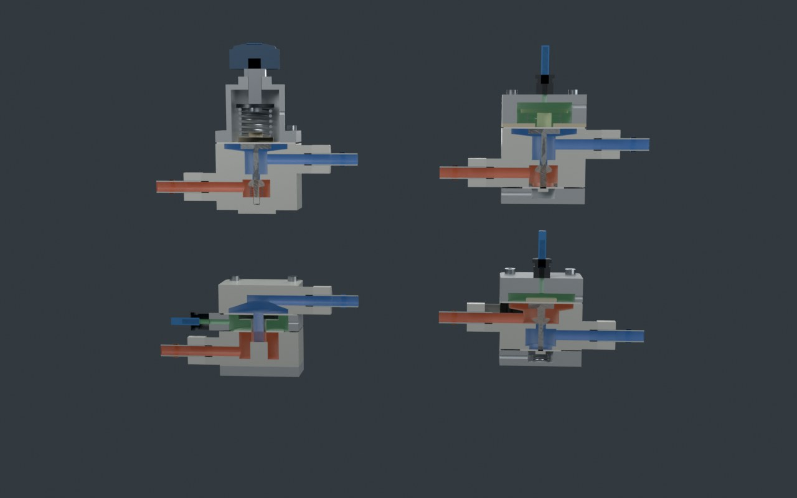
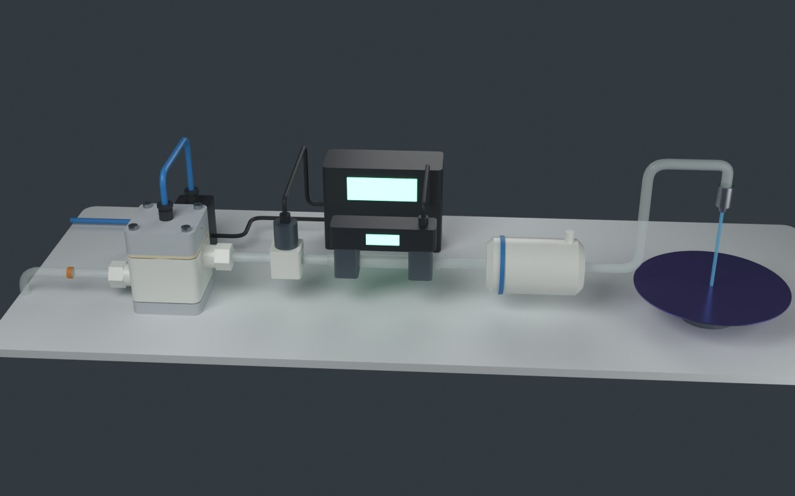

# 液体调压阀

半导体湿法设备里药液、纯水用的调压阀（レギュレータ）怎么把压力稳住。用 Blender 脚本建了四种调压阀的剖切模型和一条闭环供液线，结构参照公开专利；网页里可以拧旋钮、改供压、开关喷嘴，看阀芯怎么动，再用三个实验讲下垂、入口压力效应、开环和闭环、背压阀。

> 名字：不叫整流器。整流器是电学里把交流变直流的器件。液体用的这个叫调压阀、减压阀或稳压阀，守上游压力的叫背压阀。





## 怎么打开

- **Windows**：双击 `启动演示.bat`。它先检查 `main` 分支有没有更新，有就 `git pull --ff-only`，然后用默认浏览器打开 `index.html`。
- **其他系统**：直接打开 `index.html`。单文件页面，模型和数据都在里面，离线也能看（没网时只是字体回退到系统字体）。

## 页面里有什么

| 部分 | 内容 |
| --- | --- |
| 三维检修台 | 五个模型：手动弹簧式、气控式（带平衡膜片）、固定阀芯双膜片式、气控背压阀、闭环供液线。可切换剖开/外观，液体按压力着色，粒子在阀口加速。右侧旋钮直接驱动物理模型 |
| 实验一 | 力的账本（阀杆受力条形图）+ 流量特性（下垂）+ 压力特性（入口压力效应），对比弹簧/气压加载、有无平衡膜片 |
| 实验二 | 同一条供液线 20 秒：配方改流量、供压下降、过滤器变堵。手动式、开环气控、压力闭环、流量闭环四条线一起跑，可调反馈增益、开关噪声和抗积分饱和 |
| 实验三 | 循环主管：用液台数变化时，背压阀和固定节流阀谁守得住主管压力，以及背压阀什么时候失效 |
| 专利 | 七件公开专利，各自的结构要点和想解决的问题 |

## 文件夹里有什么

| 路径 | 内容 |
| --- | --- |
| `index.html` | 打包好的演示页面 |
| `启动演示.bat` | Windows 一键启动，含 main 更新检查 |
| `重新生成模型.bat` | 用本机 Blender 重跑建模脚本，加 `--render` 参数同时出预览图 |
| `blender/build_regulators.py` | 纯脚本建模：回转体 + 布尔运算，每个零件出完整版和剖切版，膜片带形状键 `open` |
| `blender/out/` | `regulators.blend`、`regulators.glb`、`spec.json`（标注点、粒子路径、机位）、预览图 |
| `web/src/reg_core.js` | 物理核心：力平衡、阀口流量、稳态解、特性曲线、背压阀、循环回路、开/闭环时域仿真 |
| `web/src/stage.js` | three.js 舞台：模型切换、阀芯动作、液体着色、粒子、信号光点、标注 |
| `web/src/labs.js` | 三个实验的界面 |
| `web/src/data.js` | 文字：模型介绍、零件说明、专利 |
| `web/test_core.mjs` | 物理核心的校验（下垂方向、平衡膜片效果、饱和、背压阀失效、四种控制方式的结果、增益过高会振荡） |

## 重新构建

```bash
# 1. 建模（二选一）
blender -b -P blender/build_regulators.py -- --out blender/out [--render]
pip install bpy && python blender/build_regulators.py --out blender/out [--render]

# 2. 打包页面
cd web
npm install
node test_core.mjs    # 校验物理核心
node build.mjs        # 更新上一级的 index.html
```

## 参照的专利

| 模型 | 专利 | 借用的结构 |
| --- | --- | --- |
| 手动弹簧式 | Surpass US 8,573,247 B2 | 针形阀芯在入口侧、下面弹簧推它关、上面膜片 + 主弹簧 + 旋钮 |
| 气控式 | 旭有机材 US 7,108,241 B2 | 阀芯在阀座下方、下挂平衡膜片抵消入口压力；闭阀弹簧在气室里不接液 |
| 固定阀芯式 | 旭有机材 US 6,959,725 B2 | 阀芯与阀体一体固定，一体双膜片 + 中心孔套筒，两膜片间是气室，无弹簧 |
| 背压阀 | Advance 电气工业 US 6,386,509 B1 | 锥形阀芯在阀座上游，上游压力顶开；第二膜片面积等于阀座面积，抵消出口压力 |
| 闭环供液线 | 旭有机材 US 7,650,903 B2、CKD US 2010/0090137 A1 | 流量计 → 控制器 → 电气比例阀 → 气控阀 |

另外引用了 Advance US 12,173,809 B2（接触面改用交联 PTFE、减少颗粒的定压阀）作文字介绍。外形、尺寸、颜色都是原创示意，不对应任何真实产品。

## 结论和它的边界

- 调压阀靠出口压力的偏差工作，所以有下垂。默认参数下弹簧式从 0.5 到 5 L/min 下垂约 9 kPa，气控式不到 1 kPa。
- 平衡膜片抵消入口压力的推力：气控式在供压 0.3→0.5 MPa 时，不平衡阀芯出口变化约 −2.7 kPa，带平衡膜片约 +0.2 kPa。
- 压力稳不等于流量稳。过滤器变堵时，开环和压力闭环的喷嘴流量都掉约 15%，只有流量闭环补得回来；但它要的压力超过供压能给的时也会饱和。
- 背压阀只能少放回流，不能多给流量。用液超过泵的余量时它关死，主管压力照样掉。
- 以上数字都来自本页的集总参数模型：主膜片 Ø50、阀座 Ø6、弹簧 55 N/mm 等是按常见 3/8 英寸药液调压阀的量级取的示意值，专利里没有这些数。没算流体力、惯性、液体压缩性和水锤。
- 固定阀芯式的入口压力效应（本页算出约 +8%，方向和弹簧式相反）是按力的方向推出来的，专利没有给数值。

来源列在页面最后一节。
