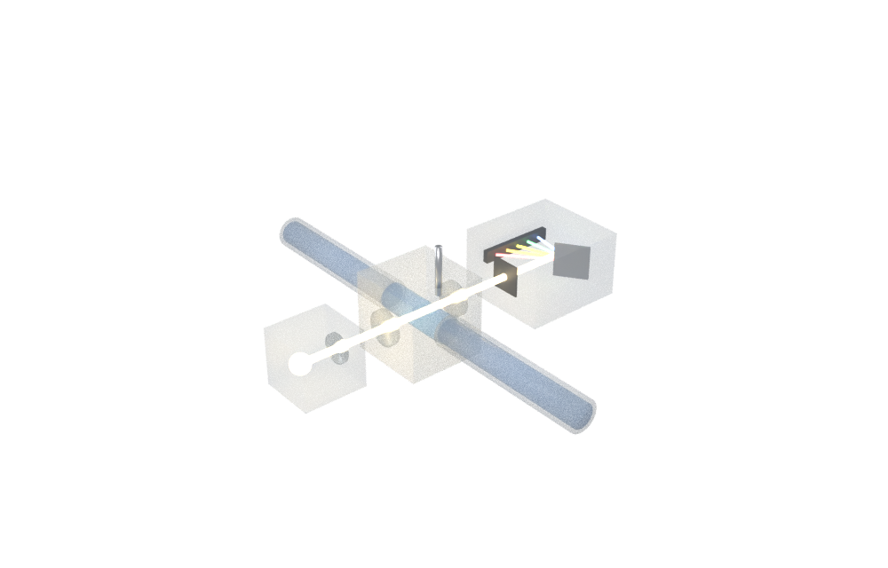
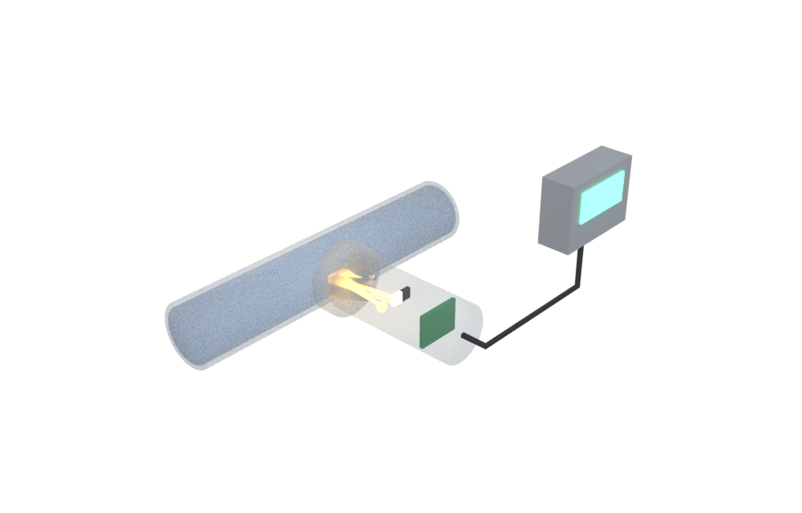
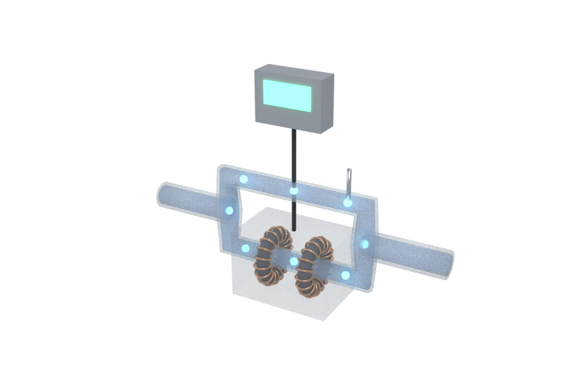
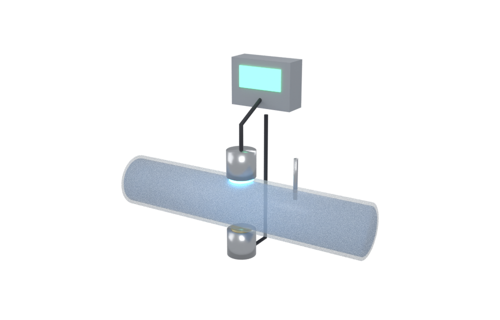
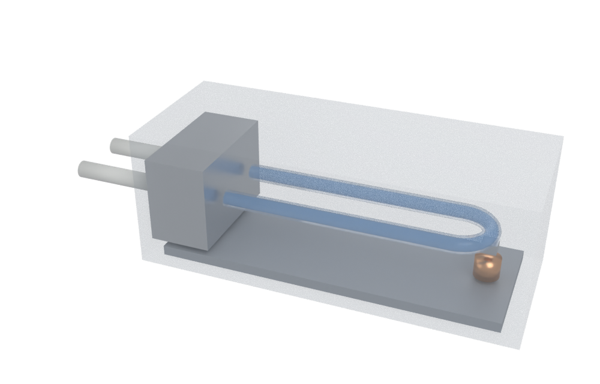
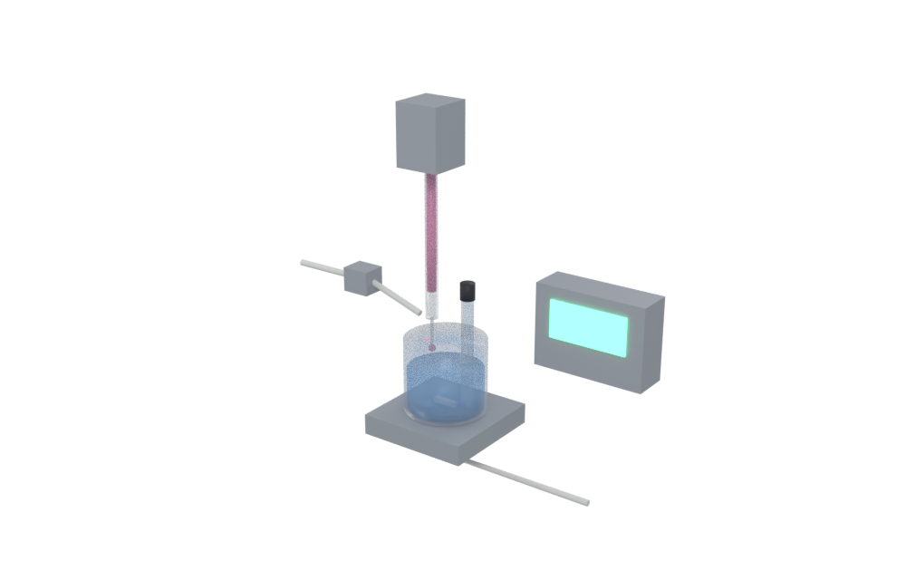
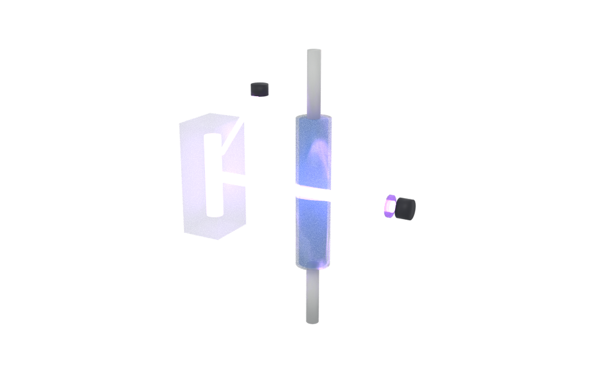
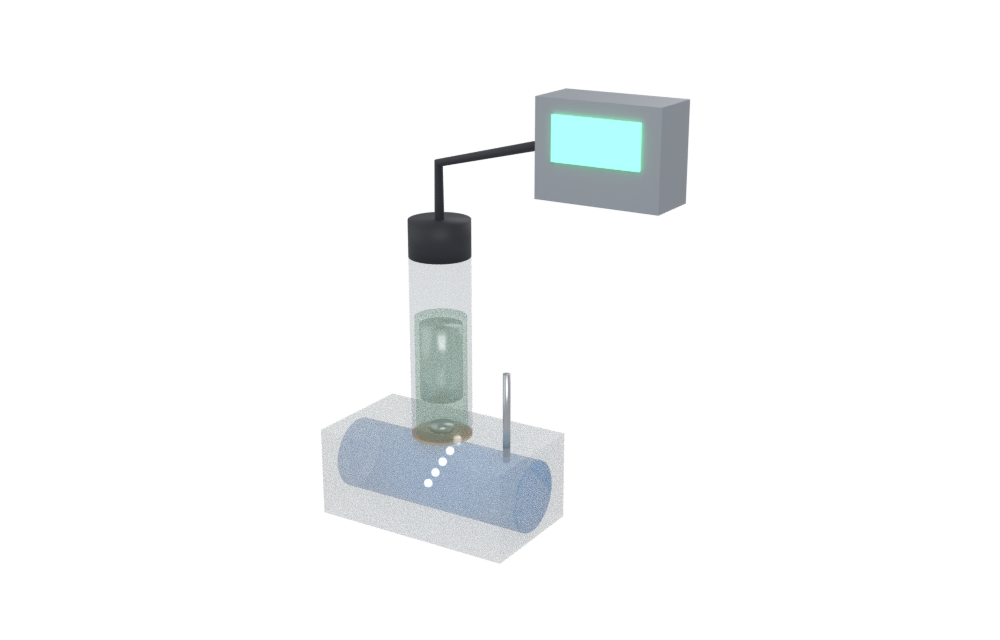
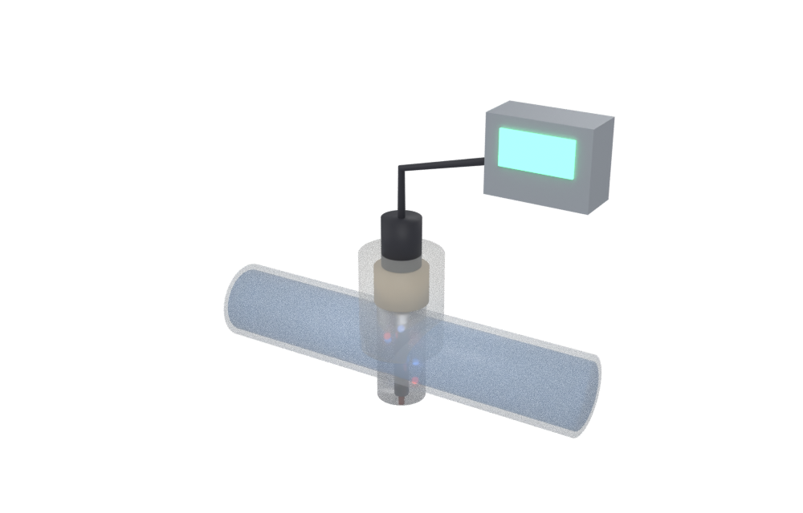

# 湿法浓度计原理

面向一般读者的教学页：半导体湿法设备（清洗、刻蚀）里，**浓度计到底怎么“看出”药液有多浓**。九种测法每种都有 Blender 脚本建模的 3D 模型（可旋转、悬停看零件名）、一个能拖滑块的小实验，以及公开专利里是怎么做的。



| ① 吸光光度式 | ② 折射率式 | ③ 电磁感应电导率 |
| --- | --- | --- |
|  |  |  |
| **④ 超声波声速式** | **⑤ 振动管密度** | **⑥ 自动滴定** |
|  |  |  |
| **⑦ 紫外臭氧计** | **⑧ 隔膜电极（溶存 H₂/O₂）** | **⑨ 电极式比电阻** |
|  |  |  |

## 怎么打开

- **Windows 双击 `启动演示.bat`**：先检查 `main` 有没有更新（有就 `git pull --ff-only`），然后用默认浏览器打开 `index.html`。
- **离线版 = `index.html`**：单文件，模型、图片、three.js 全部内嵌（约 3 MB），双击就能看，不需要联网、不需要服务器。可以直接拷到 U 盘或发给别人。
- **源码版 = `site/`**：分文件，方便改。浏览器不允许从 `file://` 读 3D 模型，所以用 `启动源码版.bat`（会起一个 `python -m http.server`，关窗口即停）。直接双击 `site/index.html` 也能看实验和图片，只是 3D 不加载。

## 文件夹里有什么

| 路径 | 内容 |
| --- | --- |
| `index.html` | 单文件离线版（由 `build_offline.py` 生成，别手改） |
| `启动演示.bat` | Windows 一键启动，含 main 更新检查 |
| `启动源码版.bat` | 起本地服务器打开 `site/`（改代码时用） |
| `重新生成模型.bat` | 用本机 Blender 重跑建模 + 渲染，再重新打包 `index.html`。加 `--no-render` 跳过渲染图；可只写模型名，如 `重新生成模型.bat absorb ozone` |
| `blender/build_models.py` | 纯脚本建模，9 个模型。每个零件带 `label`/`desc` 自定义属性 → 导出到 glTF extras → 网页悬停显示 |
| `build_offline.py` | 把 `site/` 打包成单文件 `index.html`（有 Pillow 时图片转 WebP） |
| `site/index.html` `style.css` | 页面正文 |
| `site/exp.js` | 九个原理小实验（纯 Canvas） |
| `site/patents.js` | 公开专利数据（号码、申请人、要点） |
| `site/viewer.js` | three.js 查看器（悬停提示、零件聚焦、播放 Blender 动画） |
| `site/models/*.glb` `site/img/*.png` | Blender 导出的模型和渲染图 |
| `site/lib/` | three.js r170（MIT），`viewer.bundle.js` 是给离线版用的打包结果 |

## 重新构建

```bash
# 1. 建模（二选一；Blender 4.2 以上）
blender -b --factory-startup -P blender/build_models.py -- [模型名...] [--no-render]
pip install bpy && python blender/build_models.py [模型名...] [--no-render]

# 2. 打包单文件离线版
python build_offline.py

# 3. 只有改了 site/viewer.js 才需要：重新打包 3D 查看器
npx esbuild entry.js --bundle --format=iife --minify --alias:three=./site/lib/three.module.min.js --outfile=site/lib/viewer.bundle.js
#   entry.js 内容：import { open3D } from './site/viewer.js'; window.open3D = open3D;
```

## 内容上的边界

- 页面里每条说法都标了证据等级：**公认**（教科书/物理定律）、**资料**（专利、厂商技术资料）、**示意**（为讲清楚而简化的图和数，或推测）。
- 实验里标了“示意”的曲线只表现趋势和形状，不是真实药液的数据。真实数据只用了少数几处：硫酸约 30 wt% 电导率最大、水中臭氧摩尔吸光系数约 3000 M⁻¹cm⁻¹、纯水 18.2 MΩ·cm、纯水声速的温度多项式、硫酸密度近似表。
- 23 件专利在 Google Patents 上核对过号码、标题和申请人；2 件有部分内容没能读到原文，卡片上标了“部分未核实”。要点是用自己的话概括的，以原文为准。
- 模型都是原理示意，尺寸和外形不对应任何厂商的具体产品。
