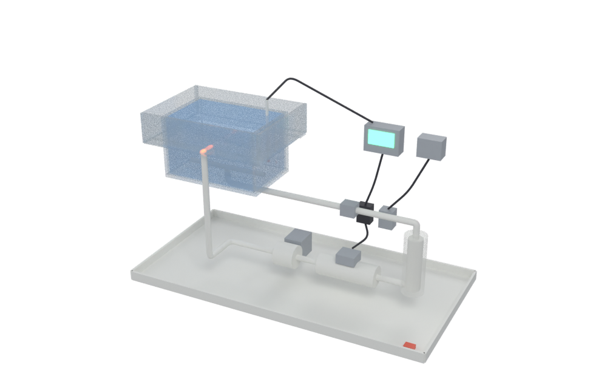
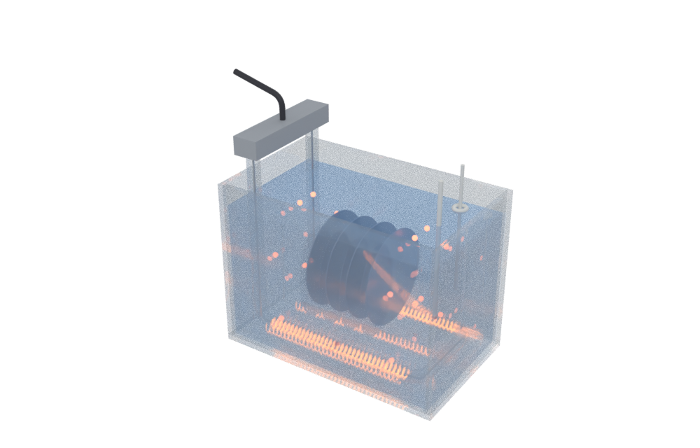
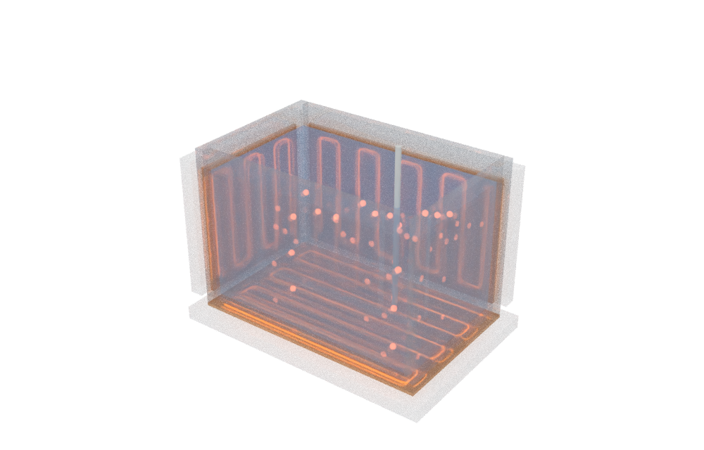
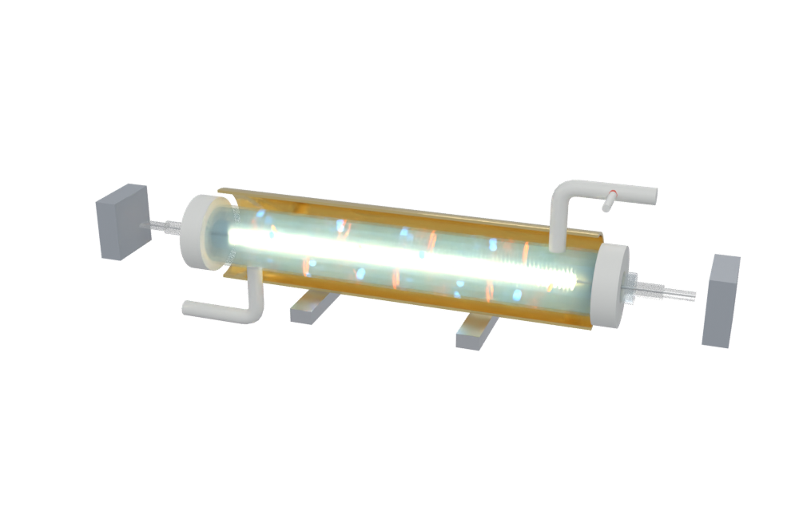
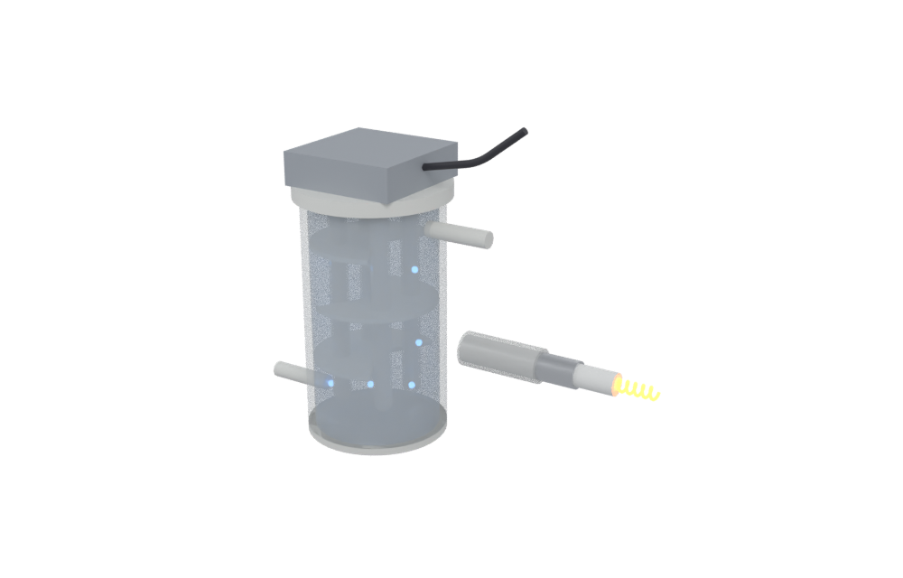
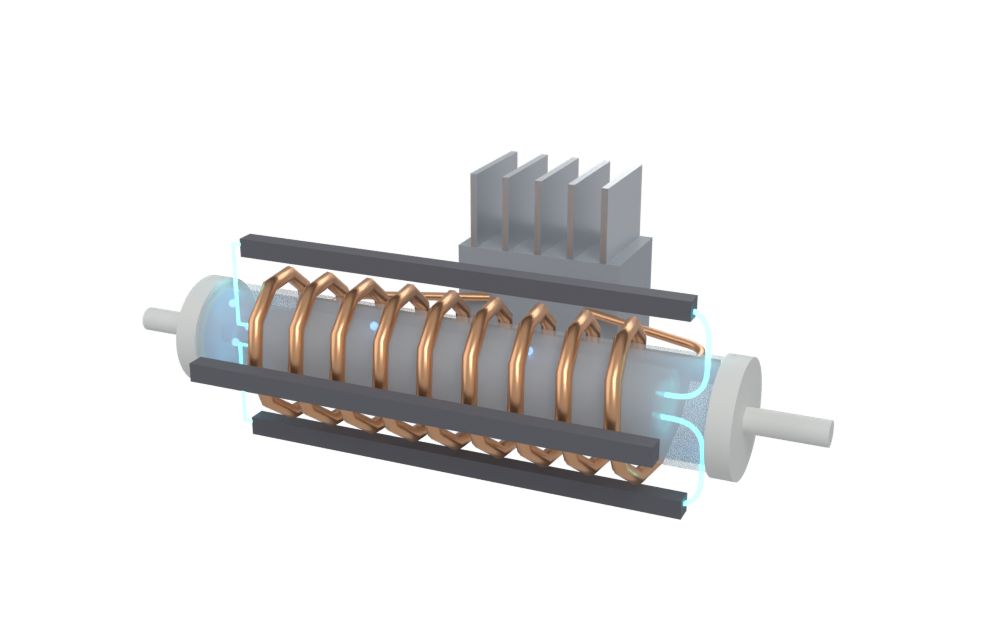
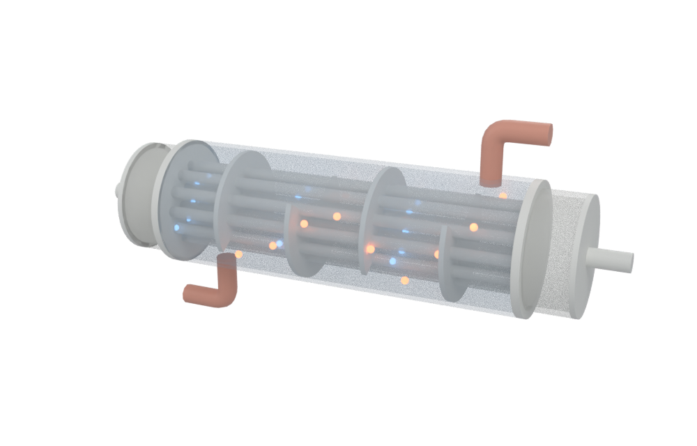
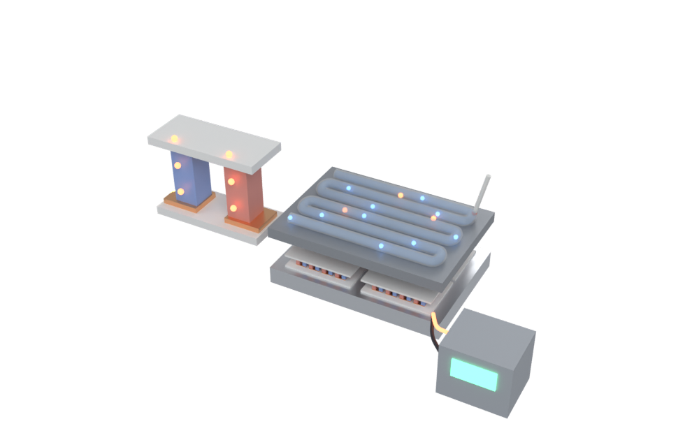

# 湿法温调器原理

面向一般读者的教学页：半导体湿法设备（清洗、刻蚀）里，**药液是怎么被加热、又怎么稳稳保持在设定温度的**。七种加热方式每种都有 Blender 脚本建模的 3D 模型（可旋转、悬停看零件名）、一个能拖滑块的小实验，以及公开专利里是怎么做的；后半部分讲「温調器」本身：PID 控温、SSR 怎么调功率、安全互锁。



| ① 槽内浸入式 | ② 槽外贴壁式 | ③ 红外灯管式 |
| --- | --- | --- |
|  |  |  |
| **④ 氟树脂包覆电阻式** | **⑤ 感应加热式** | **⑥ 换热器式** |
|  |  |  |
| **⑦ 珀耳帖式（電子冷熱）** | | |
|  | | |

## 怎么打开

- **Windows 双击 `启动演示.bat`**：先检查 `main` 有没有更新（有就 `git pull --ff-only`），然后用默认浏览器打开 `index.html`。
- **离线版 = `index.html`**：单文件，模型、图片、three.js 全部内嵌（约 5 MB），双击就能看，不需要联网、不需要服务器。可以直接拷到 U 盘或发给别人。
- **源码版 = `site/`**：分文件，方便改。浏览器不允许从 `file://` 读 3D 模型，所以用 `启动源码版.bat`（会起一个 `python -m http.server`，关窗口即停）。直接双击 `site/index.html` 也能看实验和图片，只是 3D 不加载。

## 页面里有什么

| 部分 | 内容 | 小实验 |
| --- | --- | --- |
| 为什么要控温 | 阿伦尼乌斯：差 1 °C 反应速率差多少 | 拖活化能、温度、波动 |
| 「温調器」是什么 | 温度调节器 vs 温调单元；反馈回路图；中日英术语对照 | — |
| 加热器装在哪 | 整体模型（槽、泵、加热器、过滤器、控制器、接液盘）；SPM 混合放热 | — |
| ① 浸入式 | 石英 / 氟树脂护套，冷端设计，空烧 | 功率密度 → 表面温度、局部沸腾、空烧 |
| ② 贴壁式 | 面状加热器 + 保温，热穿过石英壁 | 壁厚、功率、药液量 → 升温曲线和过冲 |
| ③ 红外灯 | 卤素灯 → 石英 → 水吸收 | 灯丝温度、水层厚度、反射罩 → 吸收比例 |
| ④ 氟树脂包覆 | 护套加热棒 + PFA 外衣 | 一层一层的温度落差、PFA 260 °C 上限 |
| ⑤ 感应加热 | 线圈在外、导电发热体自己发热 | 频率、材料、厚度 → 趋肤深度 |
| ⑥ 换热器 | PFA 细管束 + 温水 / 冷却水 | 逆流 / 顺流、流量、面积（ε-NTU） |
| ⑦ 珀耳帖（電子冷熱） | 电流方向 = 加热还是冷却；直接 / 间接两种用法 | 电流、温差 → 热流和 COP |
| PID / SSR / 互锁 | 控温算法、调功方式、独立保护 | PID 四种方式对比；三种调功波形；拔掉联锁条件 |

## 文件夹里有什么

| 路径 | 内容 |
| --- | --- |
| `index.html` | 单文件离线版（由 `build_offline.py` 生成，别手改） |
| `启动演示.bat` | Windows 一键启动，含 main 更新检查 |
| `启动源码版.bat` | 起本地服务器打开 `site/`（改代码时用） |
| `重新生成模型.bat` | 用本机 Blender 重跑建模 + 渲染，再重新打包 `index.html`。加 `--no-render` 跳过渲染图；可只写模型名，如 `重新生成模型.bat lamp peltier` |
| `blender/build_models.py` | 纯脚本建模，8 个模型（immersion wall lamp sheath induction hx peltier system）。每个零件带 `label`/`desc` 自定义属性 → 导出到 glTF extras → 网页悬停显示 |
| `build_offline.py` | 把 `site/` 打包成单文件 `index.html`（有 Pillow 时图片转 WebP） |
| `site/index.html` `style.css` | 页面正文 |
| `site/exp.js` | 11 个原理小实验（纯 Canvas） |
| `site/patents.js` | 公开专利数据（号码、申请人、要点） |
| `site/viewer.js` | three.js 查看器（悬停提示、零件聚焦、播放 Blender 动画），和「湿法浓度计原理」共用同一份 |
| `site/models/*.glb` `site/img/*.png` | Blender 导出的模型和渲染图 |
| `site/lib/` | three.js r170（MIT），`viewer.bundle.js` 是给离线版用的打包结果 |

## 重新构建

```bash
# 1. 建模（二选一；Blender 4.2 以上，这次用 bpy 5.2 生成）
blender -b --factory-startup -P blender/build_models.py -- [模型名...] [--no-render]
pip install bpy && python blender/build_models.py [模型名...] [--no-render]

# 2. 打包单文件离线版
python build_offline.py

# 3. 只有改了 site/viewer.js 才需要：重新打包 3D 查看器
npx esbuild entry.js --bundle --format=iife --minify --alias:three=./site/lib/three.module.min.js --outfile=site/lib/viewer.bundle.js
#   entry.js 内容：import { open3D } from './site/viewer.js'; window.open3D = open3D;
```

## 内容上的边界

- 页面里每条说法都标了证据等级：**公认**（教科书 / 物理定律）、**资料**（专利、厂商技术资料）、**示意**（为讲清楚而简化的图和数，或推测）。
- 实验用的物性是常见手册值（石英导热 1.38、PFA 0.195 W/m·K、PFA 连续使用 260 °C 等，出处在页面末尾）；水的红外吸收系数是按 Hale & Querry (1973) 的数量级插值的近似曲线；被控对象、传热系数、珀耳帖模块参数等标了“示意”，只表现趋势。
- 30 件专利在 Google Patents 上核对过号码、标题和申请人；其中 4 件页面上缺日期或日文标题，卡片标了“部分书目未显示”。要点是用自己的话概括的，以原文为准。
- 感应加热一节：这次只找到两件用于液体 / 蒸气的公开专利（发热体直接接触流体），另一件“把碳发热体包起来”的专利是加热气体的；也没找到半导体药液用感应加热器的公开产品规格，页面里如实注明了。
- 模型都是原理示意，尺寸和外形不对应任何厂商的具体产品。
