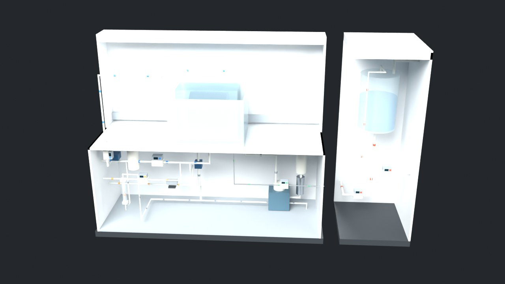
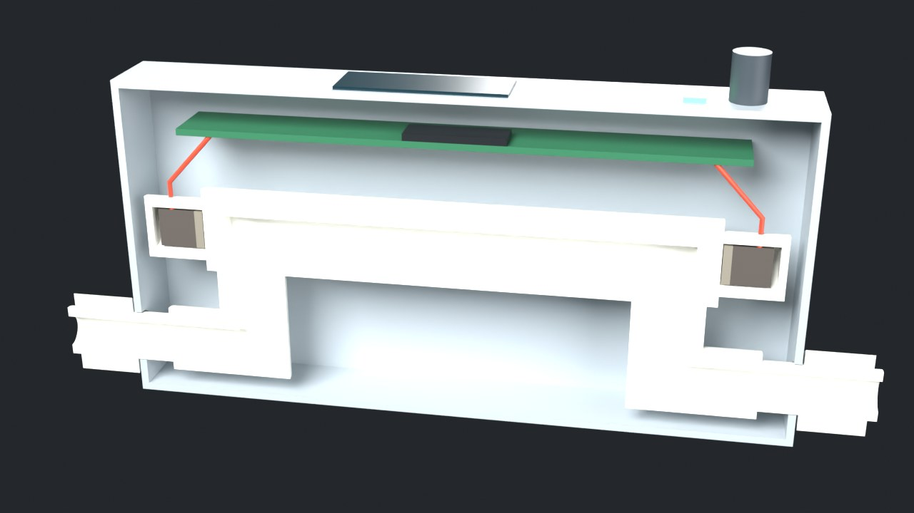
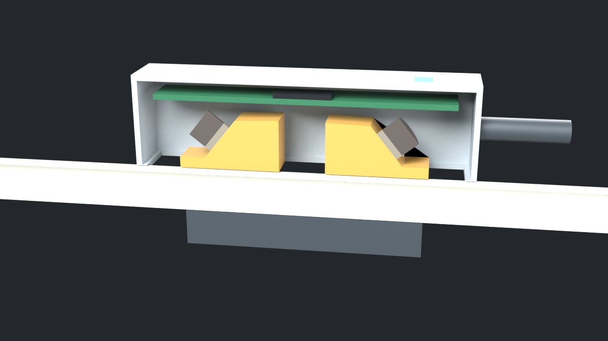
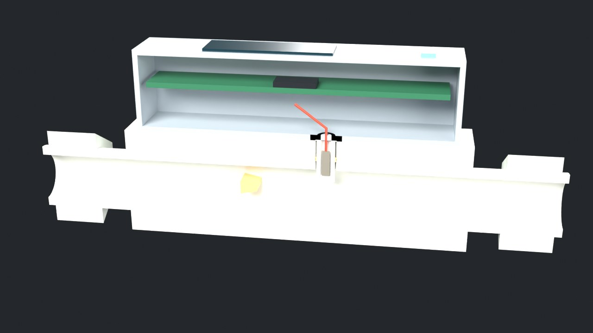
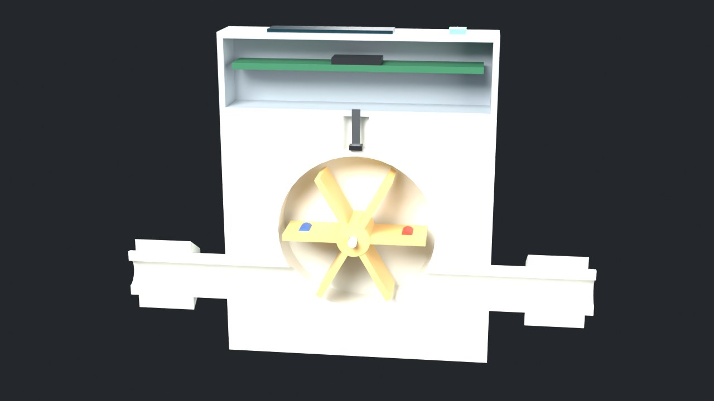
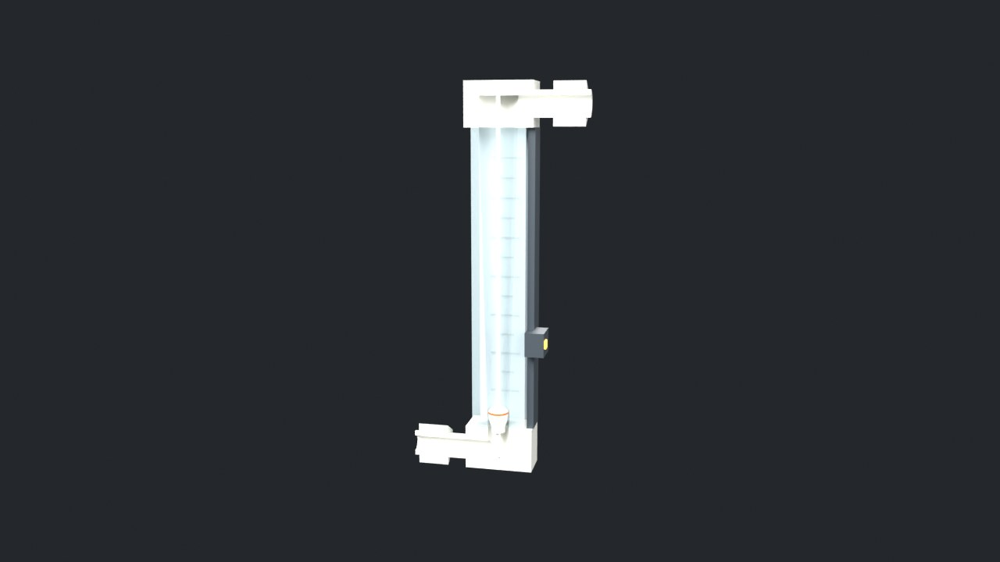
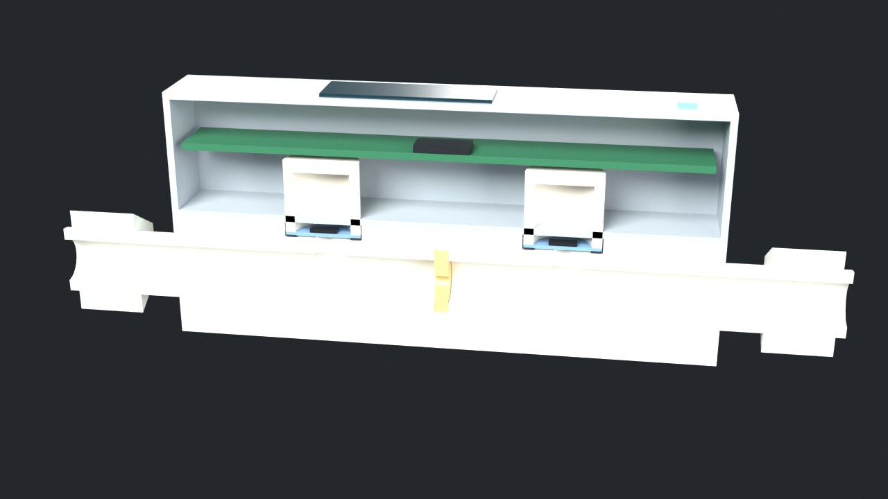
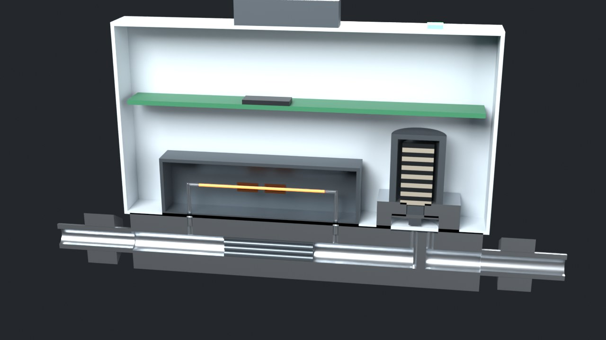
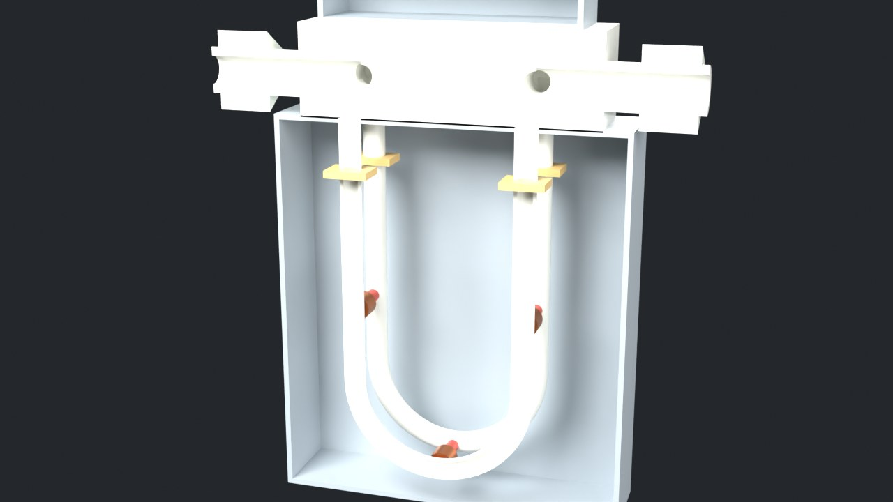
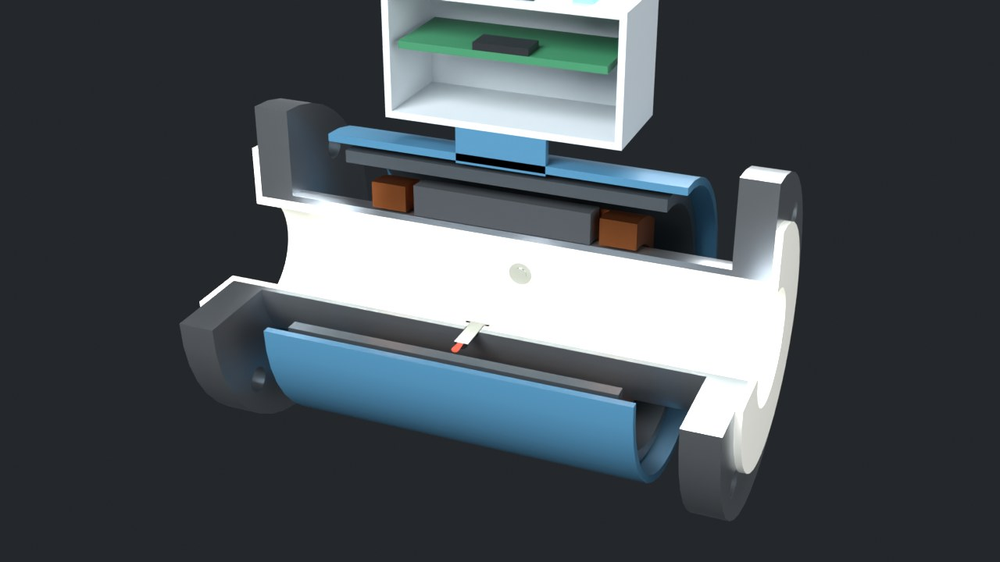

# 湿法设备里的流量计

半导体湿法清洗设备里常用的九种流量计，面向一般读者讲原理。先在一台虚构的清洗台上看它们装在哪，再把每一种剖开看结构、动手调实验，最后看公开专利里是怎么在超纯、强腐蚀的条件下把它们做干净、做稳定的。



| | | |
| --- | --- | --- |
|  |  |  |
|  |  |  |
|  |  |  |

## 怎么打开

- **Windows**：双击 `启动演示.bat`。它先检查 `main` 分支有没有更新，有就 `git pull --ff-only`，然后用默认浏览器打开 `index.html`。
- **其他系统**：直接打开 `index.html`。这是单文件页面，三维模型、数据和代码都在里面，离线也能看（没网时只是字体换成系统字体）。

## 页面里有什么

1. **三维检修台**：十个模型（机台全景 + 九种流量计剖面），拖动旋转。每种都有动画：超声波脉冲对穿、卡门涡交替脱落、叶轮转动和霍尔脉冲、浮子随流量升降、孔板前后压力、毛细管温度分布、U 管振动和相位差、磁场和正负离子。右上角是按同一套物理算出的实时读数。
2. **测流量在测什么**：流速分布、雷诺数，为什么半导体的细管常常正好落在层流和湍流之间。
3. **八个实验台**：改流量、换液体（DIW、稀氢氟酸、浓硫酸、IPA）、加气泡、加振动、加轴承磨损、换气体，看读数什么时候开始偏。
4. **选型**：对比表 + 七道选择题。
5. **专利**：17 篇公开专利，每篇写清"要解决什么问题"和"怎么做的"，带 Google Patents 原文链接。
6. **结论和边界**，以及所有来源。

## 文件夹里有什么

| 路径 | 内容 |
| --- | --- |
| `index.html` | 打包好的演示页面 |
| `启动演示.bat` | Windows 一键启动，含 main 更新检查 |
| `重新生成模型.bat` | 用本机 Blender 重跑建模脚本（加 `--render` 同时出预览图），装了 Node.js 的话顺便重新打包网页 |
| `blender/build_flowmeters.py` | 纯脚本建模：基本体 + 布尔运算 → 十个模型，剖开一半 → 导出 GLB / .blend / spec.json |
| `blender/out/` | `flowmeters.blend`（叶轮转动、浮子升降的动画）、`flowmeters.glb`、`spec.json`（尺寸、流道路径、标注、机位）、预览图 |
| `web/src/physics.js` | 物理核心：水的物性、流速分布、九种流量计的测量模型 |
| `web/src/stage.js` | three.js 舞台：模型、液体粒子、各种动画、标注、机位 |
| `web/src/labs.js` | 八个实验台 + 管流实验的画布和旋钮 |
| `web/src/content.js` | 说明文字、专利、选型题、对比表、来源 |
| `web/test_core.mjs` | 物理核心的 36 项校验 |

## 重新构建

```bash
# 1. 建模（二选一）
blender -b --factory-startup -P blender/build_flowmeters.py -- --out blender/out [--render]
pip install bpy && python blender/build_flowmeters.py --out blender/out [--render]

# 2. 打包页面
cd web
npm install
node test_core.mjs    # 校验物理核心
node build.mjs        # 更新上一级的 index.html
```

## 九种流量计一览

| 类型 | 测到的是什么 | 湿法设备里常见的位置 |
| --- | --- | --- |
| 超声波（管内式） | 顺流、逆流两个方向的传播时间 | DIW 主供水、药液供给 |
| 超声波（夹装式） | 同上，隔着管壁测 | 后加装、排查、不能切管的支路 |
| 卡门涡街 | 旋涡脱落的频率 | 循环回路、DIW 支路 |
| 叶轮式 | 叶轮转速 | 喷淋支路、冷却水 |
| 浮子式 | 浮子停住的高度 | 常流排放、不接电的确认表 |
| 差压式 | 孔板前后的压差 | 药液按比例注入（常和阀做成流量控制器） |
| 热式 MFC | 加热毛细管上下游的温差 | N₂ 鼓泡、IPA 干燥用的 N₂ |
| 科里奥利 | U 管振动的时间差和频率 | 按质量配比、CMP 浆料、浓度检查 |
| 电磁式 | 导电液体切割磁场产生的电压 | 厂务侧的导电药液（测不了超纯水） |

## 结论和它的边界

- 在湿法设备里，测得准只是基本要求，更难的是"干净"：接液部分全是 PFA、PTFE 或蓝宝石，不析出、不掉颗粒、没有死角。页面里的专利大多在解决密封、熔接、隔膜、内壁粗糙度这类问题。
- 超声波、涡街、叶轮、电磁、差压、浮子得到的是体积流量；热式和科里奥利直接测质量，科里奥利还能测密度。
- 每种都有盲区：气泡（超声波、科里奥利），小流量（差压、涡街、叶轮），液体性质（浮子、差压、热式），电导率（电磁式测不了纯水）。
- 三维模型是按专利和产品资料里的通用结构画的示意，不对应任何一家的产品；毛细管、换能器、电极等小零件做了放大。机台是虚构的。
- 实验里的物理是简化的：超声波没算管壁里的声路和计时误差；夹装式的流速分布用幂律模型，过渡区线性混合；涡街升力系数和门限、叶轮起转门槛、科里奥利管子参数、电磁式噪声随电导率的关系都是示意值，只看趋势。
- 纯水物性按温度算（声速用 Marczak 1997 多项式）；稀氢氟酸、浓硫酸、IPA 固定在 25 °C，部分数值是估算。孔板系数取 0.607；热式的气体转换系数只按摩尔热容估算。
- 页面里每句话标了证据强弱：公认（教科书原理）、资料（专利原文或厂商资料）、估算（本页估算或示意）。

专利和产品资料的链接列在页面最后一节。
