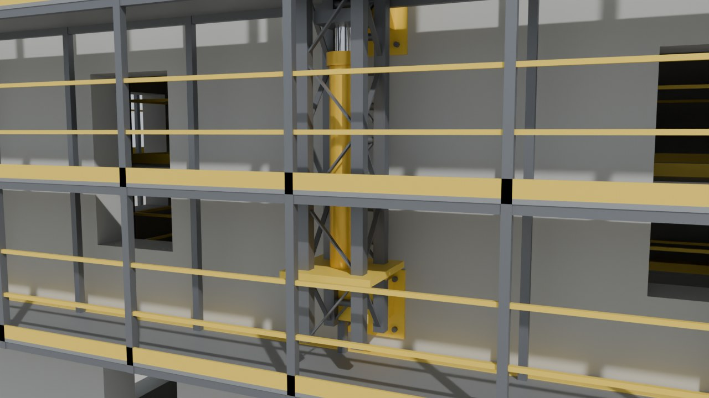
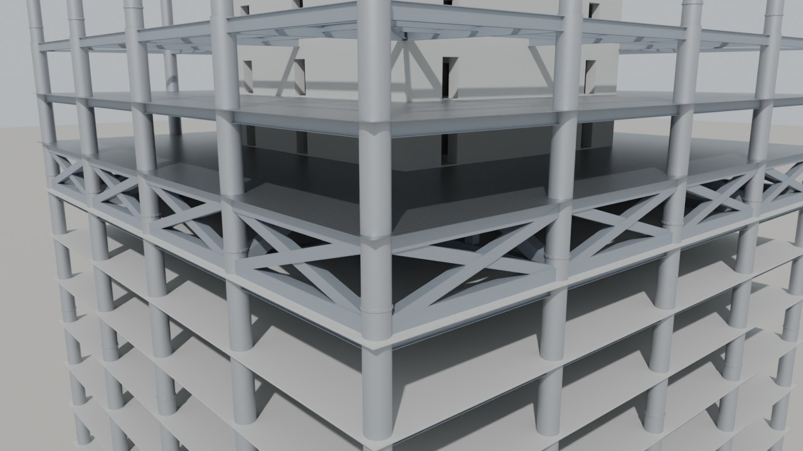

# 现代建筑工地（2026 年的超高层）

一栋原创虚构的 248 m 超高层，用 Blender 脚本建模，后面做成网页里的 4D 施工进度演示：拖时间轴，楼一层层长出来，核心筒带着造楼机先往上爬，钢框架、楼板、幕墙依次跟上。

**现在的进度：第一批模型（主楼结构 + 造楼机）已完成**，网页还没做。完整清单和状态见 [建模清单.md](建模清单.md)，每个尺寸的来历见 [参考资料.md](参考资料.md)。

| 支点：附墙支座 + 油缸 + 格构立柱 | 加强层：环带桁架和楼板 |
|---|---|
|  |  |
| **大钢模和挂架走道** | **地下室和筏板** |
|  |  |

## 怎么打开

- **看模型**：双击 `打开模型.bat`。它先检查 `main` 有没有更新（有就 `git pull --ff-only`），再用 Blender 打开 `blender/out/site.blend`。打开后是“核心筒浇到第 30 层”的样子，隐藏的楼层在大纲视图里点眼睛就能显示。
- **重新生成**：改了 `params.json` 或脚本以后，双击 `重新生成模型.bat`。同样先检查更新，再用本机 Blender 跑 `blender/build_site.py`。命令行加 `--render` 参数会顺便渲预览图（几分钟）。
- 找不到 Blender 时，把 `blender.exe` 的完整路径写进本文件夹的 `blender_path.txt`。

## 文件夹里有什么

| 路径 | 内容 |
|---|---|
| `params.json` | 唯一参数表：层高、核心筒、墙厚分段、柱径、钢梁截面、幕墙、地下室、造楼机 |
| `blender/build_site.py` | 总入口：建模 → 导出 GLB / .blend / spec.json → （可选）渲预览图 |
| `blender/tower.py` | 主楼：筏板、地下室、核心筒、钢管混凝土柱、钢梁、楼承板、楼板、幕墙、加强层、屋顶 |
| `blender/zaoloji.py` | 造楼机：贝雷片钢平台、12 个支点、7 层挂架、大钢模、防护网、布料机、附属设施 |
| `blender/sitekit.py` | 共用小工具：材质、把很多方块 / 圆柱攒成一个物体、矩形挖孔、导出 |
| `blender/out/tower.glb` | 主楼（344 个物体，约 29 万三角面） |
| `blender/out/zaoloji.glb` | 造楼机（约 10 万三角面） |
| `blender/out/site.blend` | 两者合在一起，摆成施工到第 30 层 |
| `blender/out/spec.json` | 给网页用的数字：各层标高、墙厚、柱径、支点位置、挂架标高 |
| `blender/out/view_*.jpg` | 预览图 |

## 模型的约定（做网页时要用）

**坐标**：Blender 里 z 向上，原点 = 核心筒中心、首层地面 ±0.000。导出 GLB 时转成 y 向上。

**楼层号**：地上 1 ~ 54，地下 -1 ~ -4，屋顶 55。level n 的竖向构件（核心筒墙、柱）从 z[n] 到 z[n+1]，水平构件（钢梁、楼承板、楼板）在 z[n+1]，也就是“这一层的顶”。标高表在 `spec.json` 的 `tower.z`。

**主楼每个物体的 extras**：

| stage | 是什么 | 物体名 |
|---|---|---|
| `raft` | 筏板 | `Raft`（floor = -5） |
| `bwall` / `bslab` | 地下室外墙和柱 / 地下室楼板 | `BWall_-4` … `BSlab_-1` |
| `core` | 核心筒墙 | `Core_-4` … `Core_54`，屋顶机房在 `Roof` |
| `column` | 钢管混凝土柱 | `Column_-4` … `Column_54` |
| `steel` | 钢梁 | `Steel_01` … |
| `deck` | 压型钢板 | `Deck_01` … |
| `slab` | 楼板混凝土 | `Slab_01` … |
| `curtain` | 幕墙（`refuge=1` 是避难层百叶） | `Curtain_01` … |
| `outrigger` | 加强层桁架 | `Outrigger_22`、`Outrigger_44` |
| `roof` | 屋顶 | `Roof` |

超高层的施工顺序是**核心筒先行**：核心筒领先，钢柱落后几层，钢梁、楼承板、楼板、幕墙依次再落后。`params.json` 里 `state_preview` 是预览图用的一个状态（核心筒 30 层、柱 25、钢梁 24、楼承板 23、楼板 21、幕墙 13）。

**造楼机**：原点 = 核心筒中心、刚浇完的墙顶（TOC）。施工到第 n 层时，把 `ZAOLOJI` 放到 z[n+1]。

| 物体 | 怎么动 |
|---|---|
| `ZLJ_Moving` 下面的所有东西 | 顶升时整体上移（平台、挂架、防护网、模板、立柱、布料机、附属） |
| `ZLJ_SeatsUpper` / `ZLJ_SeatsLower` | 附墙支座，固定在墙上不动 |
| `ZLJ_CylFrames` | 油缸支架 + 缸筒，挂在下支座上 |
| `ZLJ_CylRods` | 活塞杆，沿 z 伸出，行程 1.6 m（extras: `stroke`、`ext`） |
| `ZLJ_Boom1_Slew` → `Arm1` → `Arm2` → `Arm3` → `Hose` | 布料机：回转绕 z，三节臂各绕自己的 y 轴，原点都在铰点上 |

模板（`ZLJ_Forms`）和筒格里的挂架是按第 30 层的墙厚（外墙 0.7 m、内墙 0.4 m）摆的，extras 里记了 `outer_t` / `inner_t`。墙厚分四段往内收，到别的段时内侧模板要跟着挪，网页里按 `spec.json` 的 `core_t` 算偏移。

## 已知的简化

- 楼、造楼机都是原创的，尺寸按公开资料的比例定，不对应任何真实项目。
- 核心筒里没有电梯井道、楼梯和钢板剪力墙；筒内楼板只铺了中心和四个边筒格。
- 幕墙是整块玻璃 + 竖框竖翅，没有逐块开启扇。
- 钢梁和柱的节点（牛腿、加劲板）没做；钢柱每三层一圈对接耳板当示意。
- 防护网是半透明材质，不是真的冲孔。
- 塔冠先用 8 m 高的幕墙屏风代替；裙楼、塔吊、施工电梯、场地属于后面几批。
