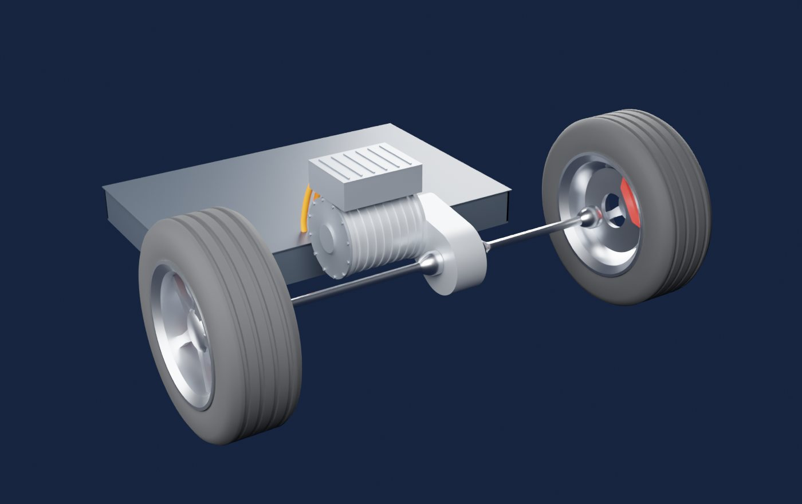
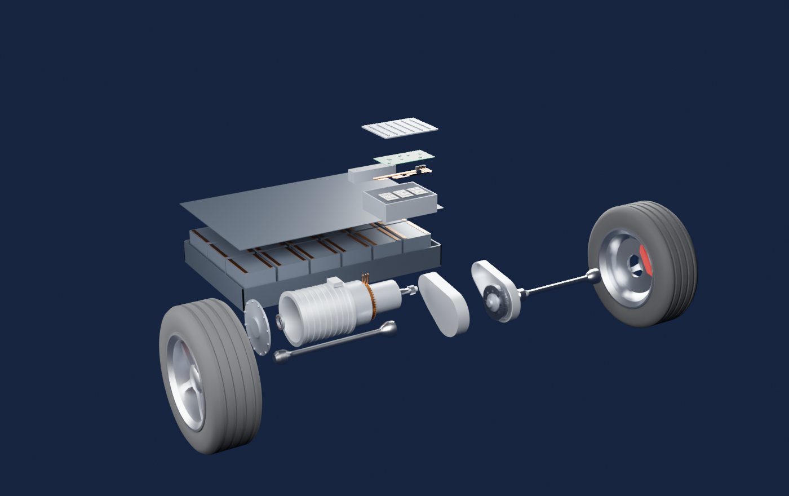

# 电动车电机调速

讲清楚新能源电动车的电机怎么调扭矩、怎么调转速。Blender 脚本建了一套三合一电驱（电池、逆变器、8 极 48 槽内嵌永磁电机、两级减速器、半轴和车轮），网页里十章逐步拆开，曲线和读数都由一套真实的 dq 模型实时算出来。

- **网页版（手机可看）**：<https://claude.ai/artifact/BqbJ9PDxXpVG6ecwJu1KDq>（默认只有自己能打开，要给别人看需在页面的 Share 里开启分享）
- **离线版**：`index.html`，模型和 three.js 都打包在里面，双击就能看（没网时字体回退到系统字体）

| 装配 | 爆炸 |
|---|---|
|  |  |

## 怎么打开

- **Windows**：双击 `启动.bat`。它先 `git pull --ff-only origin main` 检查更新（没网或没装 git 就跳过），再用默认浏览器打开 `index.html`。
- **其他系统**：直接打开 `index.html`。

要改模型再看效果：双击 `重新生成模型.bat`。它会找 Blender（`blender_path.txt` → PATH → `Program Files\Blender Foundation\Blender*` → Steam），重跑建模脚本；装了 Node 就顺便重新打包 `index.html`。

## 十章内容

| 章 | 讲什么 | 舞台 |
|---|---|---|
| 01 全貌 | 踏板到车轮的整条链路，爆炸图、剖开电机、打开减速器，点零件看作用 | 全车 |
| 02 旋转磁场 | 三相电流合成旋转磁场，可以断一相、调换相序（倒车） | 轴向截面，槽内导体按电流方向发光 |
| 03 调扭矩 | 电流幅值 + 超前角，永磁和磁阻两份扭矩，松开转子看它对齐后扭矩归零 | 轴向截面 |
| 04 调转速 | 转速是扭矩和阻力平衡的结果，频率跟着转子走；可以加定速巡航外环 | 路面 |
| 05 逆变器 | 六个开关、PWM、纹波和开关频率的取舍 | 打开的逆变器，开关逐个发亮 |
| 06 矢量控制 | Clarke/Park、FOC 框图、真实逐拍仿真的电流环阶跃，含控制周期代码 | 剖开的电机 |
| 07 高速弱磁 | 反电动势、电流圆和电压椭圆、外特性，改母线电压、关弱磁对比 | 轴向截面 |
| 08 能量回收 | 负 iq、回收和摩擦制动的分配、低速净功率翻正 | 路面，制动盘发红 |
| 09 三条路线 | 永磁同步、感应异步、电励磁同步在调法上的区别 | 剖开的电机 |
| 10 试驾 | 踏板、坡度、0–100，效率地图上的工作点 | 路面 |

每章都写了为什么这样做、依赖的假设、什么时候失效，并标了证据强度：公认、工程实践、本页简化、我的推测。

## 教学机型

虚构机型，量级接近主流后驱纯电车，不对应任何产品。参数在 `web/src/sim.js` 开头，Blender 尺寸在 `blender/build_ev_drive.py` 开头。

| 项目 | 数值 |
|---|---|
| 结构 | 内嵌 V 形永磁，8 极 48 槽，4 层发卡绕组，每极每相 2 槽 |
| ψf / Ld / Lq | 0.075 Wb / 0.125 mH / 0.29 mH |
| 电流 / 电压上限 | 520 A 峰值 / 400 V 母线（可用相电压 219 V） |
| 峰值扭矩 / 基速 / 峰值功率 | 319 N·m / 约 4080 rpm / 171 kW |
| 最高转速 / 减速比 | 16000 rpm / 9.04（65/21 × 73/25） |
| 整车 | 1850 kg，0–100 km/h 7.2 s，极速 224 km/h（被转速上限卡住） |

## 网页里的计算

| 项目 | 做法 |
|---|---|
| 工作点 | 恒参数 dq 模型。给定扭矩和转速，在电流圆和电压椭圆内找电流最小的 (id, iq)，低速落在 MTPA 上，高速落在电压椭圆边界 |
| 外特性 | 每个转速沿 id 扫一遍取最大扭矩。忽略电阻压降，留 5% 电压裕量 |
| 整车 | m_eq·dv/dt = F牵引 − 滚阻 − 风阻 − 坡度 − 摩擦制动，电池电压恒定 |
| 电流环 | 100 μs 控制周期、一拍计算延迟、PI + 解耦前馈、电压限幅，电机用连续模型逐步积分 |
| PWM | 三角载波 + 注入零序的调制波，RL + 反电动势积分出相电流。基波电流固定 200 A，只看纹波 |
| 损耗 | 铜损、铁损（频率和磁链）、机械损耗、逆变器导通和开关损耗。系数只保证量级，别当具体数字用 |
| 三维动画 | 转子、齿轮、车轮、线圈发光、定子磁场都来自同一组 θ、id、iq，按页面右上角标的倍数慢放 |

`web/test_sim.mjs` 是自检：MTPA 解析式和数值搜索一致、工作点不越限、扭矩跟随、稳态受力平衡、电流环收敛、巡航不失稳。

## 建模时的坐标约定

机械角 ϑ 的位置是 (y, z) = (−r cos ϑ, r sin ϑ)，从电机后端看过去就是屏幕上的数学角，车辆前进时转子逆时针转。U 相轴线在电角度 0，转子第 0 极（N）在 ϑ = 0，所以模型里的绕组分布和页面里的电流公式是对得上的：槽里哪根导体发亮、发什么色，都是按真实绕组排布算的。

剖开电机不靠布尔运算：定子、机壳、水道、绕组都拆成 270° 和 90° 两块（切面落在齿中心线上），网页里把 90° 那块藏起来，切面就是实心的。

## 和真实电机的差别

- 电感、磁链都是常数，没有饱和和温度影响。真实控制器用台架测出来的查表
- 只算基波。没有齿槽转矩、电流谐波、死区
- 减速器只画了啮合关系，差速器只有壳体，轴承没画保持架
- 叠片用贴图表示，线束和冷却管路省略
- 回收的淡出区间（5 到 12 km/h）和踏板映射是示意值

## 文件

| 路径 | 内容 |
|---|---|
| `index.html` | 打包好的演示页面 |
| `启动.bat` | Windows 一键启动，含 main 更新检查（ASCII、CRLF） |
| `重新生成模型.bat` | 用本机 Blender 重跑建模，并重新打包页面 |
| `blender/build_ev_drive.py` | 纯脚本建模：参数表 → 各部件函数 → 导出 |
| `blender/out/` | `ev_drive.blend`（按空格播放爆炸动画）、`ev_drive.glb`、`spec.json`（零件说明、爆炸路线、分组）、预览图 |
| `web/src/sim.js` | 电机和整车模型，纯函数 |
| `web/src/stage.js` | three.js 舞台 |
| `web/src/chapters.js` | 十章文案和实验逻辑 |
| `web/src/chart.js` | Canvas 图表工具，带悬停读数 |
| `web/test_sim.mjs` | 仿真自检 |

## 重新构建

```bash
# 1. 建模（二选一）
blender -b -P blender/build_ev_drive.py -- --out blender/out [--render]
pip install bpy && python blender/build_ev_drive.py --out blender/out [--render]

# 2. 打包页面（同时更新上一级的 index.html）
cd web
npm install
node test_sim.mjs
node build.mjs
```

兼容：在 Blender 5.2（pip 版 bpy）上测试通过。

## 参考

- [Adamas Intelligence：EV 电机类型占比（2021 H1）](https://www.adamasintel.com/?p=11819)
- [EVKX：电励磁同步电机](https://evkx.net/en/technology/motors/wrsm/)
- [BMW Blog：Gen6 电驱的电机类型](https://www.bmwblog.com/2025/02/20/bmw-gen6-electric-motors-neue-klasse-powertrain/)
- [Lesics：Model 3 IPM-SynRM 电机](https://www.lesics.com/tesla-model-3_s-ipm-synrm-electric-motor.html)
- [Yahoo Autos：保时捷 Taycan 两挡变速箱](https://autos.yahoo.com/why-porsche-taycan-evs-two-010000491.html)
- [TTI：SiC 牵引逆变器与 800 V 趋势](https://www.ttii.com/content/ttii/en/marketeye/articles/categories/new-technology/me-slovick-20250429.html)
