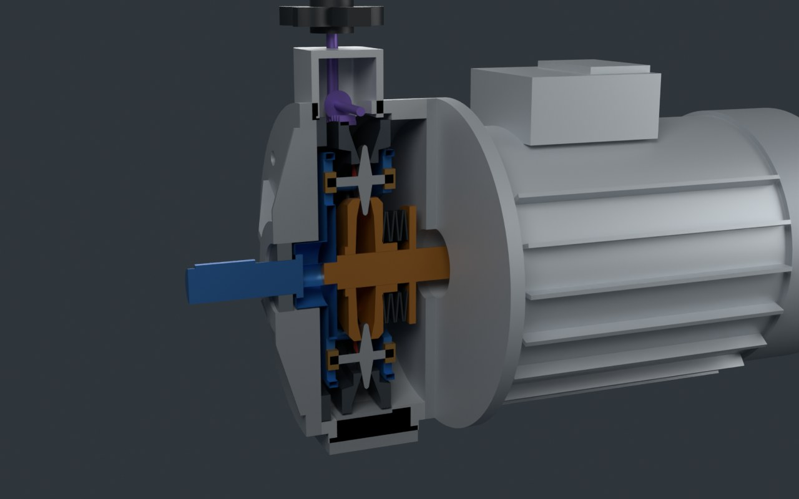
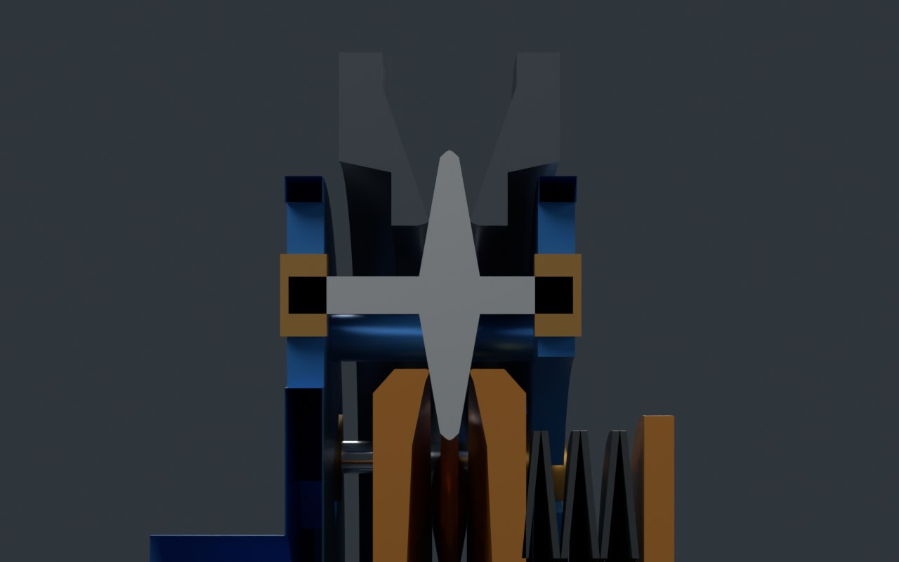

# 行星锥盘无级变速器

照片里那种带电机、顶上一个手轮、“200 ~ 1000 转随意调”的 MB / MBL / UDL 型机械无级变速器，里面是怎么调速的。用 Blender 脚本按公开说明和专利里的结构关系建了一台（0.75 kW 4 极电机 + 变速器，1:1.4 ~ 1:7），网页里可以边拧手轮边看 6 个行星锥盘整体往外挪、主动轮被撑开、外环张开；再用七章小实验讲摩擦传动、行星机构、接触半径、碟簧加压和打滑、输出特性、调速机构，最后对照 11 件公开专利。





## 怎么打开

- **Windows**：双击 `启动演示.bat`。它先检查 `main` 分支有没有更新，有就 `git pull --ff-only`，然后用默认浏览器打开 `index.html`。
- **其他系统**：直接打开 `index.html`。单文件页面，模型和数据都在里面，离线也能看（没网时只是字体回退到系统字体）。
- 在线版：<https://guangxianzhu.github.io/HTML-classroom/%E8%A1%8C%E6%98%9F%E9%94%A5%E7%9B%98%E6%97%A0%E7%BA%A7%E5%8F%98%E9%80%9F%E5%99%A8/index.html>

## 页面里有什么

| 部分 | 内容 |
| --- | --- |
| 开头 | 猜题：手轮从 1000 拧到 200，电机转速变不变 |
| 三维检修台 | 外观 / 剖开 / 正对截面 / 只看内部 / 拆开。手轮、负载、油（牵引油 / 普通油）三个旋钮直接驱动物理模型；输入、行星盘自转 + 公转 + 径向移动、行星架、外环轴向移动、凸轮环、蜗杆、手轮、指针都按算出来的数动。黄点、蓝点是内外接触点，打滑时变红。点零件看说明 |
| 第一章 | 两个摩擦轮：转速比 = 半径反比，能传的力 = μN，牵引油和蠕滑 |
| 第二章 | 行星机构：两级行星轮俯视动画，可以“站在行星架上看”，推出 n架 = n入 / (1 + T) |
| 第三章 | 过行星盘轴线的截面：外夹缝 → 盘心位置 → ρa、ρb → 速比，一步一步联动；为什么盘必须中间厚边上薄 |
| 第四章 | 碟簧、离心力、哪一圈先滑；三条加压路线（碟簧恒压 / 扭矩凸轮 / 离心力）的取舍 |
| 第五章 | 输出特性：快挡被电机卡住（恒功率），慢挡被摩擦卡住（恒扭矩），和 UDL010 样本表两个点对照 |
| 第六章 | 手轮 → 锥齿轮 → 蜗杆 → 凸轮环 → 斜坡；手轮圈数和转速的关系；为什么手松开不跑、为什么要运转中调 |
| 第七章 | 三条调速路线对比：机械无级 / 变频器 + 减速机 / 行星环锥 |
| 第八章 | 11 件公开专利卡片，标明读到摘要、片段还是只有标题 |
| 结论 | 每条结论标“公认 / 资料 / 推断 / 估算”，列出没算的东西和来源 |

## 文件夹里有什么

| 路径 | 内容 |
| --- | --- |
| `index.html` | 打包好的演示页面 |
| `启动演示.bat` | Windows 一键启动，含 main 更新检查 |
| `重新生成模型.bat` | 用本机 Blender 重跑建模脚本，再（有 Node.js 的话）跑校验、重打包页面；加 `--render` 参数同时出预览图 |
| `params.json` | **唯一的参数表**：尺寸、锥角、碟簧、μ、电机。Blender 脚本和网页都读它 |
| `blender/build_variator.py` | 纯脚本建模：回转体 + 布尔运算。转的件只出完整版（网页里用裁剪平面剖开），不转的件另出 `__cut` 剖切版 |
| `blender/out/` | `variator.blend`、`variator.glb`、`spec.json`（每个零件怎么动、拆开时往哪挪、标注点）、预览图 |
| `web/src/core.js` | 物理核心：几何、Willis 速比、碟簧和离心力、两圈接触的牵引利用率、打滑、蠕滑、电机限制、输出特性 |
| `web/src/stage.js` | three.js 舞台：按 core.js 的状态摆零件、五种看法、接触点、标注、点选 |
| `web/src/labs.js` | 七章里的 2D 实验和曲线 |
| `web/src/data.js` | 文字：零件说明、专利卡片、来源 |
| `web/test_core.mjs` | 物理核心的校验（速比两端、零件装不装得下、调速方向、功率守恒、打滑点、和样本表对照） |

## 重新构建

```bash
# 1. 建模（二选一）
blender -b --factory-startup -P blender/build_variator.py -- --out blender/out [--render]
pip install bpy && python blender/build_variator.py --out blender/out [--render]

# 2. 打包页面
cd web
npm install
node test_core.mjs    # 校验物理核心
node build.mjs        # 更新上一级的 index.html
```

改尺寸只改 `params.json`，两边会一起变；改完先跑 `test_core.mjs`，它会检查行星盘之间、心轴和刃口之间还有没有间隙。

## 结构从哪来

| 部分 | 依据 |
| --- | --- |
| 主动轮 + 压盘 + 碟簧夹内侧，定环 + 调速凸轮夹外侧，行星轮轴经滑块轴承带行星架输出 | MB 型的公开结构说明（减速机网、格鲁夫等厂商页面） |
| 1:1.4 ~ 1:7、输入输出同轴同向、UDL010 的 6 / 12 N·m | UDL 厂商资料和样本表 |
| 两个外环一个能转又能轴向动 | CN2477894Y 摘要 |
| 行星轴在行星架槽里径向滑 | DE102013010423A1 |
| 变速环不转、只轴向走 | US5484346A、JP4978557B2 |
| 盘必须中间厚边上薄、调速链的方向 | 本页从几何推出来的 |
| 蜗杆 + 齿扇 + 斜坡这套手轮机构 | 本页为了让竖着的手轮能拨动凸轮环选的示意结构 |

外形、尺寸、颜色都是原创示意，不对应任何真实产品。

## 结论和它的边界

- 速比 n出 = n入 / (1 + (R/r)·(ρa/ρb))。本页 r = 40、R = 60 mm，盘心从 44.2 mm（最快）挪到 56.0 mm（最慢），夹缝只变 4.16 mm。
- 本页模型里，快挡碟簧被压得更紧（2039 N 对 1790 N），离心力让外侧正压力比内侧多约 18%；慢挡先在外侧打滑，快挡先在内侧。
- 能长期用的扭矩：快挡约 6.4 N·m（被电机卡住），慢挡约 12 N·m（被摩擦卡住），两头和 UDL010 样本表对得上，中间没有数据可对。低速段能输出的功率掉到约 251 W，电机只用到 37%。
- μ = 0.07、安全系数 1.5、碟簧刚度、效率 0.9、蠕滑 3% 都是估算值；没算接触应力和寿命、油温、自旋损失、轴承。
- “碟簧放在主动轮这一侧”按 MB 型说明；也有设计把弹簧放在外环那一侧，那时调速方向和受力分布会不同。
- “应该在运转中调速”是按原理推断的，没有找到 UDL 原厂说明书原文。

来源列在页面最后一节。
