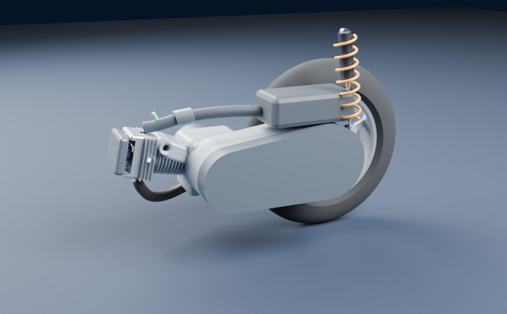
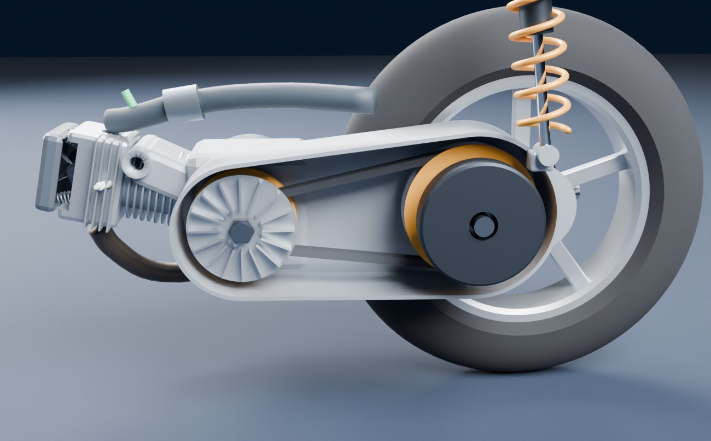
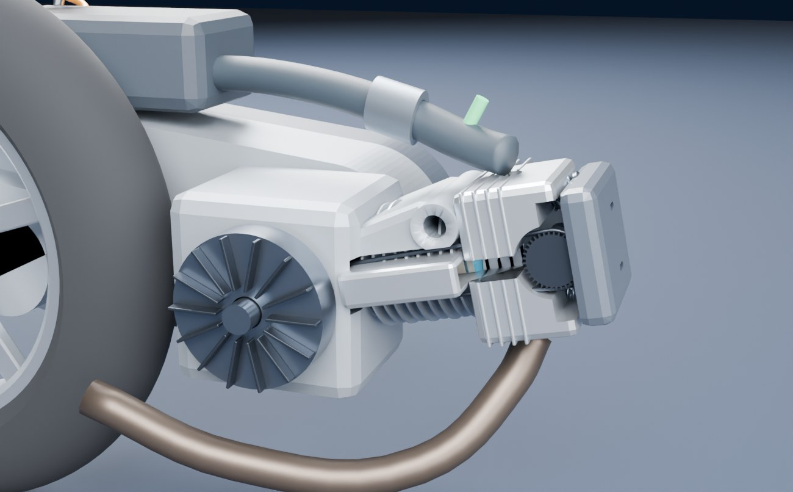
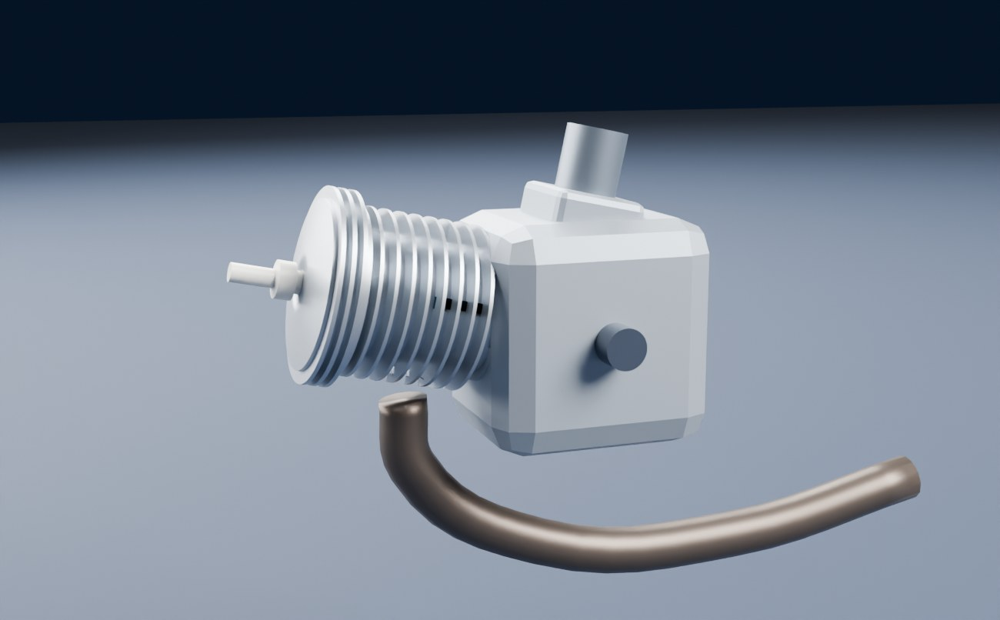
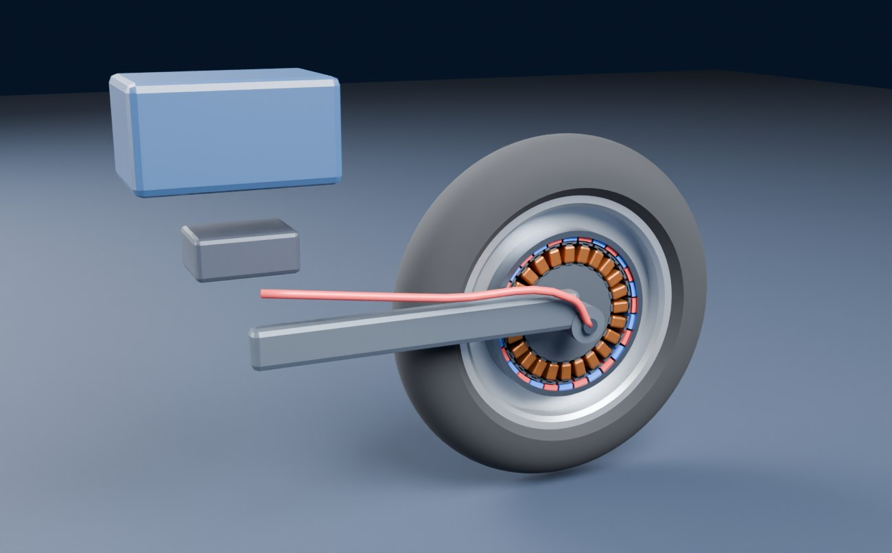
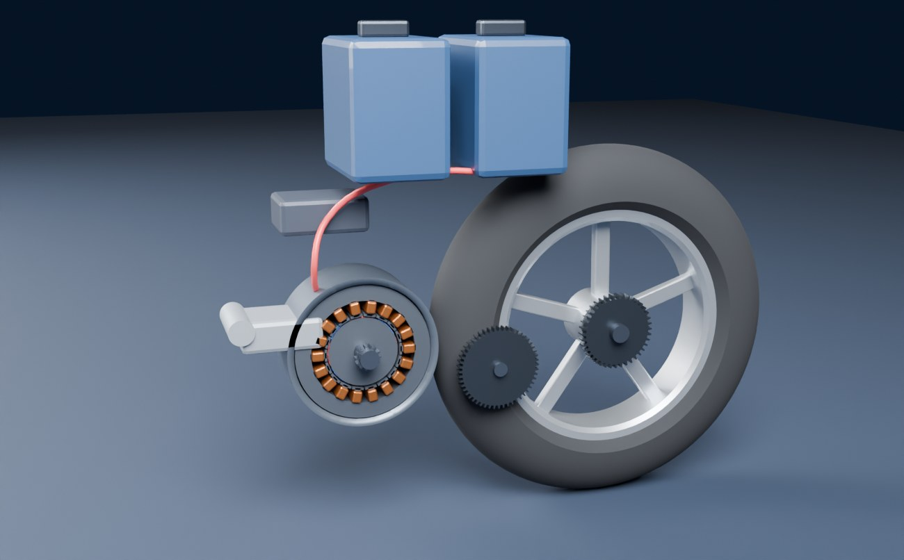
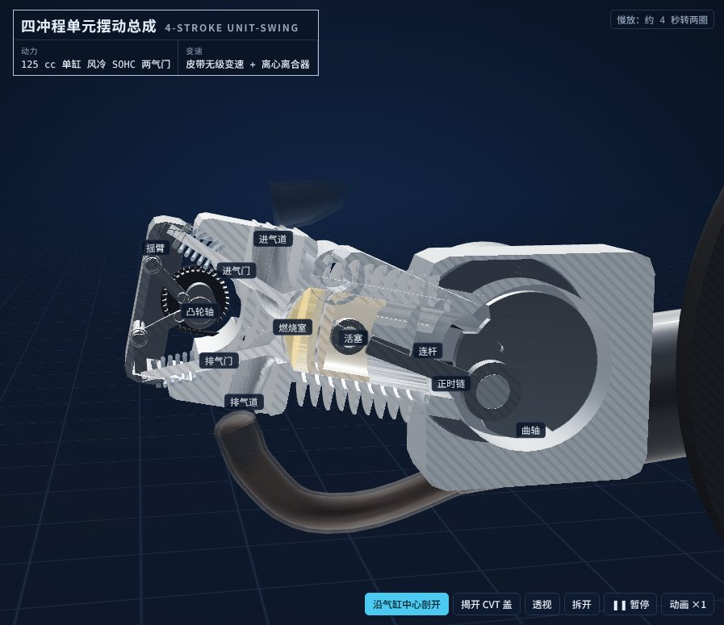
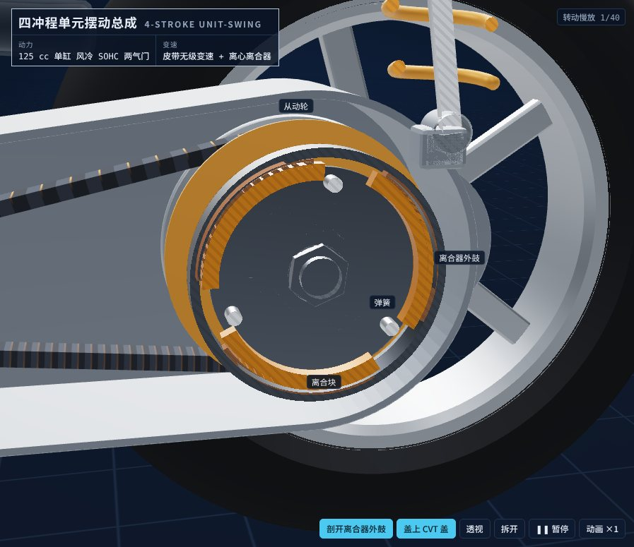
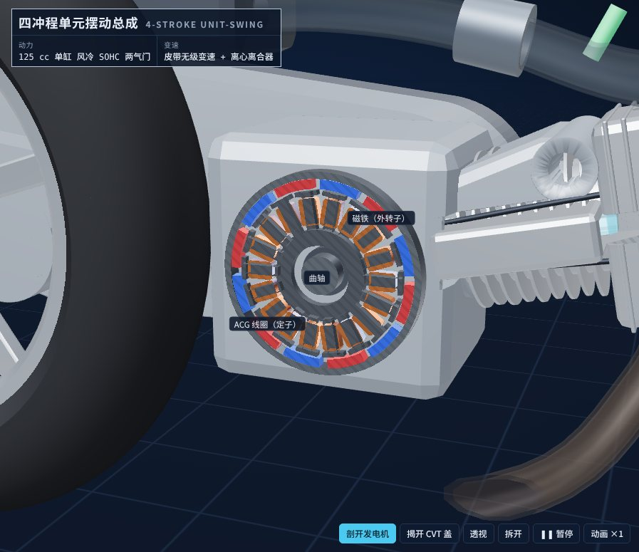

# 踏板摩托车的发动机和动力系统

面向一般读者，讲清楚踏板摩托车（スクーター）为什么拧油门就走、不用换档：动力从发动机（或电池）怎么一路走到后轮，每一环为什么这样设计、什么时候会出毛病。

四台模型都用 Blender 脚本建模，结构参考公开专利（页面最后一章列了 36 件专利和 11 份厂家 / 机构资料）：

- **四冲程单元摆动总成**（主角，最主流的组合）：125 cc 单缸风冷 SOHC 两气门 → 皮带无级变速（CVT：离心滚子 + 扭力凸轮）→ 离心离合器 → 两级减速齿轮 → 后轮，整块绕前端的摆动轴上下摆。同一台模型还带三套“变体”零件：**电控 CVT**（电机 + 齿轮 + 螺纹滑块推动盘）、**传统起动电机**（起动电机 + 减速齿轮 + 单向离合器）、**轻混**（48 V 电池 + 逆变器，发电机兼助力电机）
- **二冲程 50 cc**：曲轴箱扫气、簧片阀、缸壁上的排气口和扫气口
- **电动 · 轮毂电机**：外转子电机就是后轮的轮毂
- **电动 · 摆臂电机**：电机装在摆臂前端，两级齿轮减速，两块可换电池

网页里可以剖开看内部（沿气缸、沿两根皮带轮轴、离合器、发电机各一种剖法）、透视外壳、拆开；气缸里的气体按冲程变颜色，进排气是流动的小点，皮带是实时生成的，速比变了它就跟着爬上爬下。

- **离线版**：`index.html`，模型和 three.js 都打包在里面，双击就能看（没网时字体回退到系统字体）



| 揭开 CVT 盖 | 右侧：发电机和气缸 |
|---|---|
|  |  |

| 二冲程 | 轮毂电机 | 摆臂电机 |
|---|---|---|
|  |  |  |

网页里的剖面（截图）：

| 四冲程沿气缸剖开 | 离心离合器 | 发电机兼起动机 |
|---|---|---|
|  |  |  |

## 怎么打开

- **Windows**：双击 `启动.bat`。它先 `git pull --ff-only origin main` 检查更新（没网或没装 git 就跳过），再用默认浏览器打开 `index.html`。
- **其他系统**：直接打开 `index.html`。

要改模型再看效果：双击 `重新生成模型.bat`。它会找 Blender（`blender_path.txt` → PATH → `Program Files\Blender Foundation\Blender*` → Steam），重跑建模脚本；装了 Node 就顺便跑一遍模型校验、重新打包 `index.html`。

舞台右下角的工具条：**剖开**（每按一下换一种剖法）、**揭开 CVT 盖**、**透视**（外壳变透明）、**拆开**（爆炸图）、暂停、动画快慢。点任何零件会显示它的名字。

## 十五章

| 章 | 讲什么 | 实验 |
|---|---|---|
| 01 总览 | 动力走的路线，为什么发动机需要变速；四台模型 | 平路匀速，车速多少要多大功率，125 cc / 50 cc / 电动各还剩多少 |
| 02 单元摆动 | 发动机、CVT、后轮做成一整块绕摆动轴摆：皮带中心距不变，代价是簧下质量大；也有发动机固定的做法 | 开过一条减速带：摆动角度、后轮上下、减震压缩，皮带中心距一直是 0 |
| 03 四冲程 | 吸、压、功、排，凸轮轴转速是曲轴一半，气门早开晚关，偏置气缸、滚子摇臂、可变气门 | 拖曲轴角度或连续转；p–V 图和气门升程图跟着走；改油门看每循环做功 |
| 04 油门 | 油门拧的不是速度而是进气量：把手 → 拉线 → 节气门 → 进气管压力 → 电脑按 14.7 : 1 配油 → 扭矩；电喷、化油器、电动三种做法；怠速旁通和松油门断油 | 先猜一题；示意图分五步看，拖把手和转速看开度、压力、每次喷油、喷油时间、扭矩；同一个油门下“推力 = 阻力”稳在什么车速 |
| 05 二冲程 | 活塞开关气口、曲轴箱当打气筒、簧片阀、漏新气、机油跟着烧；为什么退场 | 分五段看：做功 / 排气口先开 / 扫气 / 漏新气 / 压缩，气口正时圆 |
| 06 CVT | 两片锥盘、离心滚子推、弹簧 + 扭力凸轮挡，两边的力停在哪里速比就是多少 | 改转速、油门、滚子重量，看两条力的曲线交在哪；沿两根轴剖开看 V 形槽 |
| 07 离心离合器 | 离合块甩开贴住外鼓，起步那一段半离合打滑；起步抖的原因 | 改转速和咬合转速看能传多少扭矩；从停车满油门起步看前 3 秒 |
| 08 开起来 | 转速“粘”在一条线上、车速一直涨；滚子重量怎么改手感；上坡自己降档 | 整车模拟：油门、滚子重量、坡度、体重；定速 50 km/h 拉坡度看降档 |
| 09 转速和功率 | 转速、扭矩、功率、车速四步互相算：转速 → 车速、扭矩 × 转速 = 功率、扭矩 → 后轮推力、推力 − 阻力 = 加速 | 先猜一题；每一步把当前数字代进公式；“定住看”自己定车速和油门，“开起来”是实时仿真（带累计距离和油耗） |
| 10 热值和油耗 | 一滴油的去向：热值 43 MJ/kg、每次喷多少、每秒烧多少、多少变成功、换成 km/L；为什么只有两成到后轮，为什么不是越慢越省油 | 先猜一题；匀速车速 / 坡度 / 载重 → 能量条（后轮、传动、摩擦、泵气、缸壁、排气）和五步算式；每升公里数 – 车速曲线，和一台量产车的厂家数字对照 |
| 11 起动 / 怠速停止 | 外转子发电机兼起动机（反转到压缩前再起动）、传统起动电机 + 单向离合器、怠速停止什么时候不工作 | 起动一次（两种方式对比）；停车次数 × 等待时间算能省多少油 |
| 12 电控 CVT | 电机 → 齿轮 → 螺纹滑块推动盘，电脑定速比；D / S / 手动 6 档 | 三种模式和离心滚子 CVT 同时起步，比转速 – 车速曲线 |
| 13 混动 | 发电机兼助力电机，拧油门后约 3 秒推一把；别的混动布置 | 有助力 / 没助力同时起步；扭矩曲线 + 助力 |
| 14 电动 | 摆臂电机和轮毂电机，为什么不要离合器和 CVT，可换电池 | 和 125 cc 一起起步；驱动力 – 车速；电池容量 → 40 km/h 续航 |
| 15 怎么选 | 六种做法对比表（四冲程 + 离心 CVT 是最主流的），开起来不对劲先怀疑哪里，证据强弱，全部来源 | — |

每章都写了为什么这样做、依赖的假设、什么时候失效，并标了证据强度：公认、专利 / 厂家资料、本页简化、我的推测。04、09、10 三章是给零基础读者加的：先猜一道选择题，再一步只讲一件事，公式里直接代入当前的数字。

文案里提到别的章一律写 `CH('章的 id')`，不要写死章号（以后再插入新章，章号会自己变）。

## 网页里的计算

| 项目 | 做法 |
|---|---|
| 皮带几何 | 皮带节线长度不变（开口带长度公式），主动轮半径 27 → 55 mm 时从动轮 70 → 44 mm，速比 2.59 → 0.80；动盘行程 = 2·tan14°·Δr |
| 滚子推力 | F₁ = K·N·m·ω²·ρ·(dρ/dδ)，斜坡做成外段更陡（ρ 是变速进度的二次函数）；K 标定成 15 g 滚子、满油门在 7000 rpm 左右开始升档 |
| 从动轮夹紧力 | F₂ = 弹簧预紧 250 N + 20 N/mm × 压缩量 + 40 N × 从动轮扭矩（N·m，扭力凸轮）；F₁ > F₂ 就升档，变速快慢按力差的一阶响应 |
| 离心离合器 | 能传扭矩 T = K·(ω² − ω₀²)；锁住时算需要多大扭矩才能保持锁住，超过就打滑，打滑时两边按摩擦扭矩各自加速 |
| 发动机 | 满油门扭矩曲线（峰值 11.7 N·m / 7000 rpm，最大约 9.4 kW），油门开度按转速换算，摩擦扭矩随转速增加，怠速控制 1700 rpm，9800 rpm 断油 |
| 整车 | 人 + 车 195 kg，滚动阻力 0.015，C<sub>d</sub>A 0.56 m²，皮带效率 0.88、齿轮 0.96，1 ms 小步积分 |
| 四冲程 p–V | 单区模型：多变压缩 / 膨胀（指数 1.32），Wiebe 放热（上止点前 20° 起、55°），气门开时缸压往进排气压力靠；配气正时 IVO 10° BTDC、IVC 40° ABDC、EVO 40° BBDC、EVC 10° ATDC |
| 二冲程 | 排气口 90° ~ 270°、扫气口 118° ~ 242°（活塞位置决定，对称），簧片阀按角度近似 |
| 电控 CVT | 目标转速 D = 3000 + 3800 × 油门，S = 5200 + 2600 × 油门；手动 6 档按固定速比；动盘移动速度有上限 |
| 混动 | 油门开大后 3 秒内在曲轴上加 3.6 N·m（约为 4000 rpm 扭矩的 1/3），6500 rpm 以上不加 |
| 空气和燃油 | 扭矩曲线不动，反推“要出这么大扭矩得吸多少空气、喷多少油”：每循环燃烧推活塞的功 = η<sub>i</sub> × 43 MJ/kg × 燃油量；泵气功 = (大气压 − 进气管压力) × 排量；曲轴净功 = 前者 − 泵气 − 摩擦。η<sub>i</sub> 大负荷 0.39、怠速附近约 0.29；空燃比 14.7，进气管压力高于大气压的 82 % 后逐渐加浓到 13.2；充气效率由满油门扭矩反推（峰值约 0.98）；松油门且转速高时断油 |
| 能量去向 | 烧油的热 = 到后轮 + 皮带和齿轮 + 发动机摩擦 + 泵气 + 缸壁散热 + 排气（守恒，测试里校验）；没变成功的热在缸壁和排气之间按 38 ～ 48 % 分给缸壁；CO₂ 按 2.35 kg/L |
| 怠速停止 | 怠速油耗直接用上面的模型（1700 rpm 约 0.024 g/s ≈ 0.12 L/h） |
| 电动 | 摆臂电机 26 N·m / 6 kW / 11000 rpm、减速比 11.4；轮毂电机 150 N·m / 4 kW / 830 rpm 直驱 |

数值都是“教学车”的量级，是我设的，不对应任何车型；结构和趋势有意义，绝对数字只是量级。`web/test_sim.mjs` 校验这些模型，也校验页面文案里写死的判断（比如“15 g 满油门 7000 rpm 左右升档”“12 g 和 18 g 相差大约 1000 rpm”“定速 50 km/h 上坡时速比更低、转速更高”）。

## 改东西

| 想改 | 改哪里 |
|---|---|
| 零件形状、尺寸、标注点、流线、剖切面、机位 | `blender/build_scooter.py`，每个模型一个 `build_XX()` |
| 文案、实验、来源 | `web/src/chapters.js` |
| 数字模型 | `web/src/sim.js` |
| 舞台、剖切上色、各零件怎么动、皮带怎么生成 | `web/src/stage.js` |

```
# 1. 建模（二选一）
blender -b -P blender/build_scooter.py -- --out blender/out [--render]
pip install bpy && python blender/build_scooter.py --out blender/out [--render]     # bpy 需要 Python 3.11

# 2. 校验 + 打包页面
cd web
npm install
node test_sim.mjs
node build.mjs          # 生成 ../index.html 和 dist/artifact.html
```

布尔运算默认用 Blender 4.5 起的 MANIFOLD 求解器，失败时自动退回 EXACT。坐标约定：毫米，+X 朝车头，+Y 朝车的左边（CVT 在左），+Z 朝上。所有会转的零件都绕 Y 方向的轴转，物体原点放在自己的转轴上；网页只改位置、绕 Y 的角度和沿某一轴的缩放。皮带不在 GLB 里（`role = renderonly`，只给渲染用），网页按当前速比实时生成。

## 结论和它的边界

- 踏板车的每一环都在“不用人操作”：离心滚子按转速推动盘、扭力凸轮按负载夹紧、离心离合器按转速咬合。代价是皮带、滚子、离合块都是会磨损的消耗件。
- 单元摆动让皮带两头的轴永远一起动，皮带中心距不变，这是皮带 CVT 能放进摆动单元的根本原因；代价是簧下质量大。
- 电控 CVT 和轻混都只换了一环：前者换“谁来推动盘”，后者在曲轴上多加一台电机。电动则把发动机和 CVT 都换掉，因为电机从 0 转就有扭矩。
- 二冲程结构最简单、同排量劲最大，但漏新气、烧机油，排放标准收紧后基本退场。
- 油门管的是进气量：空气多 → 油多 → 扭矩大；车速是“推力 = 阻力”的平衡点，转速由 CVT 的力平衡决定，两者都不是油门直接定的。
- 汽油的热只有两成左右到后轮（教学车 60 km/h 约 19 %），六七成从排气和缸壁走掉；负荷越小效率越低，所以不是越慢越省油（模型里 30 ～ 40 km/h 最省）。
- 结构细节来自公开专利，模型尺寸是教学示意，不对应任何厂家的任何车型。

来源列在页面最后一章。
