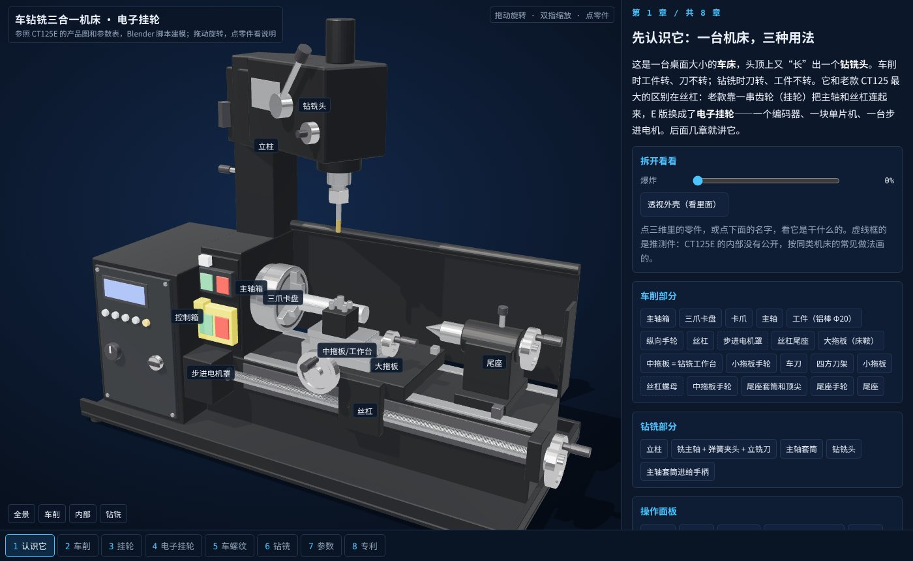
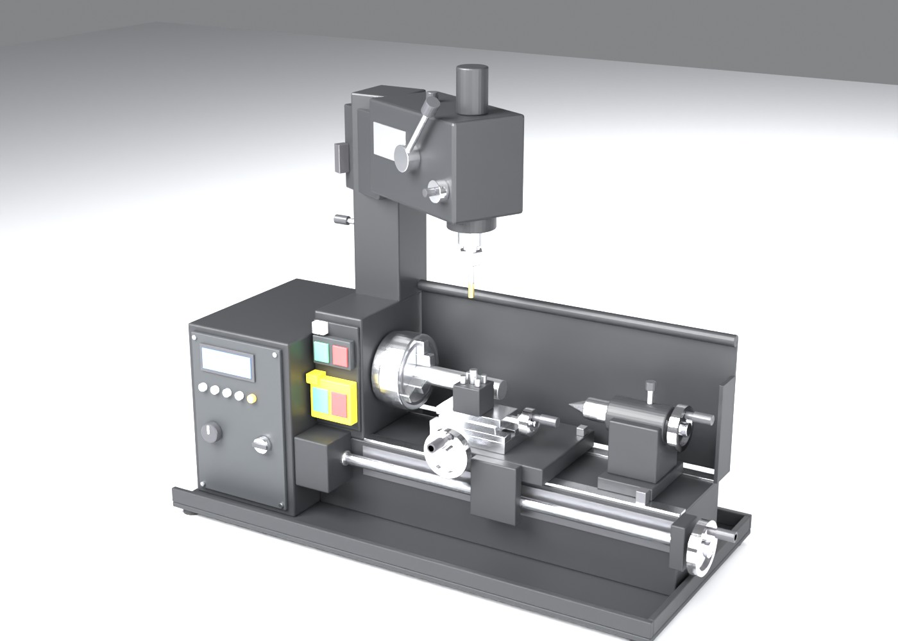
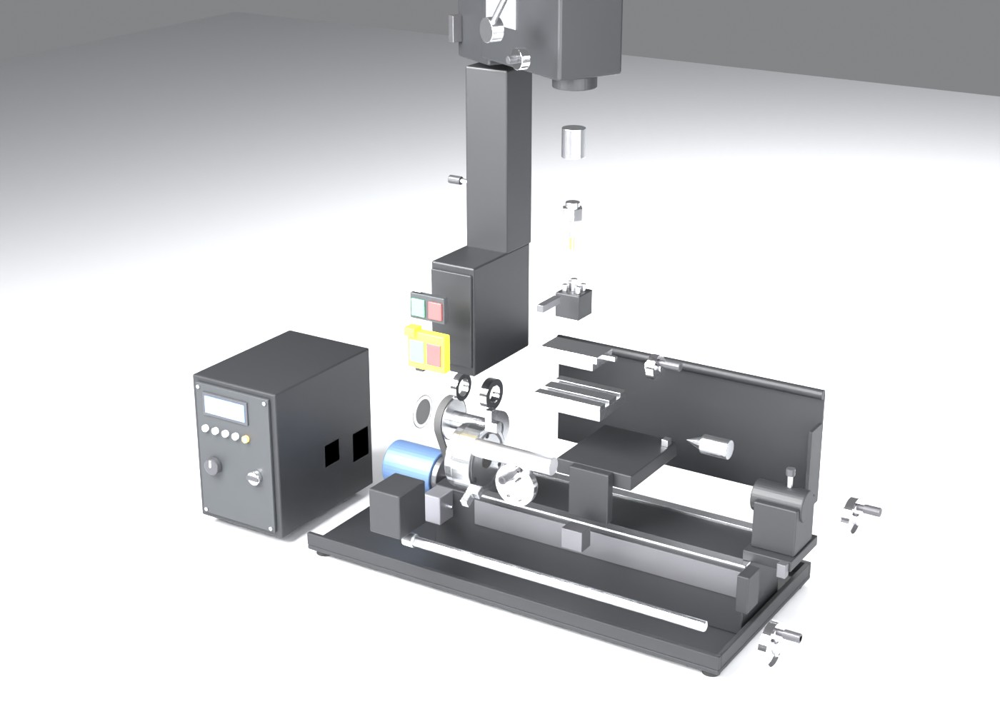

# 车钻铣三合一机床：电子挂轮原理

一台桌面大小的“车床 + 钻铣头”三合一机床（参照 CT125E 的商品图和参数表），用 Blender 脚本建模，配一个单文件网页讲清楚三件事：**车削**怎么回事、**钻铣头**怎么转过来用、以及 E 版最大的变化——**电子挂轮**（编码器 + 单片机 + 步进电机代替一串换挡齿轮）。



| Blender 装配 | Blender 爆炸 |
|---|---|
|  |  |

## 怎么打开

- **手机 / 电脑点链接**：<https://guangxianzhu.github.io/HTML-classroom/%E8%BD%A6%E9%92%BB%E9%93%A3%E4%B8%89%E5%90%88%E4%B8%80%E6%9C%BA%E5%BA%8A/index.html>
- **Windows**：双击 `启动.bat`。它先 `git pull --ff-only origin main` 检查更新，再用默认浏览器打开 `index.html`。
- **离线**：`index.html` 是单文件（约 4 MB），模型和代码都在里面，直接双击就能看。

| bat | 做什么 |
|---|---|
| `启动.bat` | 拉更新 → 打开网页 |
| `重新打包网页.bat` | 拉更新 → `npm install` → 自检 `test_core.mjs` → 重新打包 `index.html`（不需要 Blender） |
| `重新生成模型.bat` | 拉更新 → 找 Blender（`blender_path.txt` → PATH → Program Files → Steam）→ 跑 `blender/build_ct125e.py` → 再打包网页 |

## 八章讲什么

| 章 | 内容 | 动手做什么 |
|---|---|---|
| 1 认识它 | 车床 + 钻铣头 + 控制箱，每个零件干什么 | 爆炸滑杆、透视外壳、点零件看说明（推测件用虚线标出） |
| 2 车削 | 工件转、刀走；v = πDn，进给 = f × n | 调转速 / 进给 / 吃深 / 材料，三维里工件真的一刀刀变细 |
| 3 挂轮 | 主轴转 1 圈刀走 1 个螺距 → 丝杠和主轴的转速比 = 螺距 ÷ 导程 | 选螺距（含英制），对比“挂轮最接近的组合”和“电子挂轮比 N/D” |
| 4 电子挂轮 | 编码器每来一个计数，累加器加 N，满 D 出一步（Bresenham / DDA） | 调螺距和转速，看计数 / 累加 / 步进三条波形和“会不会丢步”；三种做法的取舍 |
| 5 车螺纹 | 多刀车螺纹要每刀等零点脉冲 | 关掉“等零点”看乱扣；左旋 / 右旋 |
| 6 钻铣 | 头绕立柱 360°、升降 60、套筒 40；拖板当 XY 工作台 | 转头、升降、钻孔 / 铣槽演示，算铣刀转速 |
| 7 参数 | 商品页参数逐条解释，老款 CT125 vs CT125E | — |
| 8 专利 | 11 件相关公开专利（电子挂轮 / 三合一结构 / 小型车床 / 工业对照） | 点编号打开 Google Patents |

每章末尾的“依据”把说法分成 **公认**、**参数表**、**推测**、**假设** 四类。

## 哪些是真的，哪些是估的

| 类别 | 内容 |
|---|---|
| 参数表（商品页截图） | 回转直径 125、顶尖距 180、中拖板回转 60、主轴通孔 9 / MT1、尾座行程 18 / MT1、E 版 50 ~ 2250 转/分无级、200 W、螺纹和进给“程序设定”；最大钻孔 6、主轴端到台面 180、喉深 125、绕立柱 360°、升降 60、套筒 40、台面 85 × 60、T 形槽 8 × 2；老款 560 ~ 2500 转/分 5 挡、120 W、公制 / 英制各 8 种、进给 0.07 / 0.14 |
| 按产品图比例估 | 外壳、控制箱、手轮、立柱、钻铣头的尺寸和位置 |
| 推测（模型里 `guess=1`，网页里虚线框） | 主电机和同步带的位置、主轴尾部的编码器码盘和读头、步进电机在主轴箱左下角小黑盒里、控制板；车和铣是一台电机切换还是两台电机 |
| 假设（网页里能看到） | 丝杠导程 1.5 mm、编码器 4000 计数/圈、步进 1600 步/圈、开环步进约 600 转/分可靠上限、挂轮齿数表 20 ~ 80 |

没有检索到厂家（CTMACH）名下的专利；“电子挂轮”是商品上的叫法，专利里一般叫螺纹切削同步 / 电子齿轮。

## 文件

```
blender/build_ct125e.py   建模脚本（Blender 4.2 ~ 5.x，后台运行几秒）
blender/out/ct125e.glb    网页用的模型（每个零件一个节点，extras 里有中文名 cn、说明 info、分组 grp、爆炸方向 ex、推测标记 guess）
blender/out/layout.json   网页要用的关键坐标（主轴高、丝杠位置、立柱中心、喉深……）
blender/out/parts.json    零件表
blender/out/ct125e.blend  Blender 工程（1 ~ 90 帧是爆炸动画）
web/src/core.js           唯一的数字来源：参数表、切削公式、挂轮搜索、电子挂轮整数算法
web/src/stage.js          three.js 舞台：运动组、爆炸、透视、动态车削工件
web/src/main.js           八章讲义；章节顺序只在 CHAPTERS 里定
web/test_core.mjs         自检：电子挂轮 100 圈误差 ≤ 1 步、挂轮搜索、参数表
```

模型坐标：X 沿床身从主轴箱指向尾座，Y 指向机床后面，Z 向上，托盘底面 z = 0，脚本里按 mm 写。运动组（空物体）：`G_Spin`（主轴 + 卡盘 + 码盘）、`G_LeadScrew`、`G_Carriage` → `G_Cross`、`G_Head`（绕立柱转 / 升降）→ `G_Quill` → `G_MillSpin`、`G_Tail` → `G_TailQuill`。
