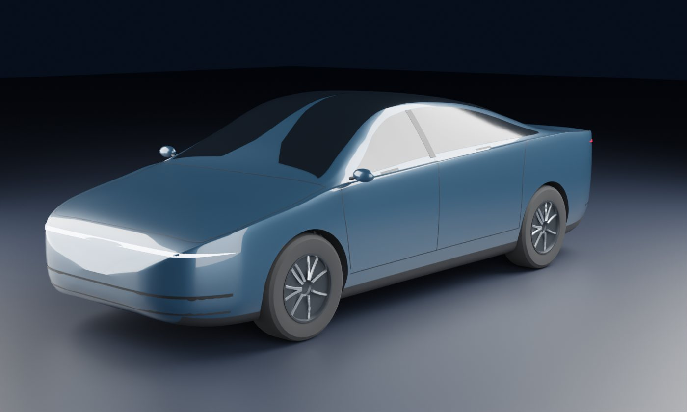
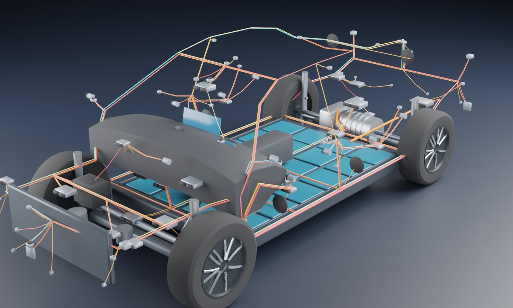
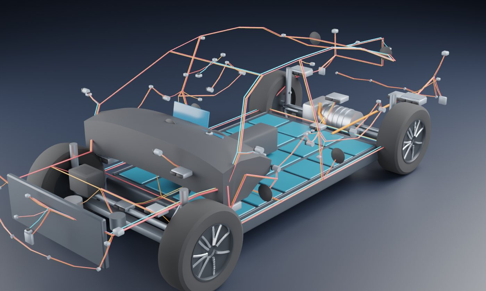

# 软件定义汽车

讲清楚软件定义汽车（SDV）和经典汽车研发到底差在哪。Blender 脚本建了一辆虚构的教学车，车身、底盘、电池、电机、传感器都不换，只换电子电气架构：分布式 34 个盒子、域集中 25 个、中央 + 区域 12 个。网页八章从架构一路讲到研发节奏、车队、组织和钱。

- **网页版（手机可看）**：<https://claude.ai/artifact/DGrAsdjhbT7vdp8nrLYvPH>（默认只有自己能打开，要给别人看需在页面的 Share 里开启分享）
- **离线版**：`index.html`，模型和 three.js 都打包在里面，双击就能看（没网时字体回退到系统字体）

| 外观 | 分布式 | 中央 + 区域 |
|---|---|---|
|  |  |  |

## 怎么打开

- **Windows**：双击 `启动.bat`。它先 `git pull --ff-only origin main` 检查更新（没网或没装 git 就跳过），再用默认浏览器打开 `index.html`。
- **其他系统**：直接打开 `index.html`。

要改模型再看效果：双击 `重新生成模型.bat`。它会找 Blender（`blender_path.txt` → PATH → `Program Files\Blender Foundation\Blender*` → Steam），重跑建模脚本；装了 Node 就顺便重新打包 `index.html`。

## 八章内容

| 章 | 讲什么 | 舞台 |
|---|---|---|
| 01 全貌 | 同一辆车两种造法，一张对比表，SDV 不等于什么 | 透视 / 实车 / 拆开，线束和盒子留在空中 |
| 02 神经系统 | 三代架构，软件小球搬家，线束统计，哪些功能不搬 | 俯视、侧视、斜视，可以点盒子、开关线种 |
| 03 改一个功能 | 六个需求在三种架构下要动多少盒子、牵涉几方，代价是同住的功能变多 | 信号沿真实线路走 |
| 04 研发节奏 | 大 V 和小 V 串，需求提出到上车要等多久，冻结线和年改的锯齿 | 二维时间线 |
| 05 SOP 之后 | 240 辆车的推送：一次全推、分批灰度、回店刷写，埋 bug、A/B 回滚，法规 | 车队 |
| 06 软硬解耦 | 控制环和大负载同住一颗芯片，共享核、时间分区、独立 MCU，信号与服务 | 拆开的 ECU 和中央计算 |
| 07 组织和钱 | 盒子按谁负责软件上色，康威定律，累计现金流和回本年份 | 按供应商上色 |
| 08 三条路 | 渐进融合（主流）、一步到位、买平台，取舍、翻车点、证据强弱一览、全部来源 | 对应架构 |

每章都写了为什么这样做、依赖的假设、什么时候失效，并标了证据强度：公认、工程实践、本页简化、我的推测。

## 网页里的计算

| 项目 | 做法 |
|---|---|
| 线束 | `blender/ee_data.py` 定义外设、盒子、总线和一张道路图。每根线用 Dijkstra 走最短路，同一段路上的线捆成一束，束的粗细和总长都由线数算出。CAN 按雏菊链，A/B 架构每个盒子一路保险丝回路，C 架构一条电源环加区控分配 |
| 智能执行器 | C 架构里门内负载、座椅、超声波、风门、扬声器按成组串接算（LIN、10BASE-T1S、A2B 一类）。这条假设对线长影响很大，少了它线长只降约 13% |
| 改动范围 | `impact()`：A/B 里逻辑和 I/O 在同一个盒子，都算要改，信号跨总线时加上网关；C 里 I/O 算稳定服务，只改逻辑所在的盒子。“同住的功能”是被改动盒子上跑着的全部功能 |
| 信号路径 | 网络图 BFS，走的是 Blender 算出来的同一批折线 |
| 需求等待 | 经典：走完变更周期，赶上软件冻结进 SOP，赶不上等年改。软件定义：必做验证 + 手工验证 ×（1 − 自动化率），等下一班发布，再灰度 1 个月 |
| 灰度 | 240 辆车，1% / 10% / 50% / 100% 分批，累计 2 辆失败后过“发现到叫停”的时间停推 |
| 调度 | 单核 600 拍。共享核：不可抢占段按泊松到达，撞上就等；时间分区：计算时间随负载变长；独立 MCU：固定小抖动 |
| 现金流 | 相比经典模式的增量：平台投入、团队成本、单车差额、在役车队的软件收入 |

后四项是玩具模型，结构是真的，默认参数是我选的，不是任何车企的实测值。三种架构的**相对**差别有意义，绝对长度只是教学车的量级。`web/test_model.mjs` 校验数据完整性、五个模型，以及页面文案里写死的判断。

## 改东西

| 想改 | 改哪里 |
|---|---|
| 盒子、外设、功能、需求、线路 | `blender/ee_data.py`，然后重新生成模型 |
| 车身、内饰、控制器造型 | `blender/build_sdv.py`，车身轮廓在开头的 `ZTOP`、`ZBELT`、`ZBOT`、`HW`、`HT` |
| 文案、实验、来源 | `web/src/chapters.js` |
| 模型 | `web/src/sim.js` |
| 舞台和机位 | `web/src/stage.js` |

```
cd web
npm install
node test_model.mjs
node build.mjs          # 生成 ../index.html 和 dist/artifact.html
```

坐标约定：毫米，+X 车右，+Y 车头，+Z 朝上，原点在前后轴中点的地面。`blender/out/sdv.blend` 打开按空格能看爆炸动画。
