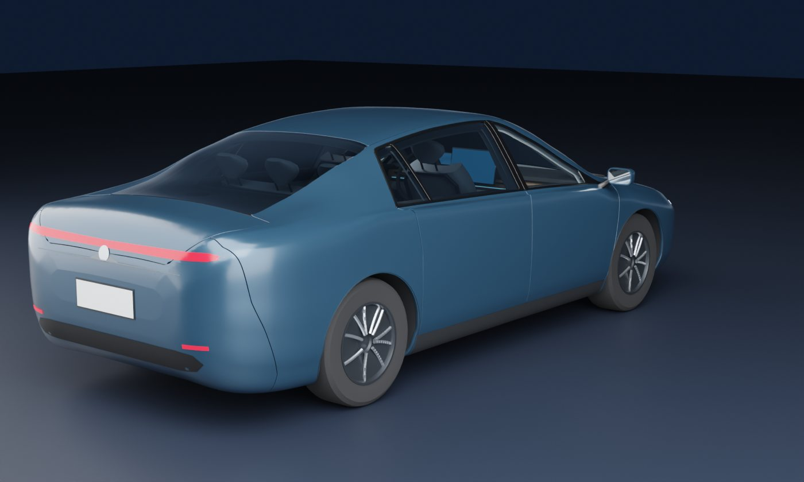
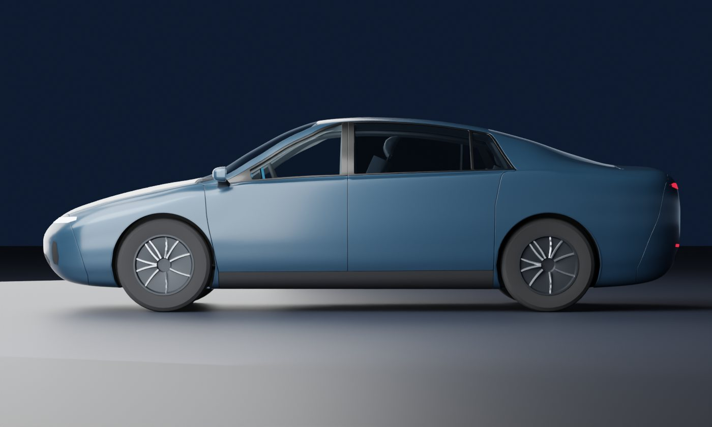
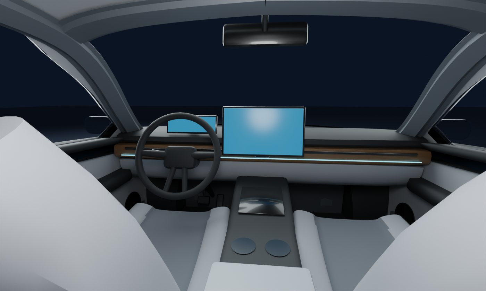
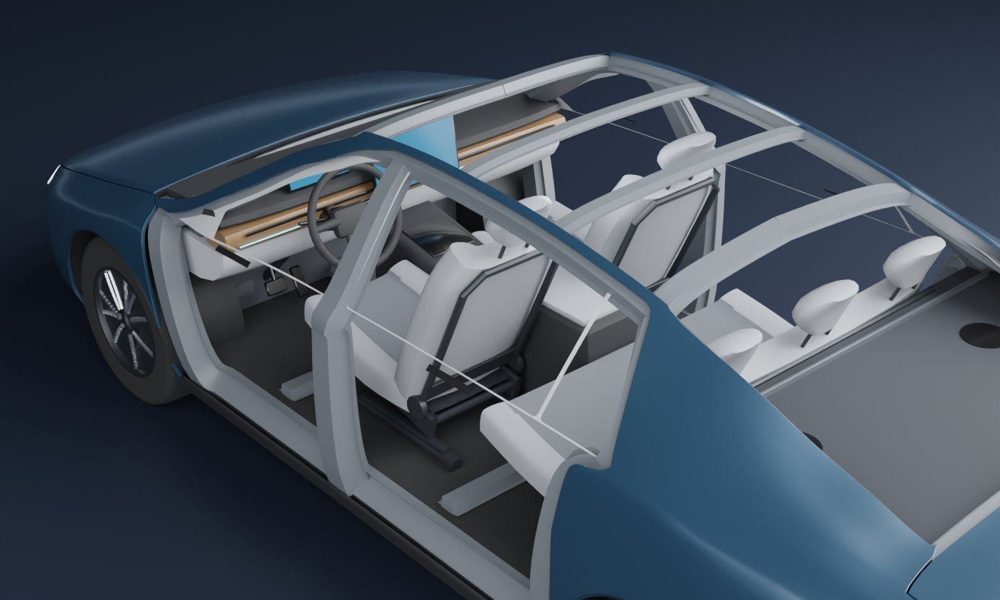

# 软件定义汽车

讲清楚软件定义汽车（SDV）和经典汽车研发到底差在哪。Blender 脚本建了一辆虚构的教学车，车身、底盘、电池、电机、传感器都不换，只换电子电气架构：分布式 34 个盒子、域集中 25 个、中央 + 区域 12 个。网页八章从架构一路讲到研发节奏、车队、组织和钱。

- **网页版（手机可看）**：<https://claude.ai/artifact/DGrAsdjhbT7vdp8nrLYvPH>（默认只有自己能打开，要给别人看需在页面的 Share 里开启分享）
- **离线版**：`index.html`，模型和 three.js 都打包在里面，双击就能看（没网时字体回退到系统字体）

| 外观 | 后面 | 侧面 |
|---|---|---|
|  |  |  |

| 内饰 | 座舱（拿掉车顶和车门） | 中央 + 区域架构 |
|---|---|---|
|  |  |  |

## 怎么打开

- **Windows**：双击 `启动.bat`。它先 `git pull --ff-only origin main` 检查更新（没网或没装 git 就跳过），再用默认浏览器打开 `index.html`。
- **其他系统**：直接打开 `index.html`。

要改模型再看效果：双击 `重新生成模型.bat`。它会找 Blender（`blender_path.txt` → PATH → `Program Files\Blender Foundation\Blender*` → Steam），重跑建模脚本；装了 Node 就顺便重新打包 `index.html`。

## 八章内容

| 章 | 讲什么 | 舞台 |
|---|---|---|
| 01 全貌 | 同一辆车两种造法，一张对比表，SDV 不等于什么 | 透视 / 实车 / 拆开，线束和盒子留在空中 |
| 02 神经系统 | 三代架构，软件小球搬家，线束统计，哪些功能不搬 | 俯视、侧视、斜视，可以点盒子、开关线种 |
| 03 改一个功能 | 六个需求在三种架构下要动多少盒子、牵涉几方，代价是同住的功能变多 | 信号沿真实线路走 |
| 04 研发节奏 | 大 V 和小 V 串，需求提出到上车要等多久，冻结线和年改的锯齿 | 二维时间线 |
| 05 SOP 之后 | 240 辆车的推送：一次全推、分批灰度、回店刷写，埋 bug、A/B 回滚，法规 | 车队 |
| 06 软硬解耦 | 控制环和大负载同住一颗芯片，共享核、时间分区、独立 MCU，信号与服务 | 拆开的 ECU 和中央计算 |
| 07 组织和钱 | 盒子按谁负责软件上色，康威定律，累计现金流和回本年份 | 按供应商上色 |
| 08 三条路 | 渐进融合（主流）、一步到位、买平台，取舍、翻车点、证据强弱一览、全部来源 | 对应架构 |

每章都写了为什么这样做、依赖的假设、什么时候失效，并标了证据强度：公认、工程实践、本页简化、我的推测。

## 网页里的计算

| 项目 | 做法 |
|---|---|
| 线束 | `blender/ee_data.py` 定义外设、盒子、总线和一张道路图。每根线用 Dijkstra 走最短路，同一段路上的线捆成一束，束的粗细和总长都由线数算出。CAN 按雏菊链，A/B 架构每个盒子一路保险丝回路，C 架构一条电源环加区控分配 |
| 智能执行器 | C 架构里门内负载、座椅、超声波、风门、扬声器按成组串接算（LIN、10BASE-T1S、A2B 一类）。这条假设对线长影响很大，少了它线长只降约 13% |
| 改动范围 | `impact()`：A/B 里逻辑和 I/O 在同一个盒子，都算要改，信号跨总线时加上网关；C 里 I/O 算稳定服务，只改逻辑所在的盒子。“同住的功能”是被改动盒子上跑着的全部功能 |
| 信号路径 | 网络图 BFS，走的是 Blender 算出来的同一批折线 |
| 需求等待 | 经典：走完变更周期，赶上软件冻结进 SOP，赶不上等年改。软件定义：必做验证 + 手工验证 ×（1 − 自动化率），等下一班发布，再灰度 1 个月 |
| 灰度 | 240 辆车，1% / 10% / 50% / 100% 分批，累计 2 辆失败后过“发现到叫停”的时间停推 |
| 调度 | 单核 600 拍。共享核：不可抢占段按泊松到达，撞上就等；时间分区：计算时间随负载变长；独立 MCU：固定小抖动 |
| 现金流 | 相比经典模式的增量：平台投入、团队成本、单车差额、在役车队的软件收入 |

后四项是玩具模型，结构是真的，默认参数是我选的，不是任何车企的实测值。三种架构的**相对**差别有意义，绝对长度只是教学车的量级。`web/test_model.mjs` 校验数据完整性、五个模型，以及页面文案里写死的判断。

## 改东西

| 想改 | 改哪里 |
|---|---|
| 盒子、外设、功能、需求、线路 | `blender/ee_data.py`，然后重新生成模型 |
| 车身外形 | `blender/build_sdv.py` 开头的五条曲线 `ZTOP_b`（顶线）、`ZBELT_b`（腰线）、`ZBOT_b`（底线）、`HW_b`（最宽）、`HT_b`（车顶宽）；车头车尾怎么收口在 `CLOSE_NOSE` / `CLOSE_TAIL`；横截面配方在 `section_ctrl` |
| 缝线、窗洞、灯、车牌 | 同一个文件的 `L_HOOD`、`L_TRUNK`、`WS_POLY`、`BACK_POLY` 等（曲面参数 `(y, s)`）；灯、格栅、车牌、车标在 `build_panels` 末尾，用正视图 `(x, z)` 画（`carkit.face_patch`） |
| 内饰、座椅 | `build_cabin`：座椅 → 仪表台 → 中央通道 → 方向盘 → 门板 / 柱子饰板 / 顶棚 / 后隔板 |
| 控制器造型 | `build_ecus`、`build_details` |
| 车身用的共用函数 | `blender/carkit.py` 是仓库根目录 `汽车建模套件/carkit.py` 的副本，改了要回写母版（说明见 `汽车建模套件/README.md`） |
| 文案、实验、来源 | `web/src/chapters.js` |
| 模型 | `web/src/sim.js` |
| 舞台和机位 | `web/src/stage.js` |

```
cd web
npm install
node test_model.mjs
node build.mjs          # 生成 ../index.html 和 dist/artifact.html
```

调外形时不用每次都导出：`python blender/build_sdv.py --out 某个临时文件夹 --noexport --check side,q34f,q34r,front,rear,top,dash,cut --res 1000 --samples 24`，只建模、渲几张检查图（机位表在 `CHECK_VIEWS`）。

## 车身是怎么建的，这次查出了什么

建法没有换：一圈圈横截面沿车长放样出外皮（和船体、机身的放样是一回事），缝线和窗洞画在外皮的参数坐标上，车板、玻璃、内饰都从这张外皮生成。这个方法本身成立，上一版不像车的原因在数据和几个细节上：

| 问题 | 原因 | 现在的做法 |
|---|---|---|
| 车头车尾像切了一刀的方块 | 截面到车头车尾只是简单缩小，最后用一大块平板盖住 | 最后 200 ~ 400 mm 乘超椭圆收口函数：俯视收成大圆弧，侧视顶线下卷、底线上收，只剩车牌大小的平面 |
| 车身高、窗户扁、车尾又高又方 | 腰线从前到后升了 150 mm，尾箱盖平直 700 mm 长 | 腰线降低（B 柱处 962），前后只差约 110 mm；后挡一路溜到尾箱盖，盖子只剩 400 mm 并带一道小扰流沿 |
| 前盖像一块平板，翼子板是直角 | 前盖截面“中间平、两边急弯” | 前盖 / 尾箱盖截面改成抛物线拱，肩部倒成大圆角 |
| 后挡玻璃像破了个洞 | 玻璃的镜面反射把灯箱映成不规则白斑；玻璃下面没有后隔板，直接看到车底 | 玻璃的反射改成按仰角渐变的“天空色”；补了后隔板和顶棚；后排换成隐私玻璃 |
| 车顶在后视图里一片白 | 主灯正好映在车顶上 | 灯箱放大到 8 米（同照度下灯面更暗），从后面拍时灯绕车转 180° |
| 车头车尾正中间有黑色的小三角 | 黑色底护板跟着收口翘到了端面上 | 底护板只铺到保险杠蒙皮为止，保险杠下沿是车身色 |
| 灯带歪歪扭扭 | 按固定高度切外皮得到的线，在收口处不稳定 | 灯、格栅、车牌改在正视图里画轮廓，再投到外皮上 |

这个方法做不到的（证据强度：我的判断）：轮拱外翻的唇边、车门上的折线和凹面、保险杠上真正的进气口（现在是贴在表面的黑色区域）。一个截面只有一条轮廓线，局部造型要靠另外贴件，或者换成曲面 / 细分建模。

## 外形和内饰的依据

车是虚构的，不对应任何一款车，下面的资料只用来定比例和布局。

| 用在哪 | 依据 | 证据强度 |
|---|---|---|
| 长 4760、宽 1864、高 1455、轴距 2800、前悬 945、后悬 1015 | Model 3（2025）：4720 / 1850 / 1440，轴距 2875，前悬 868，后悬 977；凯美瑞：4885 ~ 4920 / 1840 / 1445，轴距 2825，前悬 975，后悬 1085；小米 SU7：4997 / 1963 / 1455，轴距 3000 | 厂商公开参数 |
| 前挡倾角约 29°、溜背、短尾箱盖、贯穿式头灯 / 尾灯、隐藏式门把手、下格栅只留一条 | 2025 年在售的 B / C 级电动轿车的共同特征 | 我的归纳，没有逐款量 |
| 腰线、前盖前缘、前围上盖板的高度 | 按上面几款车的照片比例估 | 估算 |
| 侧围外板是一整张（A 柱 + 车顶边梁 + C 柱 + 后翼子板），里面是一圈门洞加强环 | US9623910、US9616935、US7032958、US4717197；Tesla Model S 车身维修手册“Body Side Outer” | 专利 / 维修手册原文 |
| 仪表台横梁：一根管横在两根 A 柱之间，托住仪表台和转向管柱 | US5934744、US6554352、US5868426 | 专利原文 |
| 前排座椅从滑轨到头枕的层次 | US5439271、US4509796（上一版已用） | 专利原文 |
| 玻璃粘接、外板包边 | US4650240、US6528176（上一版已用） | 专利原文 |
| 整车外观、仪表台、座椅的外观设计专利长什么样 | 特斯拉 US D926,083（整车）、US D955,313（仪表台）、US D938,745（座椅）。只看了七视图的画法，没有照着画 | 专利原文 |
| 内饰布局：矮平的仪表台、贯穿出风口、氛围灯条、15.6 吋悬浮中控屏 + 10 吋仪表屏、没有换挡杆的中央通道、浅色座椅 | 2025 年主流电动轿车的常见布局 | 我的归纳 |
| H 点离地 588（离地板 242）、方向盘中心比 H 点高 337 / 靠前 435、扶手高 770 | 按轿车人机布置的常见范围取的值，没有对照具体标准条文 | 估算 |

坐标约定：毫米，+X 车右，+Y 车头，+Z 朝上，原点在前后轴中点的地面。`blender/out/sdv.blend` 打开按空格能看爆炸动画。
