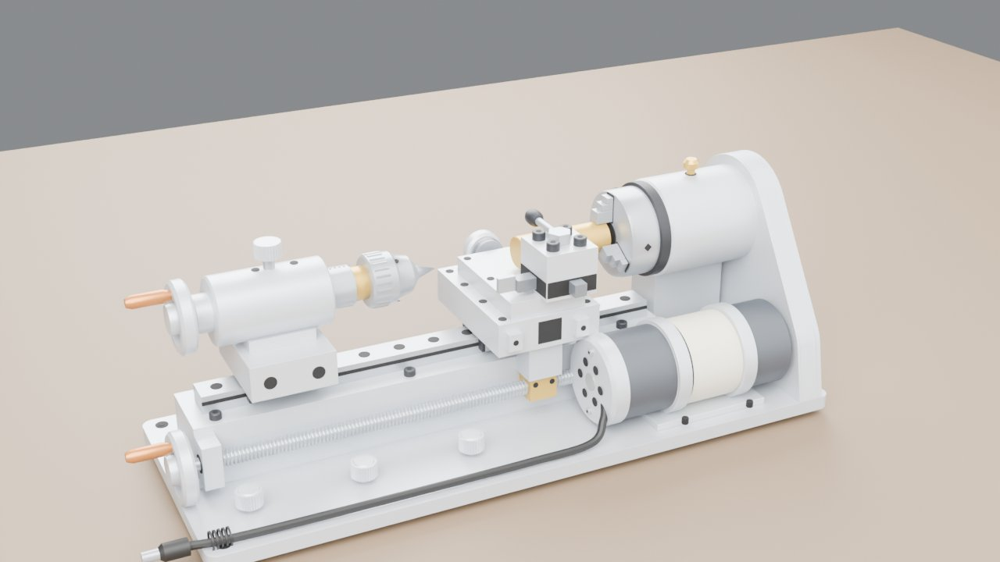
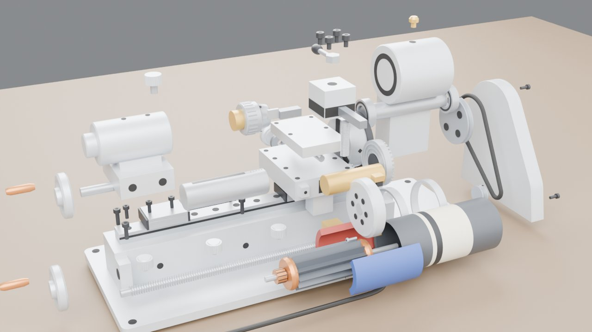

# 迷你车床爆炸图（Blender 脚本建模 + 爆炸图）

一台常见的 8 合 1 迷你桌面金属车床（铝合金底板 + 直线导轨床身，24 V 直流电机皮带传动），照着 4 张产品图（正面、两个斜前方、俯斜视）用 `build_lathe.py` 在 Blender 里全部用代码生成。
没有图纸，尺寸都是按比例估的（见下面「尺寸怎么估的」）。内部（轴承、燕尾导轨、皮带）看不到，按这类车床的常见结构补的。同一份模型导进了虚幻工程 MyVRToyBox，在 VR 里可以拆开、一个个零件拿起来看。

| 装配 | 爆炸 |
|---|---|
|  |  |

- **网页版（手机可看）**：<https://claude.ai/artifact/WYqSfwmKgtW4dnCBH1aZe9>（默认只有自己能打开，要给别人看需在页面的 Share 里开启分享）
- **离线网页**：运行一次 `启动.bat` 后，`output\迷你车床_离线版.html` 双击就能看（模型嵌在文件里，不用联网，手机也能打开）。页面怎么用见下面「网页」一节。

## 用法

双击 `启动.bat`，它会依次：

1. `git pull --ff-only origin main` 检查更新（没网或没装 git 就跳过）
2. 找 Blender（`blender_path.txt` → PATH → `Program Files\Blender Foundation\Blender*` → Steam）
3. 后台运行 `build_lathe.py`，几秒钟生成 `output\lathe.blend`、`output\lathe.glb` 和离线网页
4. 让你选：**[1]** 打开网页 / **[2]** 用 Blender 打开（按空格播放爆炸动画）/ **[3]** 用 Cycles 渲染装配、爆炸两张预览图 / **[4]** 退出

找不到 Blender 时，把 `blender.exe` 的完整路径写进同目录的 `blender_path.txt`（这个文件不会提交到 git）。支持 Blender 4.2 ~ 5.x。

| 输出（`output\`） | 用途 |
|---|---|
| `lathe.blend` | Blender 工程。第 1~120 帧按拆机顺序拆开，第 150~270 帧反顺序装回 |
| `lathe.glb` | glTF 模型，单位米，每个零件一个节点（`P07_Headstock` …），extras 里有零件号、中文名、材料、作用、爆炸路线。MyVRToyBox 的 `导入车床模型.bat` 用它 |
| `迷你车床_离线版.html` | 离线网页（约 4 MB），模型直接嵌在文件里 |
| `parts.json` | 零件表（84 个零件，53 种） |

## 网页（先猜 → 分步看 → 动手算）

按“先提问，再一步步拆开讲”编排，主问题是**一把不转的刀，怎么车出精确的圆**。不自动轮播，每一步只回答一个小问题，步骤标题就是答案；3D 里关键零件标了名字。

1. **先猜**：横向刻度一格 0.02 mm，刀进 0.1 mm，直径小多少？猜完（或点“不猜了”）后面的步骤和下半页才打开；答过一次，下次直接打开。
2. **谁在转**：皮带罩拆掉、电机外壳半透明。电机 → Φ18 小轮 → 皮带 → Φ48 大轮 → 主轴 → 卡盘 → 工件一起转，车刀不转。滑杆改电机转速，算主轴转速和切削速度。
3. **吃刀**：拖“这一刀进几格”，十字滑台、横向手轮和刻度环跟着动；旁边的横截面图画出这一刀车掉的一整圈（厚度放大 5 倍），说明直径为什么小两倍进刀量。
4. **走一刀**：进刀 → 走刀 → 退刀 → 返回循环。车过的地方工件真的变细、刀尖飞出黄铜切屑，每一刀比上一刀细，车到 Φ10 以下换新料；每一步都说为什么（比如不先退刀，回程会划出螺旋纹）。
5. **拆开看**：爆炸滑杆 + 编号 + 零件表，拆装顺序和 Blender 动画、虚幻里是同一份数据。手机竖屏时车床自动转成竖的。

下半页：

- **第二道猜题**：进给翻倍，表面的刀纹深几倍？答完打开实验。
- **实验**：选材料（黄铜 / 铝合金 / 45 钢），拖工件直径、转速、吃深、进给、刀尖圆弧半径。实时画出表面轮廓，算槽深和粗糙度 Ra、切削速度（太快提示刀会烧）、切削力、主轴要的扭矩（超过这台小电机的能力就提示闷车）、切削功率、车完 42 mm 要多久。
- 三条路线（手摇丝杠 / 挂轮自动走刀 / 数控车床，标了哪条是主流）、依赖哪些前提和什么时候失效、证据强弱分层、来源。
- 每句结论旁边标了证据等级：**公认** / **资料**（论文、手册、厂商资料）/ **本页估算** / **推测**，下半页最后有汇总和来源链接。
- 电机按 24 V 96 W 估的可用扭矩没有实测，页面里标的是“推测”。

## 零件和拆机顺序

84 个零件、53 种。先拆刀具和小件，最后抬起主轴箱、把轴承从主轴上退下来——和真去拆一台小车床的顺序差不多。
同一个组件里的零件，爆炸路线故意错开一点（比如手柄跟着手轮出来以后再往外走一截），这样在虚幻里它们是分开的抓取单元，能一个个拿起来看。

| 顺序 | 零件 | 对象名 | 爆炸方向 |
|---|---|---|---|
| 1 | 卡盘扳手（平放在底板后面）、刀架手柄螺母、刀架压紧螺钉 ×4 | `P35`、`P40`、`P16_*` | 上 |
| 2 | 纵向进给手轮 → 它的铜手柄 | `P06`、`P51_Handle_Z` | 左 |
| 3 | 四方刀架；外圆车刀往前、切断刀往左抽出 | `P15`、`P17`、`P41` | 上 |
| 4 | 横向手轮 + 铜手柄、刻度环 | `P14`、`P51_Handle_Cross`、`P52` | 后 |
| 5 | 十字滑台、里面的横向丝杠、刀架中心螺柱 | `P13`、`P38`、`P39` | 上 |
| 6 | 工件（黄铜棒 Φ18） | `P11` | 前 |
| 7 | 大拖板、下面的黄铜丝杠螺母、导轨滑块 | `P12`、`P37`、`P36_RailBlock_Carriage` | 上 / 前 |
| 8 | 三个卡爪（先径向张开）、卡盘体、里面的平面螺纹盘 | `P10_*`、`P09`、`P34` | 外 → 左 / 前 |
| 9 | 钻夹头、尾座锁紧螺钉、尾座套筒、尾座手轮 + 手柄、尾座丝杆、尾座、尾座滑块 | `P20`、`P21`、`P42`、`P19`、`P51_Handle_Tail`、`P43`、`P18`、`P36_RailBlock_Tailstock` | 右上 / 上 / 前 / 左 |
| 10 | 皮带罩螺钉 ×3 → 皮带罩 → 皮带 → 主轴锁紧螺母 → 两个皮带轮 | `P53_*`、`P22`、`P23`、`P32`、`P24`、`P25` | 右 |
| 11 | 直流电机整体往前抽出，再拆开：端盖螺钉 ×2、端盖（带两个电刷）、转子、两块磁钢 | `P27`、`P28`、`P48_*`、`P44`、`P47_*`、`P45`、`P46_*` | 前，再往左 |
| 12 | 丝杠、底板锁紧螺丝 ×3、油杯 | `P05`、`P29_*`、`P33` | 前 / 上 |
| 13 | 主轴箱抬起 → 主轴抬起 → 前后轴承从主轴两头退出 | `P07`、`P08`、`P30`、`P31` | 上 → 左右 |
| 14 | 导轨固定螺钉 ×9、床身固定螺钉 ×6 | `P49_*`、`P50_*` | 上 |
| — | 底板、脚垫 ×4、床身、直线导轨、电机座 | `P01`~`P04`、`P26` | 不动（基座） |

磁钢一块涂红（N 极）、一块涂蓝（S 极），只是为了讲原理好认，实物都是灰黑色的。

## 尺寸怎么估的

产品图没给尺寸，只能靠零件之间的比例 + 这类小车床的常见规格：

- **整机长 ≈ 37 cm**：这类 8 合 1 迷你车床的底板一般 35~38 cm，加上左边两个手轮的把手、DC 插头，取 38.8 cm（模型包围盒 388 × 140 × 134 mm）。
- **长 ≈ 高的 2.9 倍**：正面图里从左边手柄尖到皮带罩右边约 1080 像素、从脚垫底到皮带罩顶约 370 像素，比值 2.9；模型是 388 / 134 ≈ 2.9。
- **卡盘 Φ50**：正面图里卡盘直径约占整机长的 13%（388 × 0.13 ≈ 50），这类小车床也常配 Φ50 的三爪卡盘；主轴套比卡盘稍粗（Φ56）。
- **手轮 Φ38**：正面图里手轮直径约为卡盘的 0.75 倍。
- **中心高 87 mm**（主轴轴线离底板顶面）：车刀刀尖要对准主轴中心，所以中心高 = 导轨 + 大拖板 + 十字滑台 + 刀架下半截的高度加起来，再留出卡盘半径到底板的余量。
- **电机 Φ48 × 116**：常见 775 直流电机外径约 Φ45~Φ50；皮带轮 Φ48 : Φ18 ≈ 2.7 : 1 减速。

在虚幻里模型按最长边缩放到 50 cm（和电机、球阀、无人机一样），所以 VR 里看到的是 **1.3 倍**的车床。

## 原理速记

- **车削**：工件跟着主轴转，车刀不转、只移动。车刀沿轴线走（纵向进给，摇左边手轮带丝杠）车出外圆；车刀往里进（横向进给，摇刻度手轮带十字滑台）决定车多深。
- **刻度手轮**：一格 0.02 mm。车刀往里进 0.1 mm，工件**直径**小 0.2 mm（两边都被车掉）。
- **皮带减速**：电机皮带轮 Φ18、主轴皮带轮 Φ48，主轴转速 = 电机转速 × 18 / 48 ≈ 0.37 倍，扭矩放大约 2.7 倍。
- **三爪自定心**：三个卡爪背面的螺纹啮合同一个平面螺纹盘，拧一下三个一起进退，所以工件自动对中。
- **刀尖对中心高**：高了刀具后面顶住工件、低了刀尖啃进去，端面中心都会留一个小凸台。

## 建模说明

- 坐标：+X 指向主轴箱（右），-X 指向尾座（左），-Y 是操作者站的正面，+Z 向上；Z = 0 是脚垫底面，主轴轴线在 (Y 0, Z 100)。所有零件直接按装配位置建模，物体原点都在世界原点。
- 爆炸公式和电机、无人机一样：每个零件有几段位移，每段有一个出场时刻 s，在总进度 T 的 `[0.6s, 0.6s + 0.4]` 区间里缓动走完；装回时 T 倒着走，顺序自然反过来。
- 材质金属度都压在 0.55 以下：虚幻工作室里没有反射探针，金属反射的是黑的环境，金属度 0.8 的铝在虚幻里就已经发黑了（实测）。所以铝用"亮灰 + 低金属度"近似，Blender 里看起来稍微偏塑料一点。
- 内部结构：主轴的前后轴承、平面螺纹盘（正面螺旋棱、背面伞齿）、卡爪背面的齿、导轨滑块、丝杠螺母、电机的转子（12 槽铁芯、绕组、换向器）、磁钢、电刷都建了。丝杠、横向丝杠、刀架螺柱、尾座丝杆是真正的螺旋螺纹。
- 还简化着的地方：轴承里的滚珠、滑块里的滚珠没建；拖板和十字滑台之间的燕尾导轨、卡盘里的小伞齿轮没建；皮带是一根圆带。

## 网页文件

| 文件 | 说明 |
|---|---|
| `viewer_src.html` | 网页源码（three.js 从 CDN 加载）。改网页从这里改。发布成网页版时，模型以 base64 文本 `lathe_glb.txt` 放在页面旁边 |
| `viewer_template.html` | 离线模板（three.js r170 已打包在内）。`build_lathe.py` 把 glb 用 base64 填进去，生成 `output\迷你车床_离线版.html` |
| `tools/make_template.mjs` | 改了 `viewer_src.html` 之后跑一次，重新打包模板：`cd tools && npm install --no-save esbuild@0.24.0 three@0.170.0 && node make_template.mjs` |

原理演示用到的轴线位置写在 `viewer_src.html` 的项目段开头（主轴、电机、丝杠、横向丝杠），改了 `build_lathe.py` 里这些尺寸要同步改。
