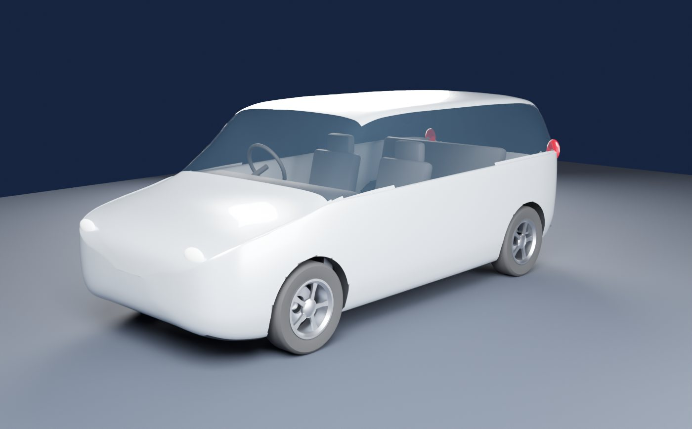
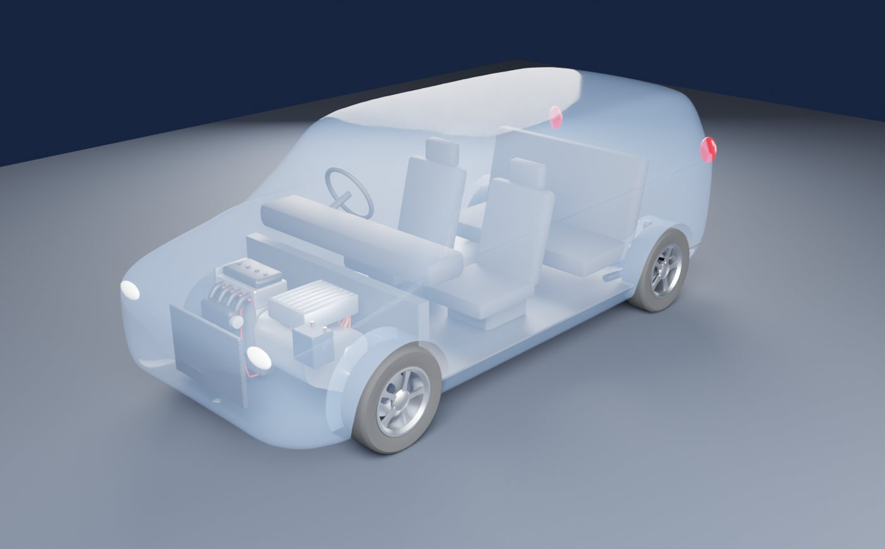
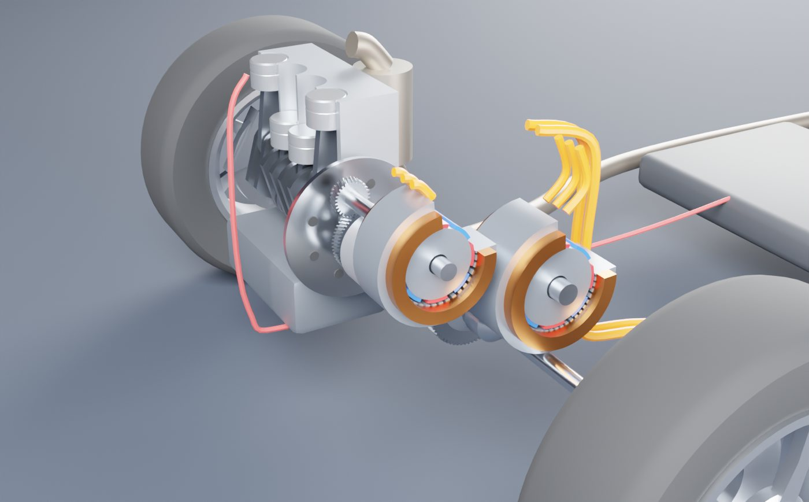
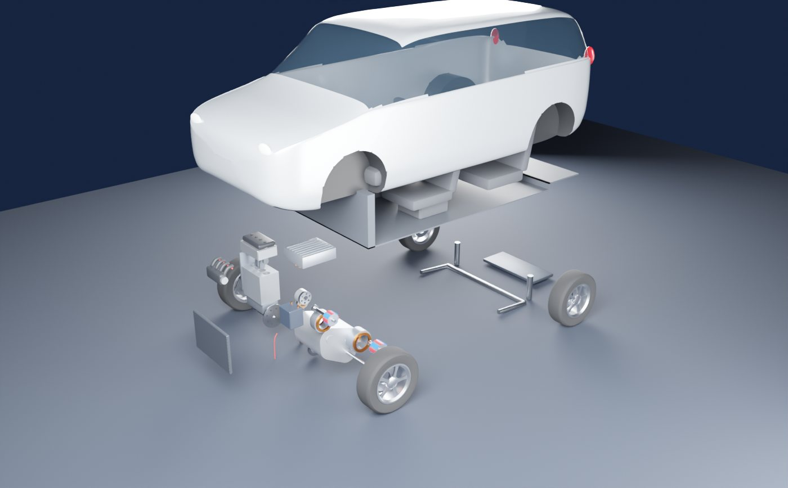

# 飞度 e:HEV 混动原理

讲清楚本田两电机混动（e:HEV，以前叫 i-MMD）为什么“大部分时间电机推车、发动机发电，高速巡航时发动机直接推车”。Blender 脚本建了一辆示意车和整套动力系统（1.5 L 发动机、发电机、驱动电机、一个直连离合器、固定齿比的齿轮、PCU、电池、中置油箱），网页里八章逐步拆开，能量流、油耗、模式切换都由一套能量模型实时算出来。

- **在线版（手机可看）**：<https://guangxianzhu.github.io/HTML-classroom/%E9%A3%9E%E5%BA%A6%E6%B7%B7%E5%8A%A8%E5%8E%9F%E7%90%86/index.html>（GitHub Pages）
- **网页版（Claude）**：<https://claude.ai/artifact/ASSTX58XASu7ARWHryJ92k>（默认只有自己能打开，要给别人看需在页面的 Share 里开启分享）
- **离线版**：`index.html`，模型和 three.js 都打包在里面，双击就能看（没网时字体回退到系统字体）
- **相关**：电机本身怎么调扭矩、调转速，见 [电动车电机调速](../电动车电机调速/)；发动机内部见 [四缸发动机爆炸图](../四缸发动机爆炸图/)

| 外观 | 透视 |
|---|---|
|  |  |
| **e-CVT 内部** | **爆炸图** |
|  |  |

## 怎么打开

- **Windows**：双击 `启动.bat`。它先 `git pull --ff-only origin main` 检查更新（没网或没装 git 就跳过），再用默认浏览器打开 `index.html`。
- **其他系统**：直接打开 `index.html`。

只改了 `web/src/` 里的网页源码：双击 `重新打包网页.bat`（需要 Node.js，不需要 Blender）。它先更新 main，再跑自检、重新打包 `index.html` 并打开。

要改模型再看效果：双击 `重新生成模型.bat`。它会找 Blender（`blender_path.txt` → PATH → `Program Files\Blender Foundation\Blender*` → Steam），重跑建模脚本；装了 Node 就顺便重新打包 `index.html`。

## 八章内容

| 章 | 讲什么 | 舞台 |
|---|---|---|
| 01 全貌 | 两台电机 + 一台发动机 + 一个离合器，点零件看作用，官方参数表 | 整车，车身可半透明 / 隐藏 / 拆开 |
| 02 三种模式 | EV、混动、发动机直驱、能量回收，各部件在干什么，能量流框图 | 动力总成 |
| 03 一个离合器 | 分六小步，一步只加一个新概念：车速 → 车轮转速、一对齿轮、电机 → 车轮（8.40）、发动机这边（发电机和直驱齿轮）、合上离合器（先同步）、只有一个挡的后果；带三道先猜再看的小题和跟着车速变的分步算式 | 剖开的 e-CVT，只点亮并标出这一步用到的零件；前四步不画能量粒子 |
| 04 发动机效率 | 效率图上，串联能挑最好的点，直驱只能在一条竖线上找点 | 剖开的发动机，燃烧室按 1-3-4-2 发光 |
| 05 高速为什么直连 | 串联链路逐级损耗 vs 直驱，四种策略的油耗对比和分工车速 | 路面 |
| 06 电池当缓冲 | 中低速“发电一会儿、熄火一会儿”为什么比一直轻负荷发电省 | 路面 |
| 07 试驾 | 油门、刹车、定速巡航、坡度、电量；电脑每一刻选哪条路、为什么 | 路面 |
| 08 对比和边界 | 和 e-POWER、THS 比较；冷车、电池满、上坡等什么时候逻辑会变；来源 | 整车 |

每章都写了为什么这样做、依赖的假设、什么时候失效，并标了证据强度：官方资料、公认、工程实践 / 媒体、本页简化、我的推测。

## 数字从哪来

| 项目 | 数值 | 来源 |
|---|---|---|
| 发动机 | LEB 1.5 L 阿特金森，78 kW / 127 N·m（2022.10 小改前 72 kW） | 本田诸元表 |
| 驱动电机 | H5 交流同步，90 kW / 253 N·m（小改前 80 kW） | 本田诸元表 |
| 变速比 / 减速比 | 电机行驶 2.454、发动机行驶 0.805、减速比 3.423 | 本田诸元表 |
| 齿数（示意） | 电机 22→54、直驱 67→54、主减速 19→65，发电机 60→30 | 按官方齿比凑的；发电机那级 2.0 是假设 |
| 动力电池 | 锂离子 48 单体，约 173 V；PCU 升压到最高约 570 V | 诸元表、救援手册、PCU 拆解报告 |
| 电池容量 | 1.0 kWh | **假设**（本田未公布） |
| 风阻 / 滚阻 | CdA 0.70 m²、0.0095 | **假设**（同级车量级） |
| 发动机效率图 | 平均有效压力模型，峰值约 39.8% | **本页模型**（本田未公布效率图） |
| 电机损耗 | 铜损 + 永磁铁损 + 开关谐波 + 高速弱磁 + 杂散 | **本页模型**（同级电机量级） |

## 网页里的计算

| 项目 | 做法 |
|---|---|
| 行驶阻力 | 滚阻 + 风阻 + 坡度，车重 1270 kg（含 1 人） |
| 串联 | 车轮 → 齿轮 → 电机 → 逆变器 → 直流母线 → 逆变器 → 发电机 → 齿轮 → 发动机，发动机跑在最优工作线上（低速时加转速上限，照顾噪音） |
| 直驱 | 发动机转速 = 车速 × 24.6 rpm/(km/h)；驱动电机零电流空转，仍算永磁铁损；发电机只发 12 V 用电 |
| 两种“交替”策略 | 发动机在高效点开一段（串联发电，或直驱顺便多带负荷充电），电存够了熄火纯电；按开机占比折算油耗，每次起动另算 30 kJ |
| 试驾 | 驾驶员力需求 → 规则化的模式选择（带滞后）→ 功率分配 → 积分车速、电量、油耗。离合器合上前先把发动机转速拉到同步 |
| 三维动画 | 车轮、各齿轮轴、曲轴、活塞连杆都由车速和发动机转速算出，按页面右上角标的倍数慢放 |

`web/test_sim.mjs` 是自检：齿比和官方一致、发动机效率峰值在 38–41%、串联和直驱的链路效率、各车速下策略分工（约 70 km/h 起用直驱，和车主观察一致）、定速巡航时的模式占比、刹车回收、长下坡电池满时的处理、全油门加速。

## 本页模型给出的分工（平路匀速）

| 车速 | 最省的做法 |
|---|---|
| 约 65 km/h 以下 | 离合器分开，发动机在高效点发电一阵、熄火纯电一阵，交替 |
| 约 70–95 km/h | 合离合器直驱，顺便多带一点负荷给电池充电；充满后熄火纯电一段，再起动、同步、合上 |
| 约 100 km/h 以上 | 一直直驱 |

这些车速是量级，会随风阻、电机损耗、电池容量这些假设移动。

## 和真车的差别

- 车身是普通紧凑两厢车的示意外形，不是飞度的外观；尺寸（轴距 2530、轮胎 185/60R15、轮距）按飞度取
- e-CVT 里各轴的相对位置、齿轮大小、离合器结构是示意，本田没有公开图纸
- 模式切换规则是按公开描述和车主观察定的简化版，不是本田的标定
- 只算平路稳态和简单的纵向动力学：没有暖机、暖风、电池温度、催化器温度、驾驶感受这些因素

## 文件

| 路径 | 内容 |
|---|---|
| `index.html` | 打包好的演示页面 |
| `启动.bat` | Windows 一键启动，含 main 更新检查（ASCII、CRLF） |
| `重新生成模型.bat` | 用本机 Blender 重跑建模，并重新打包页面 |
| `重新打包网页.bat` | 只重新打包页面：`npm install` → `node test_sim.mjs` → `node build.mjs`（ASCII、CRLF） |
| `blender/build_ehev.py` | 纯脚本建模：参数表 → 各部件函数 → 导出 |
| `blender/out/` | `ehev.blend`（按空格播放爆炸动画）、`ehev.glb`、`spec.json`（轴位置、齿数、能量流路径、零件说明）、预览图 |
| `web/src/sim.js` | 能量模型和试驾仿真，纯函数 |
| `web/src/stage.js` | three.js 舞台：转动、活塞、能量流、机位、车身半透明 |
| `web/src/chapters.js` | 八章文案和实验逻辑 |
| `web/src/chart.js` | Canvas 图表工具，带悬停读数 |
| `web/test_sim.mjs` | 自检 |

## 重新构建

```bash
# 1. 建模（二选一）
blender -b -P blender/build_ehev.py -- --out blender/out [--render]
pip install bpy && python blender/build_ehev.py --out blender/out [--render]

# 2. 打包页面（同时更新上一级的 index.html）
cd web
npm install
node test_sim.mjs
node build.mjs
```

兼容：在 Blender 5.2（pip 版 bpy 5.2.3）上测试通过。

## 参考

- [本田：飞度主要诸元表（PDF）](https://www.honda.co.jp/Fit/common/pdf/fit_spec_list.pdf)
- [Honda：e:HEV 技术说明](https://global.honda/en/tech/two_motor_hybrid_system_honda_eHEV/)
- [本田雅阁 factbook：e:HEV 与一般串联方式](https://www.honda.co.jp/factbook/auto/ACCORD/202002/P23.pdf)
- [car-me：飞度动力总成解说（2022 年小改款功率变化）](https://car-me.jp/articles/22485)
- [ベストカーWeb：飞度 e:HEV 的三种行驶模式](https://bestcarweb.jp/?p=1625707)
- [Motor-Fan：e:HEV 和 THS、e-POWER 的区别](https://motor-fan.jp/?p=206823)
- [エルテック：FIT e:HEV PCU 拆解](https://www.marklines.com/statics/teardown/ltec_pdf_078.pdf)
- [本田：FIT e:HEV 救援手册](https://www.honda.co.jp/rescue-auto/fit-hybrid/fit-ehev202002.pdf)
- [E&H Vehicle Technology：新 CR-V 增加低速直驱挡](https://www.electrichybridvehicletechnology.com/news/feature-under-the-skin-of-the-new-sixth-generation-honda-cr-v.html)
- [Honda Forums UK：车主观察约 43 mph 进直驱](https://www.hondaforums.co.uk/viewtopic.php?p=8143)
